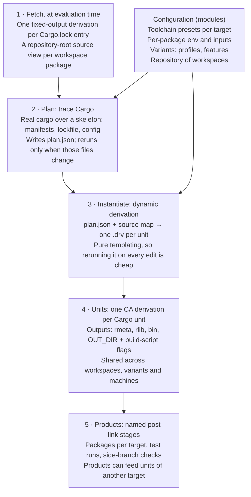

# breakbulk: design

Nov 6, 2026 · @Chaz Schlarp

## Problem statement

Rust in Nix forces a choice between fidelity and granularity, and real projects need both.

- **Fidelity tools** (`buildRustPackage`, crane, naersk) run real Cargo. Build scripts, profiles, `.cargo/config.toml`, cross builds and zigbuild-style toolchains behave exactly as they do locally. Reuse is coarse: at best a "dependencies blob" plus the workspace. One `Cargo.lock` change rebuilds every dependency, nothing is shared between projects, and every check variant (clippy, tests, coverage) carries its own full copy of the dependency build.
- **Granularity tools** (crate2nix, cargo2nix, `buildRustCrate`) build one derivation per crate and share them across projects. They reimplement Cargo in Nix and shell: feature resolution, build-script semantics, profiles and config are approximations, and every gap is a silent difference from `cargo build`. They need checked-in generated Nix or import-from-derivation (IFD).

Neither handles the patterns real repositories rely on. Examples: many workspaces with their own lockfiles sharing path crates, a host binary embedding a wasm build, per-package build stamps that must not invalidate dependencies, and ordered post-link steps that implicit stripping breaks.

**Goal.** One derivation per Cargo unit, with command lines that are exactly Cargo's, so that:

- the result matches `cargo build` under the same config, across native, cross, wasm and Windows targets;
- outputs are shared across machines, workspaces and projects through an ordinary binary cache;
- nothing generated is checked in, and there is no IFD where dynamic derivations are available;
- a change rebuilds only the affected crates and their dependents, and re-runs only the test binaries whose bytes changed.

**Non-goals.**

- Beating Cargo's incremental edit loop on the crate being edited. That stays in plain `cargo` in the dev shell.
- Mutable caches inside the sandbox (rustc incremental state, shared compiler caches). They trade reproducibility for speed in a way the design refuses.

## Principles

1. **Cargo plans, Nix executes.** The tool never reconstructs a rustc command line. It records Cargo's own, so every Cargo semantic (env vars, profile flags, config, `--cap-lints`, `-C metadata`) is correct by construction.
2. **The unit graph is static; build-script output binds late.** A build script can change flags, env and link arguments, but never which units exist. The whole graph is planned before any build script runs, and each script's output is applied at build time through argument files.
3. **Toolchains are data.** Linker, C compiler, archiver, SDKs, rustflags and test runner come from a per-platform spec. The planner never hardcodes a tool, and host and target specs never leak into each other.
4. **Configuration is scoped to the units that need it.** Env vars, inputs and extra sources attach to named packages and reach only those units, so a build stamp or a large SDK never invalidates unrelated crates.
5. **Content addressing is a bonus, not load-bearing.** The design is correct with input-addressed units. Content addressing (CA) adds early cutoff wherever outputs are byte-stable.
6. **Sugar over addressable layers.** The default package output is the sensible thing for its target. Every layer underneath (units, link outputs, post-link stages) stays addressable and overridable, so a default never becomes a trap.
7. **Stable toolchains by default.** Nothing in the default path needs nightly Rust. Nightly is something users bring, not something the tool requires.

## Architecture



Cargo is consulted only when manifests, the lockfile or config change. A source edit reruns only the cheap instantiate step and the units whose inputs changed.

### 1. Fetch, at evaluation time

Registry crates are fixed-output derivations keyed by the lockfile's checksums. Workspace packages get filtered views of the repository root. The planner never serializes sources itself.

### 2. Plan by tracing Cargo

The planner runs the user's own `cargo build` for one target and variant over a skeleton: manifests, lockfile, `.cargo/config.toml` and empty target files. A `RUSTC_WRAPPER` does the following:

- Forwards information queries (`-vV`, `--print cfg`, file-name queries) to the real rustc.
- For each compile invocation, records argv, env and working directory, writes placeholder outputs, and emits the artifact notification Cargo waits for when pipelining.
- For each build-script compile, writes a stub executable. When Cargo runs it, the stub records the exact environment Cargo gives build scripts and prints no directives.

The recorded invocations alone give the graph: `--extern` and `-L` paths name the producing unit, `OUT_DIR` ties a compile to its build-script run, and the stub path ties a run to its compile. The unstable `--unit-graph` is not needed. Paths are then rewritten:

- Target-directory paths become placeholders for the producing unit's outputs.
- Source paths become store paths of the source views, and `--remap-path-prefix` keeps them out of the outputs.
- Tool paths must already be store paths, or planning fails with the tool's name.
- Recorded env is kept only where Cargo set it or the configuration declared it; the planner's own sandbox env is dropped.

The plan is traced once per target. Host units (build scripts, proc macros) come out as identical derivations for every target and are shared. A multi-target Cargo invocation is avoided because its feature resolution can differ from building each target alone.

### 3. Instantiate

A dynamic derivation turns the plan and the source map into one derivation per unit. It is pure templating, so rerunning it on every edit is cheap, and unchanged units come out byte-identical.

### 4. Units

- Library units have separate `rmeta` and `rlib` outputs; compile units depend on transitive `rmeta`, link units on `rlib`.
- A build script is two units: its compile, and its run, with outputs `out` (`OUT_DIR`) and `flags`.
- Build-script directives are applied with Cargo's scoping: link libraries and link args reach the package's own targets, `rustc-cfg` and `rustc-env` stay local, and `DEP_*` metadata reaches only direct dependents that declare `links`.
- A unit sees exactly the environment Cargo recorded plus what configuration declares for its package. Anything that makes build scripts probe for nightly features, such as `RUSTC_BOOTSTRAP`, never reaches a unit.

### 5. Products

Link outputs flow through named stages into packages, test runs and checks, described below.

### Delivery

With dynamic derivations, steps 2–5 run without IFD. Where they are unavailable, the same planner emits `plan.json` for import-from-derivation, with input-addressed units.

## Configuration model

All user-facing configuration lives in the NixOS module system; the unit graph does not. Presets, per-package overrides and stage pipelines all need to merge (preset defaults, user additions, per-target exceptions), and the module system already provides typed options, list and attrset merging, `mkBefore`/`mkAfter`/`mkForce`, and generated docs. Its evaluation cost is acceptable for configuration and would not be for thousands of units.

### Repository, workspaces, targets

A **repository** object holds any number of **workspaces**, each with its own lockfile and toolchain. Units with the same identity (package, version, features, profile, target, toolchain) are the same derivation in every workspace, so registry dependencies and shared path crates deduplicate automatically across all of them. Each workspace is built for a set of **targets**, and each target names a toolchain preset.

### Toolchain presets

A preset is a per-platform spec: `rustc`/`cargo`/std, `linker`, `cc`/`cxx`/`ar`/`cflags`, bindgen settings, SDK store paths, extra rustflags, `env`, and `runner`. The planner resolves every tool to a store path; a non-store tool path is a hard error naming the tool.

- Spec rustflags reach Cargo through `--config`, never the `RUSTFLAGS` env var. Cargo concatenates config arrays across sources, so the spec adds to `.cargo/config.toml` instead of silently replacing it.
- Host and target specs are separate. A target's `crt-static`, static archives or cross C compiler never reach host build scripts or proc macros.

### Per-package overrides

`packages.<name>` (optionally narrowed by version range and platform) sets `env`, `inputs` and `extraSources` for that package's units only. This is how build stamps (git revision, `SOURCE_DATE_EPOCH`, compiled-in settings), external SDK paths and vendored C sources are supplied, without changing the hash of any other unit. A curated set of defaults for common `-sys` crates ships with the tool, seeded from nixpkgs' `defaultCrateOverrides`.

### Source views

A package's source is a filtered view of the **repository root**, not its crate directory: the crate directory plus declared extras, at their original relative layout. Paths such as `../../wit`, `../shared/assets` or `../../../patches` therefore resolve unchanged, and editing an unrelated file changes no source path. Test units can declare a wider scope for tests that read repository files.

Registry crates are fetched at evaluation time, one fixed-output derivation per `Cargo.lock` entry using the lockfile's checksums. Their store paths are exposed as `sources.<crate>`, so steps that need files from inside a dependency (a bundled SDK, JS glue shipped in a crate) are attribute lookups.

### Products as inputs

An override's env or inputs may reference any product, including one built for another target, for example a wasm UI bundle or a set of components embedded by a host crate. With content addressing, a byte-identical product does not rebuild the units that embed it.

### Variants

Profiles, feature sets (including a feature powerset), check modes (clippy, coverage instrumentation) and toolchains are plan parameters. Each variant is a separate plan, and units that come out identical across variants are shared rather than rebuilt.

## Products and stages

`ws.packages.<name>` gives the right artifact for its target with no configuration. Underneath it, every step is its own named derivation that can be read, replaced or removed.

### Three layers

1. **Units.** One derivation per Cargo unit. Internal, but inspectable.
2. **Stage pipelines.** A product is the raw link output passed through ordered, named stages. Each stage is its own derivation, so every intermediate is addressable (`.stages.linked`) and content-addressed cutoff applies between stages.
3. **Sugar.** `ws.packages.<name>` and `ws.target.<triple>.packages.<name>` are the raw output, run through the target preset's default stages, installed in the usual layout (`bin/`, `lib/`, `.exe` with DLLs, `pkg/` for wasm).

### Default stages per preset

| Preset | Default stages |
| --- | --- |
| Linux gnu / musl | `splitDebug` |
| Windows msvc | none (PDBs are already separate) |
| wasm, browser | `bindgen` → `wasmOpt` |
| wasm, component | `componentize` |
| Darwin (later) | `dsymutil` → `strip` → `adhocSign` |

The tool never applies an implicit fixup phase. Stripping breaks some signing schemes, and some checks must see unstripped bytes, so any default stage can be removed or reordered.

### Transforms and checks

Stages that change the artifact form the chain. Checks that only inspect it (ISA level, DLL import closure, PE headers, signature verification, "no interpreter, no needed libraries") hang off a named stage instead. They see exactly the bytes they need, never block the chain, and appear under `checks` automatically.

```nix
packages.server.checks.isa = { on = "linked"; run = isaCheck; };  # sees pre-strip bytes

packages.app.target."x86_64-pc-windows-msvc".stages = {
  stageDlls = { after = "linked"; run = stageRuntimeDlls; };
  zip       = { after = "stageDlls"; run = deterministicZip; };
  strip     = lib.mkForce null;  # signing breaks if stripped
};
```

The tool provides stage helpers: `splitDebug`, `strip`, `patchelfRpath`, `bindgen`, `wasmOpt`, `componentize`, `adhocSign`, `deterministicZip`. User stages are ordinary derivations: container images, initramfs and boot images, distribution packages, catalog generation and signing, metadata stamping.

### Debug information

Shipped binaries and cdylibs get a separate `debug` output: DWARF moved to `$debug/lib/debug/.build-id/…`, found by gdb and debuginfod. This shrinks runtime closures and removes stray store references. Test binaries keep their debug info, because symbolized backtraces in test-run logs matter more than the small cutoff gain from stripping them. Panic locations already embed line numbers, so line-only edits usually change the stripped bytes anyway.

### Tests as products

- Every test, bench and example binary is an attribute, so VM tests and system tests can consume it.
- Each test binary gets a test-run derivation that uses the target's `runner` and any declared env and `PATH` additions (a software GPU driver, external tools). Under CA, a byte-identical test binary is not re-run.
- `CARGO_BIN_EXE_*` is wired to the right product, and nextest configuration is respected.
- Test-run derivations for another architecture set `system` to that architecture, so Nix sends them to native builders. Emulation through the runner is the fallback.

## Targets and toolchains

Day one covers Linux gnu and musl on x86\_64 and aarch64, browser and component wasm, and Windows msvc; everything else is a later preset, not a redesign.

| Target | Phase | Toolchain | Linker | Runner |
| --- | --- | --- | --- | --- |
| x86\_64-unknown-linux-gnu | Day one | user's (e.g. from `rust-toolchain.toml`) | mold | native |
| aarch64-unknown-linux-gnu | Day one | user's + nixpkgs cross | mold | native aarch64 builder, else qemu-user |
| {x86\_64,aarch64}-unknown-linux-musl | Day one | user's + nixpkgs musl cross | mold or lld | native builder, else qemu-user |
| wasm32-unknown-unknown | Day one | user's, with target | lld (wasm flavor) | wasm-bindgen test runner with headless Chromium, or wasmtime |
| {x86\_64,aarch64}-pc-windows-msvc | Day one | user's + xwin SDK (unfree) | lld-link | wine |
| Host triple, fully static glibc | Day one | user's + static archives | mold | native |
| wasm32-wasip2 | Later | rustup-dist with target | wasm-component-ld | wasmtime |
| riscv64gc-unknown-linux-gnu | Later | user's + nixpkgs cross | mold | qemu-user |
| {x86\_64,aarch64}-pc-windows-gnu(llvm) | Later | user's + mingw cross | lld | wine |
| x86\_64-unknown-none (build-std) | Later | nightly, user-supplied | lld | none |
| aarch64-apple-darwin | Later | user's, built on Mac builders | ld64 or lld | native |

### Bring your own toolchain

Any rustc/cargo pair works: nixpkgs `rustPlatform`, rust-overlay or fenix, including `fromRustupToolchainFile`. The planner runs the user's own cargo, so resolver and lockfile behavior match local builds. Nightly and build-std work when the user brings a nightly; the tool's defaults never need one.

### Linker selection

The linker is chosen automatically as a pure function of target, host and LTO mode, recorded in the plan, and overridable.

- Linux ELF on a Linux host: **mold**, through nixpkgs' wrapped bintools so rpaths, `NIX_LDFLAGS` and hardening flags still apply.
- Cross-language LTO (`-Clinker-plugin-lto`) or non-Linux host: **lld** from `rustc.llvmPackages`, so the LLVM version matches rustc.
- Where rustc's target spec names the linker itself (wasm, wasip2): defer to it, and only make sure the version-matched `lld` is the one found.
- **wild** is an opt-in preset, gated by the determinism check.
- Never rustup's self-contained `rust-lld`, which bypasses the Nix linker wrapper.

### Windows msvc

The preset packages the common cross pattern once: an `xwin` CRT and SDK fixed-output derivation with pinned versions and `meta.license` unfree; `lld-link`; `clang-cl` and `llvm-lib` for C code; `-imsvc` include paths for cc and the same paths as `-isystem` for bindgen; `RC` and `LIB` for resource compilers; optional `crt-static`; and wine as the runner. It has an extension point for further SDKs, such as the Windows Driver Kit.

### wasm

- **Browser.** The `wasm-bindgen-cli` version is read from `Cargo.lock` and matched exactly; a missing version is a clear error. C code is compiled with an unwrapped clang targeting wasm32. A wrapped gcc can silently emit host objects instead.
- **Components.** Core modules from `wasm32-unknown-unknown` are componentized with `wasm-tools component new`, which gives components with no WASI imports. `wasm32-wasip2` std builds come later. C code for WASI-style targets uses clang plus nixpkgs `wasilibc`, with Rust's bundled wasi-libc turned off so headers and library match.
- `wasm-opt` operates on core modules, so component pipelines run it before componentizing.

### Static and musl

Musl targets use nixpkgs cross toolchains with `crt-static`. A static build on the host triple passes the host triple explicitly as the target, so only target units link statically while build scripts and proc macros stay dynamic. Static archives are target inputs only; on the host they make build scripts link `libc.a` and crash.

### Zig

A zig preset exists for targeting an old glibc version. Zig rebuilds its libc in an empty per-sandbox cache, so the preset includes a derivation that pre-warms that cache and copies it into each unit's sandbox.

## Content addressing and early cutoff

Units are content-addressed whenever dynamic derivations are in use. That mode already requires the `ca-derivations` feature, placeholders keep the generated derivations simple, and cutoff pays off where outputs are byte-stable. The IFD fallback uses input-addressed units. The choice is per mode, never per unit: an input-addressed derivation that depends on a CA output is deferred and resolved like CA anyway.

### Where cutoff fires

| Change | Cutoff today |
| --- | --- |
| Recompiled build script with identical `OUT_DIR` and flags | Yes |
| Toolchain or wrapper bump that leaves rlib bytes unchanged | Yes |
| Byte-identical test binary | Yes: the test run is skipped |
| Byte-identical product embedded by another unit | Yes |
| Post-link stage given identical input | Yes |
| Function-body edit in an upstream library | No: rustc's crate hash cascades to dependents |
| Interface change | No, correctly |

### Determinism requirements

Cutoff only works if outputs are reproducible.

- `-C metadata` comes from Cargo's stable unit identity, never from derivation paths or absolute paths.
- Store paths are remapped with `--remap-path-prefix`, so source paths do not appear in outputs or runtime closures.
- No `-C incremental` inside unit builds.
- A content-derived `--build-id`.
- A built-in check rebuilds sampled units and products with `nix build --rebuild`. Under CA, non-determinism fails silently: it disables cutoff and produces different realisations on different machines.

### The rustc limit, and what is changing

Today a dependent rebuilds after almost any upstream edit, because rustc's crate hash (SVH) covers bodies and source positions and dependents record it. Cargo behaves the same way.

- [rust-lang/rust#154724](https://github.com/rust-lang/rust/pull/154724), merged 2026-09-26, computes the crate hash from the encoded metadata bytes. On nightly, rmeta byte-equality and crate-hash equality are now the same thing.
- [Relink, Don't Rebuild](https://github.com/rust-lang/rust/issues/158844) (`-Z public-api-hash`) is not landed. Its main implementation, [#156940](https://github.com/rust-lang/rust/pull/156940), is a draft under review. The [2026 goal](https://goals.rust-lang.org/2026/roadmap-fast-builds.html) is listed as unfunded.
- A published third-party measurement on an async-heavy codebase found the public hash unchanged for 2% of non-test edits. Every `async fn` body edit changed it, because coroutine MIR is encoded in metadata.
- A public-hash design lets Cargo skip direct dependents, but a pure build system still rebuilds them, because their input bytes changed. Full cutoff at the first dependent needs a physical split: data that dependents read in one file, and spans and private data in another. That is the request to take upstream.

### Seams below the crate

- **rmeta and rlib as separate CA outputs.** Compile units depend only on transitive `rmeta`; link units consume `rlib`. Cheap now, and ready for stable rmeta when rustc delivers it.
- **Source narrowing from dep-info.** An optional stage derives each crate's exact file set, so edits to files outside its module tree change nothing. The cost is re-running macro expansion. File reads by proc macros are not tracked and must be declared.
- **Separate link derivations** need nightly `-Zno-link`/`-Zlink-only`, so linking stays inside bin and test units for now.
- **Rejected: impure caches.** Rustc incremental state or a shared compiler cache mounted into the sandbox would give reuse within a crate, but outputs would depend on build history and could not be cached or shared. That reuse belongs to local `cargo`.

### Operational notes

- Each unit has its own realisation, so a cache hit is one signed realisation lookup per unit, chained behind the planner. Measure this early.
- Binary caches must store signed realisations; check cache server support before committing.

## Patterns the design must support

These patterns come from a survey of working Rust-in-Nix repositories. Each is either hand-wired today or breaks silently.

| Pattern | What goes wrong today | How the design handles it |
| --- | --- | --- |
| Copied cross-toolchain plumbing (msvc via xwin: linker, cc, ar, cflags, bindgen args, SDK paths) | The same 30–60 lines copied between repositories, drifting apart | One toolchain preset |
| Build stamps (git revision, `SOURCE_DATE_EPOCH`, compiled-in settings) | Set only on the final build, by hand, to avoid rebuilding all dependencies on every commit | Per-package env reaches only that package's units |
| Build scripts reading external SDKs or vendored sources through env vars | The whole env reaches every unit, so any change rebuilds everything | Per-package `inputs` and `env` |
| Host binary embedding another target's build (wasm UI, components, a web bundle) | Embed silently falls back to a placeholder when the input is missing | Products as inputs, across targets |
| Reads outside the crate directory (`include_str!`, schema or interface files, sibling assets, patches) | Source filters drop the file, or the whole tree becomes the input | Repository-root source views plus declared extras |
| Many workspaces with their own lockfiles, path-depending on shared crates | Dependencies rebuilt once per workspace | Repository object; identical units shared |
| Check variants (clippy, nextest, coverage, feature powerset) | A full dependency build per variant, exhausting CI disk | Variants as plan parameters; shared units |
| Host-vs-target leakage (`crt-static`, static archives, the wrong C compiler) | Wrapper scripts strip flags; build scripts segfault; host objects end up in wasm | Separate host and target specs per unit |
| Rustflags from env replacing `.cargo/config.toml` rustflags | Flags duplicated in two places | Spec rustflags passed with `--config`, concatenated |
| Build-script link directives (`rustc-link-arg-bins`, delay-load, resource files, kernel link args) | Dropped or applied to the wrong targets | Cargo's own scoping, from the traced plan |
| Post-link steps that care about order (sign without stripping, check before stripping) | Fights with the implicit fixup phase | Named stages, no implicit fixup, side-branch checks |
| Runtime-loaded libraries (GPU, windowing, audio) | Rpaths removed by rpath shrinking | `patchelfRpath` stage after fixup |
| Test binaries consumed elsewhere (VM tests, `CARGO_BIN_EXE_*`) | Tests built as packages by hand, or skipped | Test binaries and test runs as products |
| Cross tests (Windows, other architectures, wasm) | Tests disabled for cross targets | `runner` in the spec; native builders by `system` |
| `wasm-bindgen-cli` version pinning | Hand-maintained hashes, or a nixpkgs version that matches by coincidence | Version read from `Cargo.lock` |
| Workspace members used as build tools (code generators, `xtask`) | Rebuilt whenever any member changes | Per-unit graph rebuilds only what the tool depends on |
| Reproducibility gates (rebuild checks, stamped artifacts, deterministic archives) | Bolted on per repository | Built-in rebuild check; deterministic helpers |
| Nightly-only workspaces and build-std targets next to stable ones | Separate tooling per toolchain | Toolchain per workspace |

## Lessons from prior art

| Source | Take | Leave |
| --- | --- | --- |
| cargo-dyndrv (Obsidian Systems) | Planning at build time via dynamic derivations; build-script output applied late through argument files; build-script compile and run as separate units; `OUT_DIR` as a CA output | Rebuilding rustc flags from `--unit-graph`; `-C metadata` hashed from derivation paths and absolute paths; serializing every source inside the planner; overrides keyed by full package ID; link flags propagating through build-dependency edges |
| crane | Real-Cargo fidelity; per-crate fetching from `Cargo.lock` with no IFD; a skeleton source for planning; source cleaning; checks as first-class outputs | The coarse dependencies-blob target directory |
| crate2nix, `buildRustCrate` | Per-crate sharing across projects; the curated `defaultCrateOverrides` for `-sys` crates; cross builds through nixpkgs splicing | Feature resolution in Nix; checked-in generated Nix; reimplementing Cargo |
| Bazel `rules_rust`, Buck2 | Pipelined metadata actions; platforms and toolchains as data; a content-hashed action cache | Their own reimplementation of Cargo semantics |

### Issues found in cargo-dyndrv that this design avoids

- `-C metadata` is a hash of upstream derivation paths, unit-graph indices and absolute source paths. It defeats CA cutoff, changes when unrelated crates join the graph, and differs between sandbox and local builds.
- Link flags from build dependencies' build scripts reach target links, which breaks cross builds or adds host libraries to target binaries.
- `rustc-link-lib` and `rustc-link-arg` apply to every downstream compile instead of only the package's own targets.
- Most Cargo env vars and profile settings are missing (`panic`, `overflow-checks`, LTO, `codegen-units`), and some are misparsed.
- A build script killed by a signal counts as success, and a `rustc-flags` directive corrupts the next argument.
- Multiple crate types per unit (`["cdylib", "rlib"]`) are rejected.

The traced planner removes most of these by construction, because the command lines come from Cargo.

## Roadmap, risks and open questions

The traced planner comes first, because it fixes most of the audit findings and every later phase builds on it.

### Roadmap

1. **Traced planner and evaluation-time fetching.** Cargo parity on native Linux; per-crate sources; repository-root source views; `--remap-path-prefix`; Cargo's own `-C metadata`.
2. **Configuration model.** Module-system options, toolchain presets, per-package overrides, products as inputs, a repository holding many workspaces.
3. **Day-one targets.** Linux gnu and musl on x86\_64 and aarch64, static glibc, wasm (browser and components), Windows msvc. Runners and native builders for tests.
4. **Products.** Stage pipelines, side-branch checks, the debug output, test-run derivations, clippy and coverage variants.
5. **Below-crate seams.** rmeta and rlib as separate outputs, dep-info source narrowing, the history-replay measurement harness.
6. **Delivery through IFD** for Nix without dynamic derivations.
7. **Later targets.** wasip2, riscv64, windows-gnu, build-std targets, Darwin on Mac builders.

### Conformance suite

A set of fixture workspaces covering every pattern in the catalogue. Each phase is done when the fixtures build and test on all its targets, and a rebuild check passes.

### Risks

- **Tracing Cargo depends on Cargo internals:** the artifact-notification protocol, how build scripts are invoked, the target-directory layout. Mitigation: a conformance suite that diffs traced command lines against `cargo build -v` across several stable Cargo releases.
- **Experimental Nix features.** Dynamic derivations need Nix 2.36 or later, and `ca-derivations` is still experimental. Remote builders must advertise the builder feature. The IFD fallback limits exposure.
- **Realisation lookups at scale.** Hundreds of units mean hundreds of signed lookups per cache hit.
- **Derivation overhead for tiny crates.** Per-sandbox setup can dominate small units, and the input edges grow quadratically with graph depth.
- **Module-system cost and errors** if configuration grows large.

### Open questions

- Does faking rustc's outputs hold up across Cargo releases, especially for pipelined builds and `links` metadata?
- Which binary cache servers store and serve signed realisations well enough?
- Does zig accept a pre-warmed cache that is read-only or only partly populated?
- Is `remap-path-prefix` enough for every embedded path, or are some crates' `env!("CARGO_MANIFEST_DIR")` uses still observable?
- How far will rustc go toward a physical split between interface metadata and private data?
