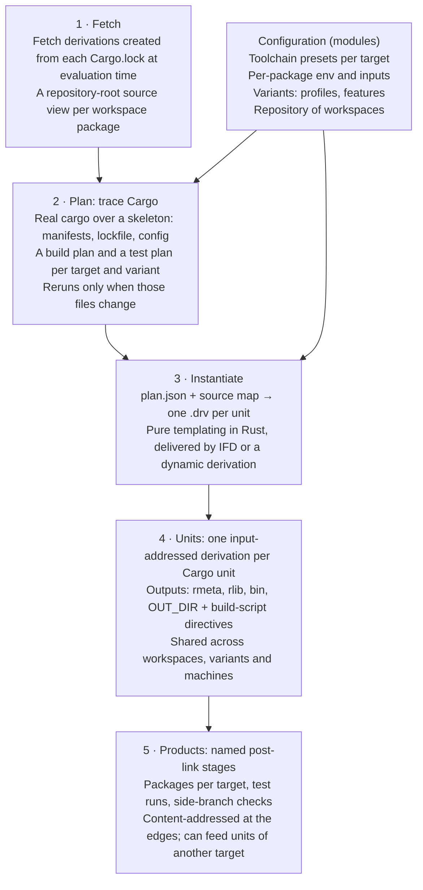

# breakbulk: design

Nov 6, 2026 · @Chaz Schlarp

## Problem statement

Rust in Nix forces a choice between fidelity and granularity, and real projects need both.

- **Fidelity tools** (`buildRustPackage`, crane, naersk) run real Cargo. Build scripts, profiles, `.cargo/config.toml`, cross builds and zigbuild-style toolchains behave exactly as they do locally. Reuse is coarse: at best a "dependencies blob" plus the workspace. One `Cargo.lock` change rebuilds every dependency, nothing is shared between projects, and every check variant (clippy, tests, coverage) carries its own full copy of the dependency build.
- **Granularity tools** (crate2nix, cargo2nix, `buildRustCrate`) build one derivation per crate and share them across projects. They reimplement Cargo in Nix and shell: feature resolution, build-script semantics, profiles and config are approximations, and every gap is a silent difference from `cargo build`. They need checked-in generated Nix or import-from-derivation (IFD).

Neither handles the patterns real repositories rely on. Examples: many workspaces with their own lockfiles sharing path crates, a host binary embedding a wasm build, per-package build stamps that must not invalidate dependencies, and ordered post-link steps that implicit stripping breaks.

**Goal.** One derivation per Cargo unit, with command lines that are exactly Cargo's, so that:

- each plan matches a named Cargo command under the same project config (for example `cargo build --workspace --target T --profile P`), across native, cross, wasm and Windows targets;
- outputs are shared across machines, workspaces and projects through an ordinary binary cache;
- nothing generated is checked in, and there is no IFD where the Nix installation supports dynamic derivations;
- a change rebuilds only the affected crates and their dependents, and re-runs only the test binaries whose bytes changed.

**Non-goals.**

- Beating Cargo's incremental edit loop on the crate being edited. That stays in plain `cargo` in the dev shell.
- Beating Cargo on a cold build of a single workspace. breakbulk optimizes for cache hits and narrow rebuilds; a cold build is expected to be somewhat slower than crane (see [Pipelining](#pipelining)). A cold build worse than about twice crane's time is a bug to investigate.
- Mutable caches inside the sandbox (rustc incremental state, shared compiler caches). They trade reproducibility for speed in a way the design refuses.
- Timed benchmark runs inside Nix. Sandbox timings on shared builders are noise, and a cached timing never re-measures. Bench binaries are built; they are run where timing means something.

## Principles

1. **Cargo plans, Nix executes.** The tool implements Cargo's public, documented formats (manifests, lockfiles, build-script instructions, target auto-discovery) and observes everything else from Cargo. It never encodes Cargo's behavior: resolution, unit selection, flag scoping or propagation. Every rustc command line is Cargo's own.
2. **The unit graph is static; build-script output binds late.** A build script can change flags, env and link arguments, but never which units exist. The whole graph is planned before any build script runs. Where each script's output goes is observed from Cargo during planning; the values are spliced in at build time.
3. **Toolchains are data.** Linker, C compiler, archiver, SDKs, rustflags and test runner come from a per-platform spec. The planner never hardcodes a tool, and host and target specs never leak into each other. The environment that native inputs need (`PATH`, `PKG_CONFIG_PATH`, wrapper flags) is captured from nixpkgs' own setup hooks, not recomputed.
4. **Configuration is scoped to the units that need it.** Env vars, inputs and extra sources attach to named packages and reach only those units, so a build stamp or a large SDK never invalidates unrelated crates.
5. **Input addressing by default; content addressing where it pays.** Units are input-addressed, so a cache hit downloads only what was asked for, on any cache server. Content addressing (CA) is used at the edges of the graph (test runs, post-link stages, embedded products), where early cutoff pays off and the cost of resolution is small. Full CA for units is a future mode, gated on Nix (see [Content addressing](#content-addressing-and-early-cutoff)).
6. **Sugar over addressable layers.** The default package output is the sensible thing for its target. Every layer underneath (units, link outputs, post-link stages) stays addressable and overridable, so a default never becomes a trap.
7. **Stable toolchains by default.** Nothing in the default path needs nightly Rust. Nightly is something users bring, not something the tool requires. Optional optimizations may use unstable rustc flags only behind a fallback, and never in a way that reaches build scripts.
8. **Inherit what changes the build; delegate what breakbulk must decide anyway.** Cargo settings that change what gets built (feature unification, profiles, `[env]`) are inherited from project config and never turned on behind the user's back. Settings that only change something breakbulk has to decide regardless, such as how paths are spelled in outputs, are delegated to Cargo when Cargo can do it.

## Architecture



Cargo is consulted only when manifests, the lockfile or config change. A source edit reruns only the units whose inputs changed; in IFD mode the instantiate step does not rerun either.

### 1. Fetch

Fetch derivations are created from every lockfile at evaluation time. Registry crates are fixed-output derivations keyed by the lockfile's checksums and download at build time, only when a unit actually builds. Git sources are fetched during evaluation, because locating a crate inside a repository needs its tree. Workspace packages get filtered views of the repository root. The planner never serializes sources itself.

### 2. Plan by tracing Cargo

The planner runs the user's own Cargo for one workspace, target and variant over a skeleton: manifests, lockfile, `.cargo/config.toml` and empty target files. Each (workspace, target, variant) gets two plans with named reference commands:

- **Build plan:** `cargo build --workspace --target T --profile P [--features …]`. Products come from this plan.
- **Test plan:** `cargo test --no-run --workspace --target T --profile P [--features …]`. Test binaries come from this plan. `--no-run` skips doctests, so the test plan also traces `cargo test --doc` with a `RUSTDOC` wrapper that records each `rustdoc --test` command without running it.

They are separate because Cargo turns on dev-dependency features only when test targets are built. Tracing products with `--all-targets` would ship binaries with features that plain `cargo build` would not enable. Units whose features are the same in both plans are identical derivations and are shared. A target can narrow the selection from `--workspace` to a package list (`-p ui`), for example a wasm target that builds only the UI crate.

A `RUSTC_WRAPPER` does the following:

- Records information queries (`-vV`, `--print cfg`, file-name queries) and forwards them to the real rustc. The `-vV` record carries Cargo's own environment, the baseline for env filtering.
- For each compile invocation, records argv, env and working directory, writes placeholder outputs, and emits the artifact notification Cargo waits for when pipelining.
- For each build-script compile, writes a stub executable. When Cargo runs it, the stub records the exact environment Cargo gives build scripts and prints one tagged **sentinel** directive of each applicable kind.

Cargo places each sentinel exactly where it would place real output from that script: which units get it, at which position, and which dependent build scripts receive `DEP_*` metadata. The planner records those positions as splice points. Placement is therefore observed from Cargo; only the values are filled in at build time. A few placements depend on the values, and breakbulk applies those rules itself at build time: search paths inside the script's `OUT_DIR` come before all others, all link-argument kinds of one script form one ordered list, and doctests get every script's search paths sorted by value. [Spike A](spikes/A-trace-fidelity.md) confirmed that the traced commands, with real build-script output filled in, equal a real `cargo build` unit for unit on Cargo 1.95 to 1.101.

The recorded invocations give the graph: `--extern` and `-L` paths name the producing unit, `OUT_DIR` ties a compile to its build-script run, the stub path ties a run to its compile, and sentinels give directive scoping and `DEP_*` edges. The unstable `--unit-graph` is not needed. Paths are then rewritten:

- Target-directory paths become placeholders for the producing unit's outputs, in both of Cargo's build-directory layouts (the classic one and the per-unit one that nightly Cargo uses by default). Whether a unit is a host unit (build script, proc macro) or a target unit is read from where Cargo put its output.
- Source paths become store paths of the source views.
- Tool paths must already be store paths, or planning fails with the tool's name.
- Recorded env is kept only where Cargo set it or the configuration declared it; the planner's own sandbox env, and what Cargo sets on its own process, are dropped.

Each target is traced on its own. Host units come out identical for every target and are shared. A multi-target Cargo invocation is avoided because its feature resolution can differ from building each target alone.

### 3. Instantiate

`breakbulk-instantiate` turns the plan and the source map into one derivation per unit. It is pure templating, so rerunning it on every edit is cheap, and unchanged units come out byte-identical. The same Rust code serves both delivery modes:

- **IFD mode:** it writes each unit's derivation attributes as JSON, which Nix imports and passes to `derivation`.
- **Dynamic-derivation mode:** it writes the same derivations into the store through Nix's `builder-rpc-v0` interface and submits each root.

Both modes produce identical unit derivation paths. The default, `mode = "auto"`, picks dynamic-derivation mode when the evaluator has the `dynamic-derivations` feature and a Nix version with `builder-rpc-v0`, and IFD otherwise. Nix implementations without dynamic derivations, such as Lix, therefore use IFD mode with no configuration. Upstream Nix and Determinate Nix are tested; others are expected to work in IFD mode but are not tested.

### 4. Units

- Units are input-addressed. A cache hit is an ordinary narinfo lookup and downloads only the requested output.
- Library units have separate `rmeta` and `rlib` outputs; compile units need every transitive `rmeta`, link units every `rlib`. A library unit lists only its direct dependencies as inputs: each `rmeta` output carries a manifest naming what lies below it, and Nix's reference scanning brings that into the sandbox, so the graph's inputs grow with its edges rather than with the square of its size. Link units list every `rlib`. With a nightly toolchain, rlibs carry no metadata, so link units also take every `rmeta`.
- A build script is two units: its compile, and its run, with outputs `out` (`OUT_DIR`) and `flags`.
- Build-script output is spliced in at the positions Cargo chose for the sentinels.
- A unit's environment is a fixed, layered contract: a fixed base, the captured nixpkgs environment for its package's inputs, Cargo's recorded env, the toolchain spec for the unit's platform, and the package's overrides.

### 5. Products

Link outputs flow through named stages into packages, test runs and checks, described below.

## Configuration model

All user-facing configuration lives in the NixOS module system; the unit graph does not. Presets, per-package overrides and stage pipelines all need to merge (preset defaults, user additions, per-target exceptions), and the module system already provides typed options, list and attrset merging, `mkBefore`/`mkAfter`/`mkForce`, and generated docs. Its evaluation cost is acceptable for configuration and would not be for thousands of units.

### Repository, workspaces, targets

A **repository** object holds any number of **workspaces**, each with its own lockfile and toolchain. Each workspace is built for a set of **targets**; each target names a toolchain preset and, optionally, the packages to select for it.

Units are shared across workspaces when Cargo produces identical commands for them. For registry crates that means the same version, features, profile, toolchain and resolved dependencies. Path crates additionally depend on where they sit relative to each workspace root: Cargo hashes a crate inside the workspace root by its relative path and a crate outside it by its absolute path, and passes source paths the same way. A shared path crate therefore deduplicates when it lies **outside every workspace root that uses it**, or when every workspace is the same workspace. A crate that is a selected member in one workspace and a plain dependency in another also differs, through `CARGO_PRIMARY_PACKAGE`. A diagnostic explains why two units expected to be shared are not. It compares the units' commands and env, not Cargo's hashes: `-C metadata` leaves out rustflags, so two units can share it and still differ.

### What is inherited from the project

The planner runs the user's Cargo over the project's own `.cargo/config.toml`, so every setting there applies as it does locally, including nightly-only settings such as `resolver.feature-unification` when the user's toolchain is nightly. Settings outside the project are not visible to the planner: `~/.cargo/config.toml`, `CARGO_*` variables exported in the user's shell, and flags in aliases or scripts. They must be moved into project config to take effect. The dev shell warns when it sees `CARGO_*` variables that the planner will not.

### Toolchain presets

A preset is a per-platform spec: `rustc`/`cargo`/std, `linker`, `cc`/`cxx`/`ar`/`cflags`, bindgen settings, SDK store paths, extra rustflags, `env`, and `runner`. The planner resolves every tool to a store path; a non-store tool path is a hard error naming the tool.

- Spec rustflags reach Cargo through `--config`, never the `RUSTFLAGS` env var. Cargo takes rustflags from one key only (per-target rustflags win over `[build] rustflags`) and concatenates arrays only within that key. The planner therefore reads the project's config files and adds the spec's flags under `[build]` when the project uses `[build] rustflags` and no per-target rustflags, and under `target.<triple>` otherwise. The trace confirms that both sets of flags arrived.
- Host and target specs are separate, and the separation is enforced per unit, not per triple. Spec env never goes through Cargo's `[env]` table, which reaches every process Cargo starts; it is added to each unit according to the unit's platform. This matters most when host and target share a triple (static glibc, zig), where triple-keyed variables such as `CC_<triple>` or `CFLAGS_<triple>` cannot tell host from target.
- Linkers: when host and target triples differ, Cargo applies each `target.<triple>.linker` correctly. When they are the same triple, Cargo applies the target linker to host units too; if the host spec's linker differs, the planner rewrites the linker value in host units after checking it is exactly the one configured. Cargo passes `-C linker` to every unit, rlibs included, and breakbulk keeps it there, so a linker change rebuilds every unit, not only those that link.

### Per-package overrides

`packages.<name>` (optionally narrowed by version range and platform) sets `env`, `nativeInputs`, `inputs` and `extraSources` for that package's units only. `nativeInputs` are tools that run on the build machine (`pkg-config`, `cmake`, `protoc`); `inputs` are libraries for the platform being built (`openssl`). This is how build stamps (git revision, `SOURCE_DATE_EPOCH`, compiled-in settings), external SDK paths and vendored C sources are supplied, without changing the hash of any other unit. A curated set of defaults for common `-sys` crates ships with the tool, seeded from nixpkgs' `defaultCrateOverrides`. It declares the native inputs only: switches that make a crate use a system library instead of the one it bundles (`LIBSQLITE3_SYS_USE_PKG_CONFIG` and the like) change what gets built, so they are left to the project.

Inputs are turned into environment by nixpkgs itself: a small derivation per package and platform runs a real `stdenv` with those inputs and records the environment its setup hooks produce. Packages without inputs share one base capture per platform, which gives build scripts the same baseline tools and hardening flags as `buildRustPackage`.

### Source views

A package's source is a filtered view of the **repository root**, not its crate directory: the crate directory plus declared extras, at their original relative layout. Paths such as `../../wit`, `../shared/assets` or `../../../patches` therefore resolve unchanged, and editing an unrelated file changes no source path. Test units can declare a wider scope for tests that read repository files.

When a build script fails, or succeeds while declaring a `rerun-if-changed` path that is missing from its sandbox, the error or warning names the path and the option to add it to. Missing paths on success are warnings by default; `strictSources = true` turns them into errors.

Registry crates are fetched as one fixed-output derivation per `Cargo.lock` entry using the lockfile's checksums. Their store paths are exposed as `sources.<crate>`, so steps that need files from inside a dependency (a bundled SDK, JS glue shipped in a crate) are attribute lookups.

### Products as inputs

An override's env or inputs may reference any product, including one built for another target, for example a wasm UI bundle or a set of components embedded by a host crate. Products reach the instantiate step as references, not as dependencies, so only the embedding unit and its dependents wait for the product; the rest of the host build starts immediately.

### Variants

Profiles, feature sets (including a feature powerset), check modes (clippy, coverage instrumentation) and toolchains are plan parameters. Each variant is a separate plan, and units that come out identical are shared. What is identical follows from Cargo:

| Between | Shared | Not shared |
| --- | --- | --- |
| Build and check or clippy | Build scripts, proc macros and their dependencies | Regular library dependencies, which Cargo compiles in check mode |
| Check and clippy | All dependencies | Workspace members |
| Build and coverage | Host units | Target units, whose commands carry the instrumentation flag |
| Build and test plans | Units whose features are unaffected by dev-dependencies | Units whose features dev-dependencies change |
| Two profiles with the same settings (`release`, `bench`, a custom profile that only inherits `release`) | Everything; a unit's identity contains the profile's settings, not its name | Nothing |
| Two profiles with different settings (opt-level, debuginfo, …) | Nothing | Everything |

Check and clippy variants should use the same profile as the main build variant to share host units. Cargo's own `clippy` defaults to the dev profile.

## Products and stages

`ws.packages.<name>` gives the right artifact for its target with no configuration. Underneath it, every step is its own named derivation that can be read, replaced or removed.

### Three layers

1. **Units.** One derivation per Cargo unit. Internal, but inspectable.
2. **Stage pipelines.** A product is the raw link output passed through ordered, named stages. Each stage is its own content-addressed derivation, so every intermediate is addressable (`.stages.linked`) and cutoff applies between stages.
3. **Sugar.** `ws.packages.<name>` and `ws.target.<triple>.packages.<name>` are the raw output, run through the target preset's default stages, installed in the usual layout (`bin/`, `lib/`, `.exe` with DLLs, `pkg/` for wasm).

### Default stages per preset

| Preset | Default stages |
| --- | --- |
| Linux gnu / musl | `splitDebug` |
| Windows msvc | none (PDBs are already separate; `install` puts them in the `debug` output) |
| wasm, browser | `bindgen` → `wasmOpt` |
| wasm, component | `wasmOpt` → `componentize` |
| Darwin (later) | `dsymutil` → `strip` → `adhocSign` |

The tool never applies an implicit fixup phase. Stripping breaks some signing schemes, and some checks must see unstripped bytes, so any default stage can be removed or reordered.

### Transforms and checks

Stages that change the artifact form the chain. Checks that only inspect it (ISA level, DLL import closure, PE headers, signature verification, "no interpreter, no needed libraries") hang off a named stage instead. They see exactly the bytes they need, never block the chain, and appear under `checks` automatically.

```nix
packages.server.checks.isa = { on = "linked"; run = isaCheck; };  # sees pre-strip bytes

packages.app.target."x86_64-pc-windows-msvc".stages = {
  stageDlls = { after = "linked"; run = stageRuntimeDlls; };
  zip       = { after = "stageDlls"; run = deterministicZip; };
  strip     = lib.mkForce null;  # signing breaks if stripped
};
```

The tool provides stage helpers: `splitDebug`, `strip`, `patchelfRpath`, `bindgen`, `wasmOpt`, `componentize`, `adhocSign`, `deterministicZip`. User stages are ordinary derivations: container images, initramfs and boot images, distribution packages, catalog generation and signing, metadata stamping.

### Source paths and debug information

Source paths must not end up in shipped outputs. Every crate's source is a store path, so an embedded source path is a real store reference: Nix would treat the sources as a runtime dependency, and any edit to a package would change the bytes of every binary that embeds its paths, defeating cutoff.

Paths are remapped by scope (rustc's `--remap-path-scope`, stable since 1.95):

- **Shipped binaries and cdylibs** remap panic locations, `file!()` and diagnostics, but keep real store paths in debug info. `splitDebug` moves DWARF to a separate `debug` output (`$debug/lib/debug/.build-id/…`, found by gdb and debuginfod). The main output has no source references; the `debug` output references exactly the sources a debugger needs, so installing it gives source-level debugging with no setup.
- **Test binaries** keep their debug info, because symbolized backtraces in test-run logs matter, and remap every scope, so a test binary's bytes do not change when unrelated files in its package change.
- With rustc older than 1.95, every scope is remapped.

Remapping is breakbulk's job until Cargo can do it. Cargo's `trim-paths` profile setting (stable in Cargo 1.101; a hard error on earlier stable releases) computes the same remaps and also removes absolute paths from the identity of path crates outside the workspace root. Its default is off for every profile, `release` included. Once it is available, breakbulk sets it by default when the project has not set it, uses Cargo's remaps instead of its own, and sets the scope per product kind as above. breakbulk cannot tell from the manifests whether the project set it without copying Cargo's profile rules, and a setting passed with `--config` would replace the project's. The planner therefore traces once, reads from the traced commands whether trim-paths is on, and traces again with it on only when it is off and Cargo is 1.101 or later.

### Tests as products

- Every test, bench and example binary is an attribute, so VM tests and system tests can consume it.
- Each test binary gets a test-run derivation that uses the target's `runner` and any declared env and `PATH` additions (a software GPU driver, external tools). The test run consumes a content-addressed copy of the test binary, so a byte-identical test binary is not re-run.
- `CARGO_BIN_EXE_*` is wired to the right product, and nextest configuration is respected.
- Test-run derivations for another architecture set `system` to that architecture, so Nix sends them to native builders. Emulation through the runner is the fallback.
- Targets that Cargo skips because their `required-features` are not enabled still have attributes. Building such a product fails with the reason; such a test run succeeds and logs that it was skipped, as `cargo test` does.
- Tests that cannot run in the sandbox (network, a writable home, devices) are skipped with libtest's own filters, per package or per test binary. Changing a skip list re-runs only the affected test runs.
- Every test binary also has a runnable app that sets up the same working directory, environment and runner as its test run, but runs on the user's machine: the escape hatch for network tests, debuggers and single-test reruns.
- **Doctests** get one derivation per library crate, which runs `rustdoc --test` against the crate and its dependencies. Compiling and running happen in one rustdoc process, so doctests have no cutoff and re-run whenever the crate or anything below it changes.
- **Benches** come only from a bench variant (`cargo bench --no-run`, bench profile), which provides optimized bench binaries to run outside Nix. `cargo test --no-run` builds no benches, so the test plan has none. Optional smoke checks run each bench once in test mode.

### Documentation

`cargo doc` writes every crate into one shared directory and updates cross-crate indexes in place, which does not split into per-crate derivations on stable rustdoc. The docs product is therefore one derivation per workspace and target that replays the traced `rustdoc` commands in Cargo's order, against the check-mode `rmeta` units it shares with check and clippy variants. Per-crate documentation waits for rustdoc's mergeable cross-crate info to stabilize.

## Targets and toolchains

Day one covers Linux gnu and musl on x86\_64 and aarch64, browser and component wasm, and Windows msvc. The later targets (M7) are presets, not a redesign: wasip2, riscv64, windows-gnu and windows-gnullvm, and zig work; build-std and Darwin do not yet (see below).

| Target | Phase | Toolchain | Linker | Runner |
| --- | --- | --- | --- | --- |
| x86\_64-unknown-linux-gnu | Day one | user's (e.g. from `rust-toolchain.toml`) | mold | native |
| aarch64-unknown-linux-gnu | Day one | user's + nixpkgs cross | mold | native aarch64 builder, else qemu-user |
| {x86\_64,aarch64}-unknown-linux-musl | Day one | user's + nixpkgs musl cross | mold or lld | native builder, else qemu-user |
| wasm32-unknown-unknown | Day one | user's, with target | lld (wasm flavor) | wasm-bindgen test runner with headless Chromium, or wasmtime |
| {x86\_64,aarch64}-pc-windows-msvc | Day one | user's + xwin SDK (unfree) | lld-link | wine |
| Host triple, fully static glibc | Day one | user's + static archives | mold | native |
| wasm32-wasip2 | M7 | rustup-dist with target, + nixpkgs wasi-libc for C | rustc's wasm-component-ld over version-matched wasm-ld | wasmtime |
| riscv64gc-unknown-linux-gnu | M7 | user's + nixpkgs cross | mold | qemu-user |
| x86\_64-pc-windows-gnu, x86\_64-pc-windows-gnullvm | M7 | user's + nixpkgs mingw-w64 cross (gcc/msvcrt; LLVM/ucrt) | lld through the mingw C driver | wine |
| Host triple, old glibc (zig) | M7 | user's + `zig cc` | zig (its lld) | native, through the build machine's `ld.so` |
| x86\_64-unknown-none (build-std) | Later; planning fails today | nightly, user-supplied | lld | none |
| aarch64-apple-darwin | Later; no Mac builders | user's, built on Mac builders | ld64 or lld | native |

### Bring your own toolchain

Any rustc/cargo pair works: nixpkgs `rustPlatform`, rust-overlay or fenix, including `fromRustupToolchainFile`. The planner runs the user's own cargo, so resolver and lockfile behavior match local builds. Nightly and build-std work when the user brings a nightly; the tool's defaults never need one.

Supported Cargo releases form a rolling window: roughly the last six months of stable, plus current nightly. Features newer than the floor (`--remap-path-scope`, `trim-paths`) have fallbacks. Repositories pinned to older toolchains, MSRV variants and vendor-forked toolchains may work but are not tested.

### Linker selection

The linker is chosen automatically as a pure function of target, host and LTO mode, recorded in the plan, and overridable.

- Linux ELF on a Linux host: **mold**, through nixpkgs' wrapped bintools. The native target gets the Linux preset by default, so this holds with no configuration. The wrapper's rpath handling, `NIX_LDFLAGS` and hardening flags apply because the unit environment carries the variables nixpkgs' setup hooks set (see [Per-package overrides](#per-package-overrides)).
- Cross-language LTO (`-Clinker-plugin-lto`) or non-Linux host: **lld** from the LLVM release that matches rustc's (from a version table, because only nixpkgs' rustc names its LLVM).
- Where rustc's target spec names the linker itself (wasm, wasip2): defer to it, and only make sure the version-matched `lld` is the one found.
- **wild** is an opt-in preset, gated by the determinism check.
- Never rustc's self-contained `rust-lld`, which bypasses the Nix linker wrapper. rustc uses it by default on `x86_64-unknown-linux-gnu` since about 1.90, and its opt-out is a rustflag that cannot reach build scripts, so the mold linker wrapper drops the `-fuse-ld=lld` and `-B…/gcc-ld` arguments rustc adds.

### Windows msvc

The preset packages the common cross pattern once: an `xwin` CRT and SDK fixed-output derivation with pinned versions and `meta.license` unfree; `lld-link`; `clang-cl` and `llvm-lib` for C code; `-imsvc` include paths for cc and the same paths as `-isystem` for bindgen; `RC` and `LIB` for resource compilers; optional `crt-static`; and wine as the runner. It has an extension point for further SDKs, such as the Windows Driver Kit.

### wasm

- **Browser.** The `wasm-bindgen-cli` version is read from `Cargo.lock` and matched exactly; a missing version is a clear error. C code is compiled with an unwrapped clang targeting wasm32. A wrapped gcc can silently emit host objects instead.
- **Components.** Core modules from `wasm32-unknown-unknown` are componentized with `wasm-tools component new`, which gives components with no WASI imports. `wasm32-wasip2` std builds link straight to components with rustc's own `wasm-component-ld`. C code for WASI-style targets uses clang plus nixpkgs `wasilibc`, and the link uses that same wasi-libc instead of the one bundled with Rust, so headers and library match. On wasip2 this is not `-C link-self-contained=no`, which also drops the program's `crt1-command.o`: the preset puts nixpkgs' library directory first on the search path and swaps the crt1 objects in its linker wrapper.
- `wasm-opt` operates on core modules, so component pipelines run it before componentizing.

### Static and musl

Musl targets use nixpkgs cross toolchains with `crt-static`; the link uses Rust's self-contained crt, `libc.a` and libunwind (nixpkgs' musl has no `libunwind.a`), while C code compiles against nixpkgs' musl headers. Static glibc builds are static-pie by default. A static build on the host triple passes the host triple explicitly as the target, so target rustflags (`crt-static`, static relocation, static archive search paths) reach only target units, while build scripts and proc macros stay dynamic. Static-only environment (static `pkg-config` mode, static archive paths) is scoped to target units by platform, because on the host it makes build scripts link `libc.a` and crash.

### Zig

A zig preset exists for targeting an old glibc version. It is a same-triple preset: host units keep the host linker through the linker rewrite. Zig rebuilds its libc in an empty per-sandbox cache, so the preset includes a derivation that pre-warms that cache; zig's own wrapper copies it into the unit's `$TMPDIR` (zig cannot use a read-only cache), so the unit builder needs no zig special case.

## Content addressing and early cutoff

### Why units are input-addressed

Nix (2.35 and current master) stores CA realisations in binary caches only for *resolved* derivations, and resolving a derivation realises the contents of all its inputs first. A fresh machine pulling a fully cached graph of CA units therefore downloads every intermediate rlib and every input, not just the requested binary. The fix is tracked as NixOS/nix#11928, with an open implementation in #14833. Caches that do not store realisations at all (Attic, FlakeHub Cache, which pushes store paths only) cannot serve CA outputs, so CA units there are always rebuilt.

Input-addressed units avoid all of this: a cache hit is a narinfo lookup, substitution never touches inputs, and every cache server works. Rust also gains less from unit-level cutoff than it seems, because most upstream edits change rustc's crate hash and cascade to dependents anyway.

### Content-addressed islands

Content addressing is used where cutoff pays off and a CA node's direct inputs are input-addressed, so resolving it downloads only those inputs:

- **Test runs** consume a CA copy of the test binary. Identical bytes, no re-run.
- **Post-link stages** are CA. Identical input, no re-run of later stages.
- **Embedded products.** In dynamic-derivation mode, products are always resolved at build time, because their first stage depends on a unit derivation that exists only after instantiation. A unit that embeds a product is therefore resolved too, and an identical product does not rebuild it. In IFD mode, products are input-addressed unless CA embedding is turned on.

Rule: no input-addressed derivation sits downstream of a CA node, except the embedding chain, whose cost is documented. On caches without realisations, islands degrade gracefully: stages and test runs re-run; units are still substituted. The embedding chain in dynamic-derivation mode is deferred (resolved at build time) rather than CA, so it is still substituted as long as the product it embeds reproduces with the same bytes.

**Full-CA units** remain a mode switch for when Nix resolves derivations from realisations without fetching input contents. Instantiation is templating, so it can emit either form.

### Where cutoff fires

| Change | Cutoff |
| --- | --- |
| rustc version bump | No: rustc writes its version into every crate's metadata, and Cargo hashes it into `-C metadata` |
| `breakbulk-unit` or wrapper change | No for units (input-addressed); possible with full-CA units |
| Recompiled build script with identical output | No for units (input-addressed); possible with full-CA units |
| Byte-identical test binary | Yes: the test run is skipped |
| Post-link stage given identical input | Yes |
| Byte-identical embedded product | Yes in dynamic-derivation mode; opt-in in IFD mode |
| Function-body edit in an upstream library | No: rustc's crate hash cascades to dependents |
| Interface change | No, correctly |

### Determinism requirements

Islands only cut off, and products only reproduce, if outputs are byte-stable.

- `-C metadata` comes from Cargo's stable unit identity, never from derivation paths or absolute paths. The planner's skeleton sits at one fixed absolute path, because Cargo hashes the absolute path of path crates outside the workspace root (until `trim-paths`).
- Source paths are remapped as described in [Source paths and debug information](#source-paths-and-debug-information).
- No `-C incremental` inside unit builds. The planner strips it from argv and never sets `CARGO_INCREMENTAL`, because the incremental setting is part of every unit's `-C metadata`.
- A content-derived `--build-id`.
- A built-in check rebuilds sampled units and products with `nix build --rebuild` and compares their outputs.

### The rustc limit, and what is changing

Today a dependent rebuilds after almost any upstream edit, because rustc's crate hash (SVH) covers bodies and source positions and dependents record it. Cargo behaves the same way.

- [rust-lang/rust#154724](https://github.com/rust-lang/rust/pull/154724), merged 2026-09-26 and shipping in 1.100, computes the crate hash from the encoded metadata bytes. rmeta byte-equality and crate-hash equality become the same thing. It also makes any byte-level nondeterminism in metadata a link error between separately built rmeta and rlib.
- [Relink, Don't Rebuild](https://github.com/rust-lang/rust/issues/158844) (`-Z public-api-hash`) is not landed. Its main implementation, [#156940](https://github.com/rust-lang/rust/pull/156940), is a draft under review. The [2026 goal](https://goals.rust-lang.org/2026/roadmap-fast-builds.html) is listed as unfunded.
- A published third-party measurement on an async-heavy codebase found the public hash unchanged for 2% of non-test edits. Every `async fn` body edit changed it, because coroutine MIR is encoded in metadata.
- A public-hash design lets Cargo skip direct dependents, but a pure build system still rebuilds them, because their input bytes changed. Full cutoff at the first dependent needs a physical split: data that dependents read in one file, and spans and private data in another. That is the request to take upstream.

### Seams below the crate

- **rmeta and rlib as separate outputs.** Compile units need only transitive `rmeta` (reached through their direct dependencies' manifests); link units consume `rlib`. A machine building one crate on cached dependencies downloads only their `rmeta`; check and clippy variants consume only `rmeta`; full-CA units would cut off on `rmeta` bytes.
- **Source narrowing from dep-info.** An optional stage derives each crate's exact file set, so edits to files outside its module tree change nothing. The cost is re-running macro expansion. File reads by proc macros are not tracked and must be declared.
- **Separate link derivations** need nightly `-Zno-link`/`-Zlink-only`, so linking stays inside bin and test units for now.
- **Rejected: impure caches.** Rustc incremental state or a shared compiler cache mounted into the sandbox would give reuse within a crate, but outputs would depend on build history and could not be cached or shared. That reuse belongs to local `cargo`.

### Pipelining

Cargo starts a dependent as soon as an upstream library's `rmeta` is written, while the upstream codegen continues. Nix publishes a derivation's outputs only when it finishes, so one derivation per library cannot pipeline. Cargo's own measurements put pipelining at 10–20% on clean optimized builds (up to 26%), less on debug builds, and close to nothing on few cores. That is the cost breakbulk accepts by default.

An optional **pipelined split** makes a library two derivations: one producing `rmeta`, one producing `rlib`. On stable rustc both must run the identical command, because the emit kinds are part of the crate hash; the first stops at rustc's metadata notification. Backends:

1. **Rerun and stop:** the rules\_rust approach. Stable, but runs the frontend twice.
2. **Checkpoint and restore:** the `rmeta` derivation checkpoints the rustc process with CRIU at the metadata notification; the `rlib` derivation restores it and lets codegen finish. One frontend, and both files come from one process. Linux only, needs namespace privileges inside the sandbox, and needs a compatible CPU and kernel at restore.
3. **`-Zno-codegen`:** the Buck2 approach. Needs `RUSTC_BOOTSTRAP` on the split crate's compile units only, never on build-script runs, together with an empty `-Zallow-features=` so stable-only code stays stable-only.

Every backend falls back to an unsplit compile, checks that the `rlib`'s crate hash matches the `rmeta` its dependents used, and has a per-package opt-out for crates that do not build reproducibly. Which crates are split is deterministic configuration, never a machine-local heuristic. Rejected: a metadata-only `--emit=metadata` action (no optimized MIR for dependents' codegen, and a different crate hash), and `-Zalways-encode-mir` (still a different crate hash).

### Operational notes

- Push with `nix copy --to <cache> .#…` or `nix copy "$DRV_PATH^*"` in a `post-build-hook`; plain `nix copy` of store paths uploads no realisations.
- CA islands need a cache that stores realisations (a `nix copy` S3 or HTTP cache does, under `build-trace-v2/`). Units do not.
- In dynamic-derivation mode, pushing the instantiation step with `"$DRV_PATH^*"` also uploads the workspace's source views, which matters for private code on a public cache.
- With no remote cache, the local store serves every role, including CA islands and embed cutoff.
- On FlakeHub Cache, units substitute and islands re-run. First-class support for FlakeHub Cache and harmonia is low priority.

## Patterns the design must support

These patterns come from a survey of working Rust-in-Nix repositories. Each is either hand-wired today or breaks silently.

| Pattern | What goes wrong today | How the design handles it |
| --- | --- | --- |
| Copied cross-toolchain plumbing (msvc via xwin: linker, cc, ar, cflags, bindgen args, SDK paths) | The same 30–60 lines copied between repositories, drifting apart | One toolchain preset |
| Build stamps (git revision, `SOURCE_DATE_EPOCH`, compiled-in settings) | Set only on the final build, by hand, to avoid rebuilding all dependencies on every commit | Per-package env reaches only that package's units |
| Build scripts reading external SDKs or vendored sources through env vars | The whole env reaches every unit, so any change rebuilds everything | Per-package `inputs` and `env` |
| Native inputs missing in the sandbox | Works locally, fails in Nix with an unrelated-looking error | Captured nixpkgs environment per package; failure hints from `rerun-if-*` declarations |
| Host binary embedding another target's build (wasm UI, components, a web bundle) | Embed silently falls back to a placeholder when the input is missing | Products as inputs, across targets, passed by reference |
| Reads outside the crate directory (`include_str!`, schema or interface files, sibling assets, patches) | Source filters drop the file, or the whole tree becomes the input | Repository-root source views plus declared extras |
| Many workspaces with their own lockfiles, path-depending on shared crates | Dependencies rebuilt once per workspace | Repository object; identical units shared; a diagnostic when they are not |
| Check variants (clippy, nextest, coverage, feature powerset) | A full dependency build per variant, exhausting CI disk | Variants as plan parameters; host units and check-mode dependencies shared |
| Dev-dependency features leaking into shipped binaries | Binaries built with features plain `cargo build` would not enable | Separate build and test plans |
| Host-vs-target leakage (`crt-static`, static archives, the wrong C compiler) | Wrapper scripts strip flags; build scripts segfault; host objects end up in wasm | Spec env and linkers scoped by unit platform |
| Rustflags from env replacing `.cargo/config.toml` rustflags | Flags duplicated in two places | Spec rustflags passed with `--config` under the key the project uses, concatenated |
| Build-script link directives (`rustc-link-arg-bins`, delay-load, resource files, kernel link args) | Dropped or applied to the wrong targets | Placement observed from Cargo through sentinels |
| Post-link steps that care about order (sign without stripping, check before stripping) | Fights with the implicit fixup phase | Named stages, no implicit fixup, side-branch checks |
| Runtime-loaded libraries (GPU, windowing, audio) | Rpaths removed by rpath shrinking | `patchelfRpath` stage after fixup |
| Test binaries consumed elsewhere (VM tests, `CARGO_BIN_EXE_*`) | Tests built as packages by hand, or skipped | Test binaries and test runs as products |
| Cross tests (Windows, other architectures, wasm) | Tests disabled for cross targets | `runner` in the spec; native builders by `system` |
| `wasm-bindgen-cli` version pinning | Hand-maintained hashes, or a nixpkgs version that matches by coincidence | Version read from `Cargo.lock` |
| Workspace members used as build tools (code generators, `xtask`) | Rebuilt whenever any member changes | Per-unit graph rebuilds only what the tool depends on |
| Reproducibility gates (rebuild checks, stamped artifacts, deterministic archives) | Bolted on per repository | Built-in rebuild check; deterministic helpers |
| Nightly-only workspaces and build-std targets next to stable ones | Separate tooling per toolchain | Toolchain per workspace |

## Lessons from prior art

| Source | Take | Leave |
| --- | --- | --- |
| cargo-dyndrv (Obsidian Systems) | Planning at build time via dynamic derivations; build-script output applied late through argument files; build-script compile and run as separate units; `OUT_DIR` as its own output | Rebuilding rustc flags from `--unit-graph`; `-C metadata` hashed from derivation paths and absolute paths; serializing every source inside the planner; overrides keyed by full package ID; link flags propagating through build-dependency edges |
| crane | Real-Cargo fidelity; per-crate fetching from `Cargo.lock` with no IFD; vendoring one directory per source with generated source replacement; optional `outputHashes` for git sources; a skeleton source for planning; source cleaning; checks as first-class outputs | The coarse dependencies-blob target directory |
| crate2nix, `buildRustCrate` | Per-crate sharing across projects; the curated `defaultCrateOverrides` for `-sys` crates; cross builds through nixpkgs splicing | Feature resolution in Nix; checked-in generated Nix; reimplementing Cargo |
| Bazel `rules_rust`, Buck2 | Pipelined metadata actions with identical commands; platforms and toolchains as data; a content-hashed action cache | Their own reimplementation of Cargo semantics |

### Issues found in cargo-dyndrv that this design avoids

- `-C metadata` is a hash of upstream derivation paths, unit-graph indices and absolute source paths. It defeats cutoff, changes when unrelated crates join the graph, and differs between sandbox and local builds.
- Link flags from build dependencies' build scripts reach target links, which breaks cross builds or adds host libraries to target binaries.
- `rustc-link-lib` and `rustc-link-arg` apply to every downstream compile instead of only the package's own targets.
- Most Cargo env vars and profile settings are missing (`panic`, `overflow-checks`, LTO, `codegen-units`), and some are misparsed.
- A build script killed by a signal counts as success, and a `rustc-flags` directive corrupts the next argument.
- Multiple crate types per unit (`["cdylib", "rlib"]`) are rejected.

The traced planner removes most of these by construction, because the command lines and directive placement come from Cargo.

## Roadmap, risks and open questions

The traced planner comes first, delivered through IFD, because it works on every released Nix and every later phase builds on it.

### Roadmap

1. **Traced planner and IFD delivery.** Cargo parity on native Linux; sentinel placement of build-script output; input-addressed units; per-crate sources; repository-root source views; path remapping; Cargo's own `-C metadata`.
2. **Configuration model.** Module-system options, toolchain presets, per-package overrides and environment capture, products as inputs, a repository holding many workspaces, the dev shell.
3. **Day-one targets.** Linux gnu and musl on x86\_64 and aarch64, static glibc, wasm (browser and components), Windows msvc. Runners and native builders for tests.
4. **Products.** Stage pipelines, CA islands, side-branch checks, the debug output, test-run derivations with skip lists and runnable test apps, doctests, bench binaries, clippy and coverage variants.
5. **Dynamic-derivation delivery** through `builder-rpc-v0`, selected automatically where available.
6. **Below-crate seams and measurement.** Pipelined split, dep-info source narrowing, the history-replay measurement harness, full-CA units when Nix supports them, `trim-paths` by default once stable, the docs product.
7. **Later targets.** wasip2, riscv64, windows-gnu, zig (done); build-std targets, Darwin on Mac builders.

### Conformance suite

A set of fixture workspaces covering every pattern in the catalogue. Each phase is done when the fixtures build and test on all its targets, and a rebuild check passes.

### Risks

- **Tracing Cargo depends on Cargo internals:** the artifact-notification protocol, how build scripts are invoked, the target-directory layout, where sentinel directives land. Mitigation: golden tests that diff traced command lines and env against `cargo build -vv`, and differential tests of directive placement, across several stable Cargo releases. Spike A found placement identical on Cargo 1.95 to 1.101; the build-directory layout already differs on nightly.
- **Unreleased Nix features.** `builder-rpc-v0` is on Nix master only; Determinate Nix is based on 2.35 and lacks it. `recursive-nix`, the older route, has an open removal proposal. Mitigation: IFD is the default delivery on released Nix.
- **CA support in Nix and caches.** Resolution fetches input contents, and several cache servers store no realisations. Mitigation: input-addressed units; CA only at the edges.
- **Derivation overhead for tiny crates.** Per-sandbox setup can dominate small units, and the input edges grow quadratically with graph depth.
- **Module-system cost and errors** if configuration grows large.

### Open questions

- How much of the pipelining gap appears on real repositories, and does it justify the pipelined split?
- Does env capture from nixpkgs' setup hooks replay faithfully outside a live stdenv shell?
- Is `remap-path-prefix` enough for every embedded path, or are some crates' `env!("CARGO_MANIFEST_DIR")` uses still observable?
- How far will rustc go toward a physical split between interface metadata and private data?

### Context

The author's own repositories are the first users; every pattern in the catalogue except riscv comes from repositories started in the past year, which is why the day-one target list is broad. Remote caching is used rarely (sometimes FlakeHub Cache), so the local store is the primary cache. The project is private and MIT-licensed.
