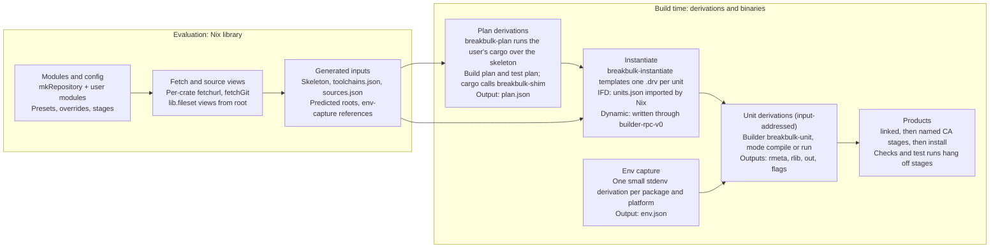

# breakbulk: implementation

Nov 6, 2026 · @Chaz Schlarp

## Scope and starting point

This document describes how to build the system in [breakbulk: design](design.md). It is a new implementation.

[cargo-dyndrv](https://github.com/obsidiansystems/cargo-dyndrv), by Obsidian Systems, is the closest prior art. It showed that per-unit derivations can be written from inside a build and handed back to Nix. Its repository has no license file, so no code is copied from it.

The project is named **breakbulk**: break-bulk cargo is loaded piece by piece rather than in containers. Its binaries are `breakbulk-shim`, `breakbulk-plan`, `breakbulk-instantiate` and `breakbulk-unit`.

| Idea from cargo-dyndrv | Decision |
| --- | --- |
| Writing `.drv` files from inside a build and handing roots back to Nix | **Adopt**, through Nix's `builder-rpc-v0` interface, in dynamic-derivation mode only |
| A wrapper that applies `KEY=value` files and then `exec`s the real program | **Adopt** inside `breakbulk-unit` |
| A build-script runner that turns directives into argument files | **Adopt**, with placement observed from Cargo, failure on death by signal, and correct `rustc-flags` handling |
| Rebuilding rustc flags from `--unit-graph` | **Avoid**: trace Cargo instead |
| A separate derivation computing `CARGO_CFG_*` | **Unneeded**: the trace records it |
| Overrides keyed by full package ID | **Avoid**: per-package module options |
| Content-addressed units | **Avoid** by default: input-addressed units, CA only at the edges (see the design doc) |

Out of scope here: the decisions already argued in the design doc. This document covers interfaces, formats, algorithms, tests and the order of work.

## Components



The skeleton and toolchain spec feed planning; the source map, toolchains and env captures feed instantiation by reference. Stage and check configuration from the modules is applied when products are assembled.

| Component | Kind |
| --- | --- |
| `breakbulk-shim` | Rust binary: rustc wrapper and build-script stub |
| `breakbulk-plan` | Rust binary: drives cargo and writes `plan.json` |
| `breakbulk-instantiate` | Rust binary: templates unit derivations, as JSON for IFD or into the store for dynamic derivations |
| `breakbulk-unit` | Rust binary: the builder of every unit |
| `lib/` (Nix) | `mkRepository`, modules, presets, fetchers, env capture, stage helpers |

All four binaries live in one Cargo workspace. `breakbulk-unit` stays small and nearly dependency-free, because it is an input of every unit and any change to it rebuilds everything. `breakbulk-shim` and `breakbulk-plan` only affect the plan derivations.

## Trace planner

`breakbulk-plan` runs the user's real cargo once per (workspace, target, variant, plan kind), with a rustc wrapper that records instead of compiling. It combines the records with `cargo metadata`, which is stable, to produce `plan.json`.

### Invocation

```sh
# build plan
cargo build --frozen --offline <selection> \
  --target <triple> --profile <profile> [--features …] \
  --config <generated source-replacement file, one directory per source> \
  --config '<spec rustflags and linkers as target.<triple> keys>'
# test plan: the same, with `cargo test --no-run`, then `cargo test --doc` for doctests
# bench variant: `cargo bench --no-run` with the bench profile
# env: RUSTC_WRAPPER=breakbulk-shim  RUSTDOC=breakbulk-shim  CARGO_TARGET_DIR=<scratch>  BREAKBULK_RECORD=<record dir>
```

- `<selection>` is `--workspace`, or `-p` for each package in the target's `packages` list.
- The vendor configuration is described under [Vendoring for planning](#vendoring-for-planning).
- Spec env is **not** passed to Cargo. Cargo's `[env]` reaches every process, including host build scripts; spec env is added per unit by platform at instantiation.
- The user's own `.cargo/config.toml` is in the skeleton and applies as it does locally. Nothing from the user's home directory or shell is visible.
- The clippy variant adds `RUSTC_WORKSPACE_WRAPPER=clippy-driver`. Cargo then calls `breakbulk-shim clippy-driver rustc …` for workspace members only.
- Doctests: `cargo test --no-run` skips them, because rustdoc compiles doctests at run time. After the faked build, the test plan runs `cargo test --doc`; the shim, acting as `RUSTDOC`, records each `rustdoc --test` command and exits successfully. Cargo runs nothing else in that mode.
- Documentation (later): `cargo doc` is traced the same way, with the shim recording each `rustdoc` command.

### Fixed skeleton location

Cargo hashes the absolute path of a path crate that lies outside the workspace root into its `-C metadata`. The planner therefore places the skeleton at one canonical absolute path inside the sandbox and records it in the plan header. When a workspace has path dependencies outside its root, `trim-paths` is not in effect, and the canonical path is not available (non-default `sandbox-build-dir`, an unsandboxed build, macOS), planning fails with a message naming the crates affected. Otherwise the location does not matter and no check is made.

### `breakbulk-shim` modes

The shim decides its mode from its arguments and how it was started.

| Mode | Detected by | Action |
| --- | --- | --- |
| Query | `-vV`, any `--print`, or `-` as the input file | `exec` the real rustc unchanged |
| Compile | `--crate-name` plus an input file | Record, then fake the outputs |
| Rustdoc | Started as `RUSTDOC` | Record; for queries, `exec` the real rustdoc; otherwise exit 0 without output |
| Build-script stub | Started as a copied stub binary, with a marker file beside it | Record the env, print sentinel directives, exit 0 |

### Faking a compile

1. Write a record: argv (with the wrapper chain), env, cwd.
2. Ask the real rustc for output names: the same arguments plus `--print=file-names` (it does not compile). Add the `.rmeta` and `.d` names that `--emit` implies.
3. Create each output as an empty file. Write the dep-info file as `<output>: <input file>`, because Cargo parses it after every compile.
4. When the arguments contain `--json=…artifacts…` and `--emit` includes `metadata`, print `{"$message_type":"artifact","artifact":"<rmeta path>","emit":"metadata"}` on stderr. Cargo waits for this before starting pipelined dependents.
5. For a build-script compile (crate name `build_script_build`), copy the shim binary to the output path and write a marker file next to it naming the unit and listing the package's targets from `cargo metadata`.

When Cargo runs a stub, the stub records argv, cwd and the full env Cargo gave it, including `TARGET`, `HOST`, `PROFILE`, `OPT_LEVEL`, `DEBUG`, `CARGO_CFG_*`, `CARGO_FEATURE_*`, `CARGO_ENCODED_RUSTFLAGS`, `CARGO_MANIFEST_LINKS`, `OUT_DIR` and any `DEP_*` sentinels from upstream stubs.

### Sentinel directives

Each stub prints one tagged directive of every kind that applies to its package, using a tag `R` derived from its run unit:

| Kind | Sentinel | Printed when |
| --- | --- | --- |
| `rustc-cfg` | `__bb_R_cfg` | Always |
| `rustc-check-cfg` | `cfg(__bb_R_ccfg)` | Always |
| `rustc-env` | `__BB_R_ENV=1` | Always |
| `rustc-link-search` | `native=<OUT_DIR>/__bb_R_search` | Always; inside the build directory, so Cargo's dynamic-library-path rule applies to it |
| `rustc-link-lib` | `__bb_R_lib` | Always |
| `rustc-link-arg` | `__bb_R_arg` | The package has a linkable target |
| `rustc-link-arg-bins`, `-tests`, `-examples`, `-benches`, `-cdylib` | `__bb_R_arg_<kind>` | The package has such a target |
| `rustc-link-arg-bin=NAME=` | `__bb_R_arg_bin_NAME` | For each bin target |
| `metadata` | `__bb=R` | The package declares `links` |

Stubs use the `cargo:` single-colon syntax when the package's `rust-version` predates the `cargo::` syntax. The planner then:

1. Finds every sentinel token in recorded argv and env.
2. Checks that each appears in the exact shape the wrapping table expects (for example `-l`, `__bb_R_lib`). Any other shape fails the plan, naming the Cargo version, the kind and the arguments seen.
3. Replaces each sentinel with a splice point in the plan: "run R's directives of kind K go here".
4. Turns `DEP_<LINKS>___BB=R` in a dependent stub's env into a metadata edge from run R.
5. Turns sentinel search paths found in dynamic-library path variables of runs and tests into dynamic-path splice points.
6. Fails the plan if any sentinel token is left unconverted.

The expected shapes are pinned by golden tests per Cargo release.

### Unit identity and graph edges

- **Compile units** are keyed by Cargo's `-C metadata=<hash>` value; **build-script runs** by the `<pkg>-<hash>` component of their `OUT_DIR`. These hashes come from Cargo's stable unit identity.
- **Edges** come from the records: a `--extern name=<path>` or `-L dependency=<dir>` path names the producing unit's output; `OUT_DIR` in a compile's env names its build-script run; the stub's path names the run's compile unit; sentinels give directive placement and metadata edges.
- **Platform** is read from the output location: Cargo always receives `--target`, so host units write under `<scratch>/<profile>/` and target units under `<scratch>/<triple>/<profile>/`.
- **`links` overrides** in config (`[target.<triple>.<links>]`) need no special case. Cargo skips the build script and passes the flags directly, so they appear in the recorded arguments.

### Path rewriting

Every recorded argument and env value is split into literal text and references. Any remaining absolute path that is not in the store is an error that names the unit and the argument.

| Recorded path | Becomes |
| --- | --- |
| `<scratch>/<triple>/<profile>/deps/<file>` | `{"out": <unit>, "output": "rmeta" or "rlib" or "bin", "file": <name>}` |
| `<scratch>/…/build/<pkg>-<hash>/out` | `{"out": <run unit>, "output": "out"}` |
| The stub binary path | `{"out": <compile unit>, "output": "bin"}` |
| `<skeleton>/<rel>` | `{"src": <workspace package>, "rel": <rel>}`, resolved at instantiation |
| `<vendor dir>/<source>/<crate>/<rel>` | `{"crateSrc": <package id>, "rel": <rel>}` |
| `/nix/store/…` | Literal; the containing store path becomes an input |

Two rewrites go beyond paths:

- **Same-triple linkers.** When host and target triples are equal and the host spec's linker differs from the target's, each host unit's `-C linker=` value is replaced with the host linker. The planner first checks that the unit carries exactly one `-C linker=` equal to the configured target linker. A linker set by the user's own config is left alone, because local Cargo applies it the same way.
- **Build-directory remap.** When Cargo's `trim-paths` is in effect, Cargo emits one `--remap-path-prefix=<build dir>=/cargo/build-dir`. In breakbulk the build directory is split into one store path per `OUT_DIR`, so the planner expands it into one remap per referenced `OUT_DIR`.

### Env filtering

A unit's recorded env is the recorded env minus the baseline env the planner gave Cargo. That keeps exactly what Cargo set, including the project's `[env]`. Then:

- Drop `RUSTC_WRAPPER`, `CARGO_MAKEFLAGS` and the planner's own variables. Keep `RUSTC_WORKSPACE_WRAPPER` only in the clippy variant.
- Replace `NUM_JOBS` with `$NIX_BUILD_CORES`, applied by the runner at build time.
- Never pass `RUSTC_BOOTSTRAP` to a build-script run. If it reached one, build scripts that probe for nightly would turn on nightly-only code paths. Compile units may receive it only from the pipelined split's `-Zno-codegen` backend.

## Plan format

`plan.json` is a versioned, deterministic description of one (workspace, target, variant, plan kind): every unit, with arguments split into literals, references and splice points. It contains no store paths for sources, so it changes only when manifests, the lockfile, config or the toolchain change.

```json
{
  "version": 1,
  "kind": "build",
  "cargo": "1.96.1", "rustc": "1.96.1 (…)", "host": "x86_64-unknown-linux-gnu",
  "target": "wasm32-unknown-unknown", "variant": { "profile": "release", "features": [], "mode": "build" },
  "skeletonRoot": "/build/skeleton", "trimPaths": false,
  "units": {
    "c-8f3a1d2e9b0c4f17": {
      "kind": "compile",
      "package": "registry+https://github.com/rust-lang/crates.io-index#ring@0.17.14",
      "crate": { "name": "ring", "types": ["lib"], "edition": "2021" },
      "platform": "target",
      "program": ["/nix/store/…-rustc/bin/rustc"],
      "args": ["--crate-name", "ring", [{ "crateSrc": "…ring@0.17.14", "rel": "src/lib.rs" }], "…",
               "--extern", ["cfg_if=", { "out": "c-…", "output": "rmeta", "file": "libcfg_if-….rmeta" }],
               { "splice": "r-ring-…", "kind": "rustc-cfg" },
               { "splice": "r-ring-…", "kind": "rustc-link-lib" }],
      "env": { "CARGO_PKG_NAME": "ring", "OUT_DIR": [{ "out": "r-ring-…", "output": "out" }] },
      "envSplices": [{ "splice": "r-ring-…", "kind": "rustc-env" }],
      "cwd": { "crateSrc": "…ring@0.17.14", "rel": "" },
      "outputs": { "rmeta": ["libring-….rmeta"], "rlib": ["libring-….rlib"] }
    },
    "r-ring-…": {
      "kind": "run", "package": "…ring@0.17.14", "platform": "target", "links": "ring_core_0_17_14_",
      "script": { "out": "c-…", "output": "bin" },
      "env": { "TARGET": "wasm32-unknown-unknown", "…": "…" },
      "metadataFrom": []
    }
  },
  "roots": [{ "package": "…", "target": "app", "kind": "bin", "unit": "c-…", "test": false }]
}
```

### Fields

- **Argument segments.** A string is a literal argument. An array is one argument made by concatenating literals and references. A reference object is `src`, `crateSrc` or `out`. A splice object (`splice`, `kind`) expands at build time to zero or more arguments: run R's directives of that kind, wrapped by the wrapping table, in the order the script printed them.
- **`envSplices`** add run R's `rustc-env` values to the unit's env.
- **`platform`** is `host` or `target`, observed from Cargo's output layout. Instantiation picks the matching toolchain spec and env capture, so host and target settings never mix.
- **`metadataFrom`** on a run lists upstream runs whose `DEP_<links>_*` metadata it receives, observed from sentinels.
- **`roots`** are the plan's products: bins, cdylibs and staticlibs in a build plan (plain `cargo build` never builds examples); test, bench and example binaries in a test plan.

### Invariants

1. Keys and arrays are sorted, and the file is canonical JSON. Two traces of the same inputs produce byte-identical plans.
2. Every `out` reference and every splice names a unit in the same plan.
3. No literal contains the scratch directory, the skeleton, the vendor directory, `/build`, `$HOME` or a sentinel token. Validation fails the plan otherwise.
4. Every literal store path is a declared toolchain input or a store path from the evaluation-time source map.

## Instantiation

`breakbulk-instantiate` turns `plan.json` plus a source map into unit derivations. It does no compiling, fetching or source serialization. The same templating code serves both delivery modes, so both produce identical unit derivation paths.

### Inputs

- `plan.json`: the output of a plan derivation.
- `sources.json`: built at evaluation time. Workspace packages map to their source-view store paths, which evaluation has already copied to the store. Crate sources map to their fetch derivations, passed with drv-only context, so instantiation can name them without building them.
- `toolchains.json`: the host and target specs, with tools passed as drv-only references, including the `breakbulk-unit` builder.
- `overrides.json`: per-package env, inputs and env-capture references. Derivations here, including products of other workspaces, are passed with drv-only context.
- The predicted root list.

Instantiation therefore realises nothing except the plan and the source views. Neither the toolchain, nor crate sources, nor embedded products are built before units are known.

### Derivation shape per unit

| Field | Value |
| --- | --- |
| `name` | `<crate>-<version>-<kind>`, for example `ring-0.17.14-lib` or `ring-0.17.14-build-run` |
| `builder` / `args` | `breakbulk-unit`, `["unit"]` |
| `env.BREAKBULK_UNIT` | Canonical JSON of the unit with every reference rendered |
| `outputs` | Library: `rmeta`, `rlib`. Bin or test: `out`. Build-script run: `out`, `flags`. Input-addressed |
| `inputs` | `Built{drv, output}` for each referenced unit output, crate source, toolchain component and env capture; `Opaque` for each source view |
| `system` | The builder platform: the planner's system for compile units |

Referenced outputs are input-addressed or fixed-output, so their paths are known and rendered literally. The one exception is a product referenced through a package override in dynamic-derivation mode: products are resolved at build time there, so the reference is a placeholder and the referencing unit is resolved at build time too.

### IFD mode

The instantiate derivation runs `breakbulk-instantiate --emit json` and writes `units.json`, mapping each unit to its complete derivation attributes, plus a map from root names to units. The Nix side imports it and applies `derivation` to each entry. Nix computes output paths.

### Dynamic-derivation mode

The instantiate derivation is content-addressed with a text-hashed output and requires the system feature `builder-rpc-v0`. Its name, `breakbulk-instantiate-requires-builder-rpc-v0`, makes Nix's error self-explanatory when no builder supports the feature.

- Units are added in topological order with `nix derivation add`, or with harmonia's derivation types if they fit; spike B decides. Either way the input-addressed output paths must equal the ones Nix computes in IFD mode.
- Each root is handed back with `nix store submit-output`, as an output named `<root>.drv`.
- `recursive-nix` is not used. It has an open removal proposal, and `builder-rpc-v0` replaces it for this purpose.

### Mode selection

`mode = "auto"` (the default) chooses dynamic-derivation mode when `builtins ? outputOf` (the builtin is only registered when the `dynamic-derivations` feature is enabled) and `builtins.nixVersion` is at least the first release that ships `builder-rpc-v0`. Otherwise it chooses IFD. Determinate Nix reports its upstream base version there, so the same check works for it. `mode = "ifd"` and `mode = "dynamic"` override the choice. A daemon or builder older than the evaluator still fails with Nix's own error; the docs point to `mode = "ifd"`.

Unit derivations are identical in both modes. Products are not (resolved at build time in dynamic-derivation mode, input-addressed in IFD mode), so teams that mix Nix versions should pin the mode to share product cache entries.

### Root names are fixed at evaluation time

Nix attribute names, and a dynamic derivation's outputs, must be known at evaluation time, but the roots are discovered by the planner. The Nix library predicts them from the manifests with `builtins.fromTOML` and directory listings, implementing Cargo's documented target auto-discovery: `src/main.rs`, `src/bin/*.rs` and `src/bin/*/main.rs`, `examples`, `tests`, `benches`, the `auto*` switches, explicit target tables merged with discovered ones, custom `path =`, and `test`/`bench` flags.

`required-features` is ignored during prediction, because deciding it would need feature resolution. The prediction is a superset of what Cargo builds, computed separately for build and test plans. Instantiation fills each predicted root with:

- the real root, when the plan contains it;
- for a product the plan lacks, a stub derivation that fails with the reason ("`admin-cli` was not built by Cargo in variant `release`: required features `[cli]` not enabled");
- for a test run the plan lacks, a stub that succeeds and logs that the test was skipped, as `cargo test` does.

A root in the plan that was not predicted is an error listing both sets, because it means the discovery implementation has a bug. An explicit `roots` option is the escape hatch. A single "all roots" output was rejected because building any one product would then build every product.

## Unit execution

`breakbulk-unit` is the builder of every unit. It is a small, dependency-light Rust binary with two modes: `compile` and `run`. Test runs belong to products.

### Environment contract

A unit's environment is built in layers; later layers win, except for list-like variables (`PATH`, `NIX_CFLAGS_COMPILE`, `NIX_LDFLAGS`), where later layers append:

1. A fixed base: `HOME=/homeless-shelter`, `TMPDIR`, `NIX_BUILD_CORES`, `LC_ALL=C`, `TZ=UTC`.
2. The env capture for the unit's package and platform, or the base capture for the platform.
3. Cargo's recorded env, after filtering.
4. The toolchain spec's env for the unit's platform.
5. The package override's env for the unit's platform.

Nothing from the planner's environment reaches a unit.

### `compile`

1. Read `BREAKBULK_UNIT` and set up the environment contract. Replace `NUM_JOBS` with `$NIX_BUILD_CORES`.
2. Build a dependency directory: `$TMPDIR/deps` with symlinks to the `rmeta` or `rlib` outputs of every transitive dependency. Pass one `-L dependency=$TMPDIR/deps`. This replaces Cargo's single shared `deps` directory and keeps argv short.
3. Expand splice points from each referenced run's `flags` output, using the wrapping table and the value-dependent rules below.
4. Add path remapping, unless the plan already carries Cargo's own remaps (`trimPaths`): map every source view, crate source and upstream `OUT_DIR` to a stable name (`<name>-<version>` for crates, the package's path from the repository root for workspace members), with the scope for the unit's product kind (see below).
5. Point `--out-dir` at `$TMPDIR/out` and run the recorded program.
6. Parse rustc's JSON diagnostics from stderr, print each `rendered` field, and drop artifact notifications. Without this, build logs are unreadable JSON.
7. Move outputs into place: `.rmeta` to `$rmeta`, `.rlib` to `$rlib`, binaries and cdylibs to `$out`. Discard dep-info.

### `run` (build scripts)

1. Set up the environment contract, and set `OUT_DIR` to `$out`, which is writable and empty.
2. For each unit in `metadataFrom`, read its `flags/metadata.json` and set `DEP_<LINKS>_<KEY>`, uppercased with `-` mapped to `_`, as Cargo does.
3. Execute the script from its compile unit's output, with the package source as the working directory. The source is read-only, as it is in any Nix build.
4. Parse stdout. Write `$flags/directives.json` (values grouped by kind, in printed order), and `$flags/metadata.json` when the package declares `links`.
5. Fail on a non-zero exit, on death by signal (with the signal named), and on any `error` directive. Print `warning` directives.
6. Check every `rerun-if-changed` path against the sandbox. On failure, add a hint for each missing path naming the package option to add it to; likewise for `rerun-if-env-changed` variables that are unset. On success, warn about missing paths, or fail when `strictSources` is set.

### Directive parsing

Build-script output is a documented, line-based format: `cargo::KEY=VALUE`, or the older `cargo:KEY=VALUE`. Lines without the prefix are ignored. Values are opaque strings and are never interpreted beyond the splitting below.

| Key | Parsing | Wrapping |
| --- | --- | --- |
| `rustc-cfg` | Value as is | `--cfg <value>` |
| `rustc-check-cfg` | Value as is | `--check-cfg <value>` |
| `rustc-env` | Split on the first `=` | Env var on the compile |
| `rustc-link-lib` | Value as is | `-l <value>` |
| `rustc-link-search` | Value as is | `-L <value>` |
| `rustc-link-arg` and its target-specific forms | Value as is; `-bin=` splits `NAME=ARG` | `-C link-arg=<value>` |
| `rustc-flags` | Split on whitespace into `-l` and `-L` parts; anything else is an error | As `rustc-link-lib` and `rustc-link-search` |
| `metadata` | Split on the first `=` | `DEP_<LINKS>_<KEY>` for dependents' runs |
| Unknown key, `cargo:` syntax | Treated as `metadata` | As `metadata` |
| Unknown key, `cargo::` syntax | Error | — |
| `warning`, `error` | Message | Printed; `error` fails the run |
| `rerun-if-changed`, `rerun-if-env-changed` | Path or variable | Used only by the sandbox check |

The wrapping column is also what the planner asserts against Cargo's placement of sentinels on every trace.

**Validations copied from Cargo:** `rustc-env` may not set `RUSTC_BOOTSTRAP`; `rustc-link-arg-bin=NAME=` must name an existing bin target; `rustc-flags` accepts only `-l` and `-L`.

**Value-dependent rules**, each implemented explicitly and tested:

- A `rustc-link-search` path is added to the dynamic-library path of runs and tests only when it lies inside an upstream run's `out`, matching Cargo's rule that only paths inside the target directory are added.
- Duplicate values are handled as Cargo handles them; the differential tests pin this down.
- `rustc-flags` splitting, as above.

### Source paths at run time

Path remapping uses rustc's `--remap-path-scope` (stable since 1.95):

| Unit | Scope |
| --- | --- |
| Units linked into a shipped product that gets `splitDebug` | `macro,diagnostics` (plus `coverage` in coverage variants); debug info keeps store paths |
| Test binaries, and products without `splitDebug` | All scopes |
| Any unit, with rustc older than 1.95 | All scopes (no scope flag) |

When Cargo's `trim-paths` is in effect, Cargo's own remaps and scope are used instead, and breakbulk adds none of its own, because rustc picks one remap when several match.

`CARGO_MANIFEST_DIR` must be the real source-view store path: crates use it in `include_str!(concat!(env!("CARGO_MANIFEST_DIR"), …))` and in build scripts. Remapping does not rewrite `env!` values, so a binary can still retain a source store path. Every product therefore gets a default check that fails when its main output references a source path. The `debug` output is allowed to.

## Environment capture

Inputs declared on a package become environment through nixpkgs' own setup hooks, not through code in breakbulk.

- For each (package, platform) with `nativeInputs` or `inputs`, a derivation runs `stdenv.mkDerivation` with `nativeBuildInputs = nativeInputs` and `buildInputs = inputs`, and writes the environment its setup hooks produced as `env.json`. Target units use the target's stdenv (`pkgsCross.<target>.stdenv` when cross); host units use the build platform's stdenv. Tools stay native inputs there, but libraries must be the build platform's `buildInputs`, or the wrappers add no include or library flags; `inputs` is therefore a function of a package set (`inputs = p: [ p.openssl ]`), called with the package set matching each platform.
- One **base capture** per platform has no inputs. It gives build scripts the baseline `buildRustPackage` has: coreutils, bash, make, the C compiler on `PATH`, and the standard hardening and wrapper variables.
- A capture keeps only what setup hooks added relative to a plain shell, minus per-build values: `NIX_BUILD_TOP`, `TMPDIR`, `PWD`, `out`, log descriptors, `SOURCE_DATE_EPOCH` (set by the base layer instead), and any value naming the capture's own output.
- The capture derivation sets `strictDeps = true` (otherwise every input's `bin/` reaches `PATH` and flags are doubled) and `NIX_NO_SELF_RPATH = 1` (otherwise every binary gets an rpath to the capture). It strips stdenv's own `-frandom-seed`; each unit adds its own, as stdenv does. `NIX_*` variables are always kept, because some stdenvs (musl) set `NIX_HARDENING_ENABLE` as a derivation attribute.
- A unit gets exactly one capture. Variables such as `CC`, `PATH` and `NIX_CFLAGS_COMPILE` mean "this stdenv's platform", so host and target captures never merge.
- C objects carry source paths in their debug info; units add `-ffile-prefix-map` for the source views to the C flags, matching the Rust remaps.

The spike result is in [spikes/C-env-capture.md](spikes/C-env-capture.md).
- Captures are input-addressed. Their output references the inputs' store paths, so building a unit realises the inputs, and substituting a unit does not.

To verify in a spike: that nixpkgs' compiler and linker wrappers behave the same when their role variables come from a replayed environment, and that no common setup hook relies on anything other than environment variables.

## Nix library

The library is one `lib.evalModules` call over user modules, plus functions that turn the evaluated config into derivations. A flake-parts module wraps it for flake users.

### Entry point

```nix
repo = breakbulk.lib.mkRepository {
  inherit pkgs;
  root = ./.;
  modules = [ ./nix/rust.nix ];
};
```

### Options

```nix
{
  mode = "auto";                      # auto | ifd | dynamic
  strictSources = false;              # fail on missing rerun-if-changed paths

  workspaces.<ws> = {
    path = ".";                       # relative to root; its Cargo.lock is used
    toolchain = breakbulk.toolchains.fromRustupToolchainFile ./rust-toolchain.toml;
    targets.<triple> = {
      packages = null;                # null: --workspace; or a list traced with -p
    };
    variants.<v> = { profile = "release"; features = [ ]; mode = "build"; };  # build | check | clippy | coverage
    roots = null;                     # override predicted root names
    devShell.setTarget = true;        # export CARGO_BUILD_TARGET in the dev shell
    benchSmoke = false;               # run each bench once in test mode, as a check
    docs.noDeps = true;               # cargo doc --no-deps (later)
  };

  targets.<triple> = {
    preset = breakbulk.presets.linuxGnu;  # or msvc { … }, wasmBrowser, wasmComponent, musl, staticGlibc
    linker = null; cc = null; cxx = null; ar = null; cflags = [ ];
    bindgen.extraClangArgs = [ ];
    rustflags = [ ];                  # passed with --config, so it adds to .cargo/config.toml
    env = { };                        # added to this platform's units only
    runner = null;                    # wine, wasmtime, qemu-user, …
    testSystem = null;                # e.g. "aarch64-linux" to run tests on native builders
    stages = { };                     # default post-link stages for this target
  };

  packages.<name> = {
    version = null;                   # optional version constraint
    env = { }; nativeInputs = [ ]; inputs = [ ]; extraSources = [ ];
    host = { env = { }; nativeInputs = [ ]; inputs = [ ]; };   # only for host units of this package
    target.<triple> = { env = { }; inputs = [ ]; stages = { }; checks = { }; };
    stages = { }; checks = { };
    test = {
      env = { }; path = [ ]; sourceScope = [ ];
      args = [ ];                     # libtest flags for every test binary, e.g. [ "--skip" "net::" ]
      includeIgnored = false;         # also run #[ignore] tests
      binaries.<binary> = { args = [ ]; enable = true; };  # enable = false: built, not run in checks
    };
    strictSources = null;             # per-package override
    pipelining = null;                # opt in or out of the pipelined split (later)
  };

  registries.<name>.dl = "…";         # download URL template for alternative registries
  gitHashes."<source url>" = "sha256-…";  # optional; makes a git source substitutable
}
```

- `env` values may reference any derivation, including another workspace's products: `env.UI_DIST = repo.workspaces.ui.target.wasm32-unknown-unknown.packages.ui;`. They are passed to instantiation by reference.
- A curated module of defaults for common `-sys` crates ships with the library. User values merge over it with ordinary module priorities.
- An override whose `version` or name matches nothing in any lockfile is an evaluation warning, not silence.

### Outputs

| Attribute | Contents |
| --- | --- |
| `repo.workspaces.<ws>.target.<triple>.packages.<pkg>` | The product after default stages; `.stages.<name>` for each intermediate; `.debug` where split |
| `repo.workspaces.<ws>.packages.<pkg>` | The same, for the native target |
| `repo.workspaces.<ws>.target.<triple>.tests.<pkg>.<test>` | Test binaries, for VM and system tests |
| `repo.workspaces.<ws>.target.<triple>.testRuns.<pkg>.<test>` | Test-run derivations |
| `repo.workspaces.<ws>.target.<triple>.testApps.<pkg>.<test>` | Runnable apps: the test binary with its test-run environment, run outside the sandbox |
| `repo.workspaces.<ws>.target.<triple>.doctests.<pkg>` | Doctest derivations |
| `repo.workspaces.<ws>.target.<triple>.benches.<pkg>.<bench>` | Bench binaries from the bench variant |
| `repo.workspaces.<ws>.target.<triple>.docs` | The documentation product (later) |
| `repo.checks` | All checks and test runs flattened, ready for `checks.<system>` |
| `repo.sources.<crate>` | Fetched crate sources by name (and `<name>@<version>`) |
| `repo.workspaces.<ws>.devShell` | A shell matching the planner's Cargo invocation (see below) |
| `repo.workspaces.<ws>.plans.<triple>.<variant>.{build,test}` | `plan.json`, for debugging |
| `repo.explainSharing` | Given two plans and a package, the inputs that make its units differ |

### Dev shell

The planner always passes `--target`, and local Cargo without it behaves differently: rustflags reach build scripts, every unit's `-C metadata` changes, and outputs move. The dev shell therefore:

- exports `CARGO_BUILD_TARGET=<native triple>`, unless `devShell.setTarget = false`;
- exports the toolchain spec as Cargo env config (`CARGO_TARGET_<TRIPLE>_RUSTFLAGS`, `CARGO_TARGET_<TRIPLE>_LINKER`), matching the planner's `--config`;
- includes the union of the packages' native env captures, because one shell cannot scope env per unit (a union is only valid within one platform);
- warns about `CARGO_*` variables in the user's environment that the planner will not see.

Limits, documented: binaries move to `target/<triple>/…`; a missing input declaration can work locally and fail in Nix; and for same-triple presets (static glibc, zig) local Cargo cannot keep target env away from host build scripts.

## Fetching and source views

Fetch derivations are created from the lockfiles at evaluation time. Registry crates download at build time. Git sources are fetched during evaluation.

### Registry crates

- Every `Cargo.lock` in the repository is read with `builtins.fromTOML`. Entries are merged by (source, name, version, checksum), so a crate locked by several workspaces is fetched once.
- A crates.io entry becomes `fetchurl` of `https://static.crates.io/crates/<name>/<name>-<version>.crate`, using the lockfile's SHA-256 checksum. An unpack derivation then writes the `.cargo-checksum.json` (`{"files":{},"package":"<checksum>"}`) that Cargo's directory sources require.
- Other registries need their download URL template from `registries.<name>.dl`, because reading the registry's `config.json` would need a fetch at evaluation time.

### Git dependencies

- A `git+<url>?…#<rev>` entry becomes `builtins.fetchGit { url; rev; allRefs = true; shallow = true; }`. A full revision makes the input locked, so this works in pure evaluation without a hash. Submodules are an option per URL.
- Without a content hash, every fresh machine clones the source during evaluation, and evaluation fails if the remote is unreachable. `gitHashes.<source url>` (optional) switches that source to a fixed-output fetch, which a binary cache can serve. This follows crane's `outputHashes`.
- The crate inside the repository is found by walking the fetched tree's `Cargo.toml` files, stopping at the first match. A `subdir` hint per URL skips the walk.
- Fetches are keyed by URL and locked revision, because two workspaces can lock the same git source at different revisions.

### Vendoring for planning

Each workspace gets a vendor directory with one subdirectory per source, following crane's layout:

- **Registries:** one directory per registry, named by a hash of its URL.
- **Git:** one directory per source id (URL plus `branch`, `tag` or `rev` query, without the locked revision), named by a hash of the id.
- **Inside each:** `<name>-<version>` symlinks to the fetched crates, for crates in this workspace's lockfile only.

Generated config, passed as a file (`--config <file>`; an inline `--config` value may hold only one dotted key), replaces each source with its directory:

```toml
[source.crates-io]
replace-with = "breakbulk-<hash>"
[source.breakbulk-<hash>]
directory = "<vendor>/<hash>"
[source."git+https://github.com/me/serde?rev=abc"]
git = "https://github.com/me/serde"
rev = "abc"
replace-with = "breakbulk-<hash2>"
```

The planner sees exactly the crates in the lockfile, the lockfile's checksums are verified, and two sources providing the same name and version never collide.

### Source views

A workspace package's source is `lib.fileset.toSource { root = <repository root>; fileset = …; }`. Because the root is the repository root, relative paths outside the crate resolve unchanged.

- **Default fileset:** the package directory, minus `target/`, `.git`, `result*`, and any nested directories that belong to other workspace members.
- **Plus:** the package's `extraSources`, at their original relative paths.
- **Test units** additionally get `test.sourceScope`.

### The planning skeleton

The plan derivations' source is a skeleton, so they are rebuilt only when the manifests, the lockfile, config or the toolchain change:

- every `Cargo.toml`, `Cargo.lock`, `.cargo/config.toml` and `rust-toolchain.toml`;
- an empty `README.md`, `README.txt` or `README` wherever one exists, because Cargo sets `CARGO_PKG_README` from its presence;
- an empty file for every file name in the conventional target directories (`src/lib.rs`, `src/main.rs`, `src/bin`, `examples`, `tests`, `benches`, including `*/main.rs` forms), every explicit `path =` target and every `build.rs`.

The skeleton copies file names only and needs no discovery rules; Cargo performs its own discovery during the trace.

## Toolchain presets

A preset is a function from `{ pkgs, triple, …options }` to a `targets.<triple>` module, so users override any field with ordinary module priorities. Every preset also sets the host spec from `pkgs.buildPackages`, so host units always get the build machine's tools. Preset env is added per unit by platform, never through Cargo's `[env]`.

| Preset | Linker | C toolchain | Rustflags and env (target units) | Runner | Default stages |
| --- | --- | --- | --- | --- | --- |
| `linuxGnu` | mold via wrapped bintools (`-fuse-ld=mold`); lld when cross-language LTO is on | `pkgsCross.<x>.stdenv.cc` | `CC_<triple>`, `AR_<triple>` | native; `qemu-user` when cross without a builder | `splitDebug` |
| `linuxMusl` | as `linuxGnu` | `pkgsCross.<x>-musl.stdenv.cc` | `+crt-static` | as `linuxGnu` | `splitDebug` |
| `staticGlibc` | mold, same as host | host `cc` | `+crt-static`, `-C relocation-model=static`, `-L native=` for `glibc.static` and the declared static archives; static `pkg-config` mode | native | `splitDebug` |
| `msvc { arch; sdk }` | `lld-link` | `clang-cl`, `llvm-lib` from `rustc.llvmPackages` | `-Lnative=` for CRT, `um` and `ucrt` libs; `CFLAGS_<triple>` with `-imsvc`; `BINDGEN_EXTRA_CLANG_ARGS_<triple>` with `-isystem`; `RC`, `RCFLAGS`, `LIB`; optional `+crt-static` | `wine` with a `WINEPREFIX` in `$TMPDIR` | none |
| `wasmBrowser` | lld from rustc's target spec, version-matched | unwrapped clang targeting wasm32 | none by default | `wasm-bindgen-test-runner` + headless Chromium, or Node | `bindgen` → `wasmOpt` |
| `wasmComponent` | as `wasmBrowser` | clang + `wasilibc` when C is present | `-C link-self-contained=no` + `-L` to `wasilibc` when C is present | `wasmtime` | `wasmOpt` (optional) → `componentize` |

### msvc

```nix
targets.x86_64-pc-windows-msvc.preset = breakbulk.presets.msvc {
  arch = "x86_64";
  sdk = breakbulk.xwinSdk {            # fixed-output; meta.license = unfree
    manifestVersion = 17; crt = "14.44.17.14"; sdk = "10.0.26100";
    hash = "sha256-…";
  };
  crtStatic = true;
  extraSdks = [ ];                  # e.g. a driver kit, with its own include and lib dirs
};
```

The include directories are passed twice in different syntax: `-imsvc` for `clang-cl` and `-isystem` for bindgen's libclang. `aarch64` uses the same preset with `arch = "aarch64"`.

### wasm

- **wasm-bindgen version.** The `bindgen` stage reads the `wasm-bindgen` version from the workspace's `Cargo.lock`. It picks the matching `wasm-bindgen-cli_<version>` from nixpkgs, or builds that version from crates.io with a hash from a table shipped with the library. If neither exists, evaluation fails naming the version.
- **Unwrapped clang.** C code uses clang from `rustc.llvmPackages`, never the stdenv compiler wrapper. A wrapped gcc can silently produce host objects for a wasm target.

### Zig (later)

For an old glibc version: `zig cc -target <arch>-linux-gnu.<glibc>` wrappers as linker and C compiler for target units. The host triple is the same, so host units keep the host linker through the planner's linker rewrite. A separate derivation pre-warms zig's global cache for the target, and `breakbulk-unit` copies it into `$TMPDIR` before each unit.

## Products, stages and tests

Every product starts at a fixed stage named `linked` and passes through an ordered set of named stages. Each stage is one content-addressed derivation. Checks hang off stages without joining the chain.

### The `linked` stage

`linked` is a small derivation that symlinks the root unit's output. In IFD mode it depends on the root unit like any derivation. In dynamic-derivation mode it depends on `builtins.outputOf <instantiate drv>."<root>.drv" "out"`, so Nix resolves it at build time. Either way, later stages get an ordinary derivation to depend on.

### Stage ordering

```nix
stages.<name> = {
  after = "linked";   # or another stage; default: the previous stage in the preset's chain
  before = null;
  run = { input, product, target, pkgs }: <derivation>;   # input = previous stage's output
};
```

- The effective stage set is the preset's defaults merged with the target's and the package's stage modules. `lib.mkForce null` removes a stage.
- Order comes from `lib.toposort` over the `after` and `before` constraints. A cycle, or a reference to a missing stage, fails evaluation and lists every stage with its constraints.
- The last stage in the order is the product. The `install` stage normalizes the layout (`bin/`, `lib/`, `.exe` with DLLs, `pkg/`) and runs last unless removed.

### Checks

```nix
checks.<name> = { on = "linked"; run = { input, product, pkgs }: <derivation>; };
```

Each check becomes `repo.checks."<ws>/<triple>/<pkg>/<name>"`. Every product gets `noSourceReferences` by default, which fails if the main output's runtime closure contains a source-view or crate-source store path. The `debug` output is exempt.

### Stage helpers

| Helper | Does |
| --- | --- |
| `splitDebug` | Reads the GNU build ID, writes `$debug/lib/debug/.build-id/<xx>/<rest>.debug` with `objcopy --only-keep-debug`, then strips debug info and adds a debuglink |
| `strip` | `strip --strip-debug` (or `--strip-all` when asked) |
| `patchelfRpath { libs }` | Adds rpaths for libraries loaded at runtime, after any rpath shrinking |
| `bindgen { target ? "web" }` | Lockfile-matched `wasm-bindgen` |
| `wasmOpt { flags ? [ "-Oz" ] }` | `wasm-opt` on a core module |
| `componentize { adapter ? null; metadata ? { } }` | `wasm-tools component new`, then `wasm-tools metadata add` |
| `deterministicZip` | Sorted entries, fixed timestamps, no extra attributes |
| `install` | Final layout |

### Tests

- **Test binaries** are roots with `test = true` in the test plan. `tests.<pkg>.<name>` is the binary's `linked` stage. Test binaries are never stripped.
- **`CARGO_BIN_EXE_<name>`** is compile-time env recorded by the planner, and is rewritten to the bin root's `linked` output. The test's compile unit therefore depends on that link.
- **`CARGO_TARGET_TMPDIR`** is also compile-time env, but must be writable when the test runs. It is rewritten to a fixed path under the build directory, and the test-run derivation creates that path before running (see spikes).
- **Test runs** are one derivation per test binary. A small CA derivation copies the test binary, and the test run consumes that copy, so a byte-identical binary does not re-run. The run uses the target's `runner`, with the package source view as the working directory (as Cargo does), plus Cargo's runtime env (`CARGO_MANIFEST_DIR`, `CARGO_PKG_*`), the package's `test.env`, and `test.path` on `PATH`. Its `system` is the target's `testSystem` when set. It succeeds on exit 0, and its output records the log.
- **Skipped tests:** a predicted test the plan lacks gets a test-run stub that succeeds and logs the reason.
- **Test arguments:** `test.args` and `test.binaries.<binary>.args` are passed to the binary; `includeIgnored` adds `--include-ignored`. They are part of the test-run derivation, so changing them re-runs only the affected runs. `enable = false` leaves a binary's run out of `repo.checks`. Every test run sets `RUST_TEST_THREADS=$NIX_BUILD_CORES`.
- **Test apps:** each test binary also gets a runnable app with the test run's working directory, environment and runner, run on the user's machine. It is the escape hatch for tests that need network, and the way to rerun one binary under a debugger or with a filter. Network access inside `nix flake check` (through a fixed-output test run) is a possible later addition; impure derivations are not used.
- **nextest.** The first milestones run libtest binaries directly. nextest support comes later, by synthesizing the `binaries-metadata` file that nextest's reuse-build mode reads, so per-test retries, timeouts, test groups and default filters from the nextest config apply.
- **Doctests:** one derivation per library crate, from the test plan's traced `rustdoc --test` command. Inputs are the crate's `rlib`, its dependencies with test-plan features, and the source view. It runs with the target's runner and records the log; it appears in `repo.checks`. There is no cutoff, because compiling and running happen in one rustdoc process. If the toolchain cannot run doctests for a cross target, the derivation is a stub that logs why.
- **Benches:** the test plan compiles bench targets as Cargo does. The bench variant builds optimized bench binaries, exposed for running outside Nix. With `benchSmoke`, each bench binary also runs once with `--test` as a check. Timed runs never happen inside Nix.

### Documentation (later)

One derivation per workspace and target replays the traced `rustdoc` commands in Cargo's order into a single output directory, because rustdoc updates cross-crate indexes in place. Its inputs are the check-mode `rmeta` units shared with check and clippy variants. Per-crate derivations with a final merge wait for rustdoc's mergeable cross-crate info to become stable.

## Pipelined split (later)

An optional per-package split of a library into an `rmeta` derivation and an `rlib` derivation, described in the design doc. Implementation notes:

- Both derivations carry the identical rustc command. The `rmeta` derivation stops at the `"emit":"metadata"` artifact notification, which `breakbulk-unit` already reads from rustc's JSON stream.
- Backends: rerun and stop (stable), CRIU checkpoint and restore (one frontend; Linux; needs a nested user and PID namespace inside the sandbox and a CPU and kernel check before restore), and `-Zno-codegen` (with `RUSTC_BOOTSTRAP` on the compile only, and `-Zallow-features=` empty).
- The `rlib` derivation reads the crate hash from the `rmeta` it was paired with and from its own `lib.rmeta` member, and fails with "crate X does not build reproducibly; disable splitting for X" when they differ.
- Every backend falls back to an unsplit compile.
- Which crates are split is configuration (`packages.<name>.pipelining`, or a deterministic size rule), never a measurement taken on the building machine.

## Testing and conformance

Trace golden tests and directive differential tests guard against Cargo changes; invalidation and sharing tests guard the main promise, that an edit rebuilds only what it should.

1. **Rust unit tests** for the directive parser (both syntaxes, every directive, malformed input), path rewriting, env filtering, splice expansion, plan canonicalization and unit ordering.
2. **Trace golden tests.** For each fixture, run real `cargo build -v` and the traced planner on the same skeleton, render the plan back to concrete argv with the same scratch layout, and diff per unit after normalizing paths. This runs against the oldest release in the supported window (about six months of stable), the latest stable and the latest nightly.
3. **Directive differential tests.** Generate dependency graphs and build-script outputs (several values per kind, duplicates, paths inside and outside the build directory, mixed order). Let stubs replay them so Cargo applies them, and separately expand the sentinel plan with `breakbulk-unit`'s splicing. The two argv and env sets must be identical. The same harness checks that sentinels do not change any unit's `-C metadata`.
4. **Root prediction tests.** Compare the Nix prediction with `cargo metadata` targets over a corpus of real workspaces. The target sets must be identical, with `required-features` as the only allowed difference in what is built.
5. **Fixture builds.** Each fixture builds and tests on its targets in IFD mode, and in dynamic-derivation mode on a Nix with `builder-rpc-v0`. Unit derivation paths must be identical in both modes, and product bytes identical.
6. **Invalidation tests.** Instantiate a fixture, apply a scripted edit, instantiate again, and compare the sets of unit `.drv` paths. Each test states which units may change. For example: changing a build stamp on the top package changes only that package's units.
7. **Sharing tests.** For fixtures with several workspaces or variants, assert the exact set of shared unit derivations, using the same comparison as `explainSharing`.

### Fixtures

One small workspace per pattern from the design doc, under `tests/fixtures/`.

| Fixture | Pattern | Targets | Asserts |
| --- | --- | --- | --- |
| `directives` | Every build-script directive, `links` chains, `DEP_*` | linux-gnu | Placement matches Cargo; signal death fails |
| `build-dep-leak` | A build dependency emitting `rustc-link-lib` | linux-gnu → aarch64 | Target link args contain no host libs |
| `sys-native` | pkg-config, cmake and bindgen `-sys` crates with `nativeInputs` and `inputs` | linux-gnu, aarch64 | Builds; captured env reaches only that package |
| `missing-input` | A `-sys` crate with an undeclared input | linux-gnu | Failure names the variable or path and the option to set |
| `crate-types` | `["cdylib", "rlib"]`, `staticlib`, proc macro | linux-gnu, wasm | All outputs present |
| `outside-reads` | `include_str!` of `../`, a proc macro reading a sibling directory | linux-gnu | Builds; editing an unrelated sibling changes nothing |
| `multi-ws` | Three workspaces sharing a path crate and registry crates; one workspace contains the path crate; one git source locked at two revisions | linux-gnu | Registry units shared; path crate shared only outside every root; `explainSharing` names the reason otherwise |
| `vendor-collision` | A crates.io crate and a git fork with the same name and version | linux-gnu | Each consumer gets its own source |
| `dev-dep-features` | A dev-dependency enabling extra features on a normal dependency | linux-gnu | The build plan's product lacks the feature; the test plan's binaries have it |
| `required-features` | Bins and tests with `required-features` | linux-gnu | Stubs fail or skip with the reason; enabled variants build them |
| `feature-unification` | `resolver.feature-unification = "package"` in project config | linux-gnu, nightly | The plan contains one unit per feature set of a shared dependency |
| `embed` | A host crate embedding a wasm product via env | linux-gnu + wasm | Host instantiation does not depend on the product; only the embedding chain references it; identical wasm bytes do not rebuild the host (dynamic-derivation mode) |
| `stamps` | Git revision and `SOURCE_DATE_EPOCH` per package | linux-gnu | Only the stamped package's units change |
| `msvc` | C code, a resource via `rustc-link-arg-bins`, bindgen | x86\_64 msvc, aarch64 msvc | Builds; tests pass under wine |
| `wasm-browser` | wasm-bindgen, `ring`, getrandom backend cfg from config | wasm | Bindgen version matched; browser tests pass |
| `wasm-component` | C via `wasilibc`, componentize, metadata stamp | wasm | Component has no imports |
| `static` | musl and static-glibc products | musl x2, host | No `INTERP` or `NEEDED`; build scripts dynamic |
| `same-triple` | Target spec with a marker linker and marker env on the host triple | host | No build-script or proc-macro unit sees either marker |
| `variants` | Feature powerset, clippy, coverage | linux-gnu | Host units shared between build and clippy at the same profile; dependencies shared between check and clippy; no target units shared between build and coverage |
| `post-link` | Custom stages, `mkForce null` on `strip`, a check on `linked` | linux-gnu, msvc | Stage order; check sees unstripped bytes |
| `source-paths` | Panics in dependencies, `splitDebug`, test binaries | linux-gnu | No source references in main outputs; `debug` references sources; editing a README in a package does not change its test binary |
| `trim-paths` | `trim-paths = "all"` in the profile | linux-gnu, Cargo ≥ 1.101 | Cargo's remaps used, none added; path crates outside the root hashed without absolute paths |
| `doctests` | Doctests using a dev-dependency, one `should_panic`, an edition-2024 crate | linux-gnu, aarch64 | Doctests run; cross doctests run under the runner or skip with a reason |
| `test-control` | Tests that need network, `#[ignore]` tests, a skip list per binary | linux-gnu | Skipped tests do not run; changing a skip list re-runs only that test run; the test app runs the network test outside the sandbox |
| `benches` | A libtest bench and a Criterion bench | linux-gnu | Bench binaries built with the bench profile; smoke checks pass with `--test` |

### Determinism and dogfooding

- CI runs `nix build --rebuild` on every fixture product and on a sample of units, and fails on any difference.
- The tool builds itself from the second milestone on.

### CI environment

- A released Nix for IFD mode, and Nix master (until a release ships `builder-rpc-v0`) with `dynamic-derivations` and `ca-derivations` enabled for dynamic-derivation mode.
- A binary cache that stores realisations, for the CA island and embed tests.
- An aarch64 builder for native test runs. Without one, qemu-user through binfmt.
- wine and headless Chromium for runners.
- `allowUnfree` scoped to the xwin SDK, for the msvc fixtures.

## Milestones

Each milestone ends with fixtures passing in CI, so progress is measured by patterns supported rather than by components written.

1. **M0: Spikes.** Prove the risky assumptions before building on them (next section).
   - **Exit:** each spike has a written result and a go or no-go decision.
2. **M1: Traced planner with IFD delivery, on native Linux.** Starts with a walking skeleton: one binary, one registry dependency and one build script, end to end. Then `breakbulk-shim` with sentinels, `breakbulk-plan`, the plan format, `breakbulk-instantiate` emitting JSON, `breakbulk-unit` with splicing and remapping, input-addressed units, build and test plans.
   - **Exit:** `directives`, `build-dep-leak`, `crate-types`, `dev-dep-features` and `sys-native` (native only) pass. Trace golden tests and directive differential tests pass on three stable Cargo releases. `nix build --rebuild` is clean.
3. **M2: Nix library.** Module options, fetching, per-source vendoring, `gitHashes`, source views, the skeleton, env capture, per-package overrides, root prediction with stubs, the repository with many workspaces, the dev shell, `explainSharing`.
   - **Exit:** `outside-reads`, `multi-ws`, `vendor-collision`, `required-features`, `missing-input` and `stamps` pass, including their invalidation and sharing tests. Root prediction tests pass on the corpus. The tool builds itself.
4. **M3: Day-one targets.** The `linuxGnu`, `linuxMusl`, `staticGlibc`, `msvc`, `wasmBrowser` and `wasmComponent` presets; mold and lld selection; platform-scoped env and the linker rewrite; runners; `testSystem`.
   - **Exit:** `msvc`, `wasm-browser`, `wasm-component`, `static`, `same-triple` and cross `sys-native` pass, with tests running under their runners.
5. **M4: Products and variants.** Stage pipelines, CA islands, checks, helpers, `splitDebug` with scoped remapping, test-run derivations with test arguments, test apps, doctests, bench binaries and smoke checks, products as inputs, clippy, coverage and feature variants.
   - **Exit:** `post-link`, `embed`, `variants`, `source-paths`, `doctests`, `test-control` and `benches` pass. One of the author's multi-workspace repositories with an embedded product builds end to end, with its CI using `repo.checks`.
6. **M5: Dynamic-derivation delivery.** The outer derivation on `builder-rpc-v0`, root submission, `mode = "auto"` detection. Developed against Nix master; becomes the automatic choice once a release ships the feature.
   - **Exit:** every fixture passes in both modes with identical unit derivation paths and identical product bytes.
7. **M6: Below-crate seams and measurement.** The pipelined split with its backends, the history-replay harness reporting rmeta stability per edit, optional dep-info source narrowing, nextest integration, the documentation product, `trim-paths` by default once Cargo 1.101 is stable, and full-CA units once Nix resolves derivations without fetching input contents.
   - **Exit:** a published measurement on stable and on nightly with relink-don't-rebuild flags, and a go or no-go on each pipelining backend.
8. **M7: Later targets.** wasip2, riscv64, windows-gnu, build-std targets, Darwin on Mac builders, zig.

## Spikes and open questions

Spikes A, B and C gate M1 and M2. The rest are measurements to take as soon as the code can produce them.

| Spike | Question | Method | Feeds |
| --- | --- | --- | --- |
| A. Trace fidelity | Does Cargo accept empty outputs, synthetic dep-info and artifact notifications across releases, including pipelining and `links` overrides? Where do sentinels land, in what shapes, and do they leave `-C metadata` unchanged? Does `--target <host>` keep rustflags off host units while applying the linker? Does a path crate hash differently from two workspaces? How should breakbulk tell whether the project set `trim-paths`? Does `cargo test --doc` with a `RUSTDOC` shim record doctests without running anything? Which targets does `cargo test --no-run` build by default, and is the profile name part of a unit's identity (bench versus release)? | Shim prototype on the M1 fixtures across the supported Cargo window | M1 go or no-go; the wrapping table |
| B. Delivery mechanics | Can a `builder-rpc-v0` derivation add input-addressed unit derivations whose paths equal those Nix computes in IFD mode? How does Nix treat a stage that depends on `outputOf`? What does `post-build-hook` with `"$DRV_PATH^*"` upload? | Prototype on Nix master | M5 design; the instantiation backend |
| C. Env capture | Do replayed captures make nixpkgs' compiler and linker wrappers behave as in a live stdenv? Does any common setup hook rely on more than environment variables? | Capture and replay for `openssl-sys`, `ring` and a bindgen crate | Env capture design |
| Pipelining gap | How much of Cargo's pipelining gain applies to real repositories? | `cargo build --timings` on several workspaces; compute the critical path with and without starting dependents at rmeta | Whether M6's pipelined split is worth building |
| Compile-time paths | Which compile-time env values must be valid at run time (`CARGO_TARGET_TMPDIR`, others), and is a fixed build-directory path portable across sandbox configurations? | Grep the plan of each fixture for paths; run tests with a non-default build directory | Test-run design |
| CA island cost | How long does resolving a test run or stage take with a cold cache, and what does it download? | Populate a cache; time cold substitution of products and test runs | Whether to batch realisation lookups |
| Per-unit overhead | What does sandbox setup cost per unit, compared with compiling tiny crates? | Build a 1,000-unit graph; profile | Whether small units need special handling |
| Graph size | How large do instantiated derivations get with transitive inputs, and how fast is instantiation? | Instantiate a 1,000-unit graph in both modes | Store write batching; evaluation time in IFD mode |
| CRIU in a sandbox | Can a builder checkpoint and restore rustc inside a nested namespace in the Nix sandbox, and is the rlib byte-identical to a normal compile? | Prototype outside Nix, then inside | The CRIU pipelining backend |
| nextest reuse | Can a synthesized `binaries-metadata` file drive nextest over binaries that live in separate store paths? | Prototype with one fixture | M6 nextest integration |
| Zig cache | Does zig accept a pre-warmed global cache that is read-only or only partly populated? | Try both on one target | The zig preset |
