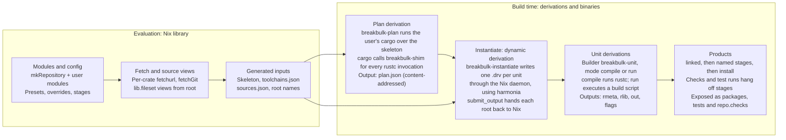

# breakbulk: implementation

Nov 6, 2026 · @Chaz Schlarp

## Scope and starting point

This document describes how to build the system in [breakbulk: design](design.md). It is a new implementation.

[cargo-dyndrv](https://github.com/obsidiansystems/cargo-dyndrv), by Obsidian Systems, is the closest prior art. It showed that per-unit derivations can be written through the Nix daemon and handed back with `submit_output`. Its repository has no license file, so no code is copied from it. This implementation uses [harmonia](https://github.com/nix-community/harmonia)'s crates directly for daemon access and derivation writing.

The project is named **breakbulk**: break-bulk cargo is loaded piece by piece rather than in containers. Its binaries are `breakbulk-shim`, `breakbulk-plan`, `breakbulk-instantiate` and `breakbulk-unit`.

| Idea from cargo-dyndrv | Decision |
| --- | --- |
| Writing `.drv` files over the daemon protocol (ATerm, `Text` content addressing) and returning roots with `submit_output` plus a symlink wrapper | **Adopt** the approach |
| A wrapper that applies `KEY=value` files and then `exec`s the real program | **Adopt** inside `breakbulk-unit` |
| A build-script runner that turns directives into argument files | **Adopt**, with Cargo's scoping, failure on death by signal, and correct `rustc-flags` handling |
| Rebuilding rustc flags from `--unit-graph` | **Avoid**: trace Cargo instead |
| A separate derivation computing `CARGO_CFG_*` | **Unneeded**: the trace records it |
| Overrides keyed by full package ID | **Avoid**: per-package module options |

Out of scope here: the decisions already argued in the design doc (why tracing, why content addressing, which targets). This document covers interfaces, formats, algorithms, tests and the order of work.

## Components



The skeleton and toolchain spec feed planning; the source map feeds instantiation. Stage and check configuration from the modules is applied when products are assembled.

| Component | Kind |
| --- | --- |
| `breakbulk-shim` | Rust binary: rustc wrapper and build-script stub |
| `breakbulk-plan` | Rust binary: drives cargo and writes `plan.json` |
| `breakbulk-instantiate` | Rust binary: writes unit derivations through the daemon with harmonia |
| `breakbulk-unit` | Rust binary: the builder of every unit |
| `lib/` (Nix) | `mkRepository`, modules, presets, fetchers, stage helpers |

All four binaries live in one Cargo workspace. `breakbulk-unit` stays small and nearly dependency-free, because it is an input of every unit and any change to it rebuilds everything. `breakbulk-shim` and `breakbulk-plan` only affect the plan derivation.

## Trace planner

`breakbulk-plan` runs the user's real cargo once per (workspace, target, variant), with a rustc wrapper that records instead of compiling. It combines the records with `cargo metadata`, which is stable, to produce `plan.json`.

### Invocation

```sh
cargo build --frozen --offline --workspace --all-targets \
  --target <triple> --profile <profile> [--features …] \
  --config 'source.crates-io.replace-with="breakbulk"' \
  --config 'source.breakbulk.directory="<vendor dir>"' \
  --config '<spec rustflags, linker, env as config keys>'
# env: RUSTC_WRAPPER=breakbulk-shim  CARGO_TARGET_DIR=<scratch>  BREAKBULK_RECORD=<record dir>
```

- The vendor directory is a tree of symlinks to the per-crate store paths fetched at evaluation time, plus the `.cargo-checksum.json` files Cargo requires.
- The clippy variant adds `RUSTC_WORKSPACE_WRAPPER=clippy-driver`. Cargo then calls `breakbulk-shim clippy-driver rustc …` for workspace members only, so the recorded program differs only where it should.
- Doctests (`rustdoc --test`) are traced later through a `RUSTDOC` shim; they are not in the first milestone.

### `breakbulk-shim` modes

The shim decides its mode from its arguments and how it was started.

| Mode | Detected by | Action |
| --- | --- | --- |
| Query | `-vV`, any `--print`, or `-` as the input file | `exec` the real rustc unchanged |
| Compile | `--crate-name` plus an input file | Record, then fake the outputs |
| Build-script stub | Started as a copied stub binary, with a marker file beside it | Record the env, print nothing, exit 0 |

### Faking a compile

1. Write a record: argv (with the wrapper chain), env, cwd.
2. Ask the real rustc for output names: the same arguments plus `--print=file-names` (it does not compile). Add the `.rmeta` and `.d` names that `--emit` implies.
3. Create each output as an empty file. Write the dep-info file as `<output>: <input file>`, because Cargo parses it after every compile.
4. When the arguments contain `--json=…artifacts…` and `--emit` includes `metadata`, print `{"$message_type":"artifact","artifact":"<rmeta path>","emit":"metadata"}` on stderr. Cargo waits for this before starting pipelined dependents.
5. For a build-script compile (crate name `build_script_build`), copy the shim binary to the output path and write a marker file next to it naming the unit.

When Cargo runs a stub, the stub records argv, cwd and the full env Cargo gave it. That includes `TARGET`, `HOST`, `PROFILE`, `OPT_LEVEL`, `DEBUG`, `CARGO_CFG_*`, `CARGO_FEATURE_*`, `CARGO_ENCODED_RUSTFLAGS`, `CARGO_MANIFEST_LINKS` and `OUT_DIR`. `DEP_*` variables are empty at plan time; the runner supplies them at build time from upstream `flags` outputs.

### Unit identity and graph edges

- **Compile units** are keyed by Cargo's `-C metadata=<hash>` value; **build-script runs** by the `<pkg>-<hash>` component of their `OUT_DIR`. These hashes come from Cargo's stable unit identity: package, features, profile, target and dependencies.
- **Edges** come from the records: a `--extern name=<path>` or `-L dependency=<dir>` path names the producing unit's output; `OUT_DIR` in a compile's env names its build-script run; the stub's path names the run's compile unit.
- **Run-to-run edges** (a build script that needs `DEP_*` metadata) come from `cargo metadata`: the package's direct dependencies that declare `links`.
- **`links` overrides** in config (`[target.<triple>.<links>]`) need no special case. Cargo skips the build script and passes the flags directly, so they appear in the recorded arguments.

### Path rewriting

Every recorded argument and env value is split into literal text and references. Any remaining absolute path that is not in the store is an error that names the unit and the argument.

| Recorded path | Becomes |
| --- | --- |
| `<scratch>/<triple>/<profile>/deps/<file>` | `{"out": <unit>, "output": "rmeta" or "rlib" or "bin", "file": <name>}` |
| `<scratch>/…/build/<pkg>-<hash>/out` | `{"out": <run unit>, "output": "out"}` |
| The stub binary path | `{"out": <compile unit>, "output": "bin"}` |
| `<skeleton>/<rel>` | `{"src": <workspace package>, "rel": <rel>}`, resolved at instantiation |
| `<vendor dir>/<crate>/<rel>` | `{"crateSrc": <package id>, "rel": <rel>}` |
| `/nix/store/…` | Literal; the containing store path becomes an input |

### Env filtering

A unit's env is the recorded env minus the baseline env the planner gave Cargo, plus any keys the toolchain spec or a package override declared. That keeps exactly what Cargo set and what configuration asked for. Then:

- Drop `RUSTC_WRAPPER`, `CARGO_MAKEFLAGS` and the planner's own variables. Keep `RUSTC_WORKSPACE_WRAPPER` only in the clippy variant.
- Replace `NUM_JOBS` with `$NIX_BUILD_CORES`, applied by the runner at build time.
- Never pass `RUSTC_BOOTSTRAP`. If it reached a unit, build scripts that probe for nightly would turn on nightly-only code paths.

## Plan format

`plan.json` is a versioned, deterministic description of one (workspace, target, variant): every unit, with arguments split into literals and references. It contains no store paths for sources, so it changes only when manifests, the lockfile, config or the toolchain change.

```json
{
  "version": 1,
  "cargo": "1.96.1", "rustc": "1.96.1 (…)", "host": "x86_64-unknown-linux-gnu",
  "target": "wasm32-unknown-unknown", "variant": { "profile": "release", "features": [], "mode": "build" },
  "units": {
    "c-8f3a1d2e9b0c4f17": {
      "kind": "compile",
      "package": "registry+https://github.com/rust-lang/crates.io-index#ring@0.17.14",
      "crate": { "name": "ring", "types": ["lib"], "edition": "2021" },
      "platform": "target",
      "program": ["/nix/store/…-rustc/bin/rustc"],
      "args": ["--crate-name", "ring", [{ "crateSrc": "…ring@0.17.14", "rel": "src/lib.rs" }], "…",
               ["--extern", "cfg_if=", { "out": "c-…", "output": "rmeta", "file": "libcfg_if-….rmeta" }]],
      "env": { "CARGO_PKG_NAME": "ring", "OUT_DIR": [{ "out": "r-ring-…", "output": "out" }] },
      "cwd": { "crateSrc": "…ring@0.17.14", "rel": "" },
      "outputs": { "rmeta": ["libring-….rmeta"], "rlib": ["libring-….rlib"] },
      "directivesFrom": ["r-ring-…"]
    },
    "r-ring-…": {
      "kind": "run", "package": "…ring@0.17.14", "links": "ring_core_0_17_14_",
      "script": { "out": "c-…", "output": "bin" },
      "env": { "TARGET": "wasm32-unknown-unknown", "…": "…" },
      "depLinks": []
    }
  },
  "roots": [{ "package": "…", "target": "app", "kind": "bin", "unit": "c-…", "test": false }]
}
```

### Fields

- **Argument segments.** A string is a literal argument. An array is one argument made by concatenating literals and references. A reference object is `src`, `crateSrc` or `out`.
- **`platform`** is `host` or `target`. Instantiation picks the matching toolchain spec, so host and target settings never mix.
- **`directivesFrom`** lists the build-script runs whose `flags` output applies to this unit, with Cargo's scoping already resolved: the package's own run for `rustc-cfg`, `rustc-env` and link directives; transitive runs only for link search paths, which Cargo also propagates.
- **`depLinks`** on a run lists upstream runs whose `DEP_<links>_*` metadata it receives.
- **`roots`** are the plan's products: bins, cdylibs, staticlibs, examples, and test and bench binaries.

### Invariants

1. Keys and arrays are sorted, and the file is canonical JSON. Two traces of the same inputs produce byte-identical plans.
2. Every `out` reference names a unit in the same plan.
3. No literal contains the scratch directory, the skeleton, the vendor directory, `/build` or `$HOME`. Validation fails the plan otherwise.
4. Every literal store path is a declared toolchain input or a store path from the evaluation-time source map.

## Instantiation

`breakbulk-instantiate` turns `plan.json` plus a source map into unit derivations and hands each root back to Nix. It runs inside the outer dynamic derivation and does no compiling, fetching or source serialization.

### Inputs

- `plan.json`: the content-addressed output of the plan derivation.
- `sources.json`: built at evaluation time. It maps each workspace package to its source-view store path and each `crateSrc` package ID to its fetched store path. Its string context makes all of them inputs of the outer derivation, which is cheap because they are already in the store.
- `toolchains.json`: the host and target specs, resolved to store paths, including the `breakbulk-unit` builder.

### Derivation shape per unit

| Field | Value |
| --- | --- |
| `name` | `<crate>-<version>-<kind>`, for example `ring-0.17.14-lib` or `ring-0.17.14-build-run` |
| `builder` / `args` | `breakbulk-unit`, `["unit"]` |
| `env.BREAKBULK_UNIT` | Canonical JSON of the unit with every reference rendered |
| `outputs` | Library: `rmeta`, `rlib`. Bin or test: `out`. Build-script run: `out`, `flags`. All floating CA, NAR SHA-256 |
| `inputs` | `Built{drv, output}` for each referenced unit output; `Opaque` for each toolchain and source store path |
| `system` | The builder platform: the planner's system for compile units; a test-run's own `system` for test runs |

References are rendered with harmonia's placeholders: `Placeholder::ca_output(drv, output)` for upstream outputs, followed by `/<file>` for file references, and `Placeholder::standard_output` for the unit's own outputs. Nix substitutes placeholders in env values, so the unit spec can live in `env`.

### Store writes

- Units are written in topological order: harmonia prints each derivation as ATerm, and `add_ca_to_store` adds it with `Text` content addressing and the input root paths as references.
- Iteration uses `BTreeMap`s keyed by unit ID, so unchanged units produce byte-identical `.drv` files.
- Each root is handed back with `submit_output`, through a symlink wrapper derivation, as an output named `<root>.drv`.

### Root names are fixed at evaluation time

A dynamic derivation's outputs are declared when Nix evaluates it, but the roots are discovered by the planner. The Nix library therefore computes the expected root names at evaluation time: it parses the workspace manifests with `builtins.fromTOML` and mirrors Cargo's target auto-discovery (`src/main.rs`, `src/bin/*`, `examples/*`, `tests/*`, `benches/*`). The roots in the plan are checked against that list, and a mismatch fails with both lists. An explicit `roots` option is the escape hatch. A single "all roots" output was rejected because building any one product would then build every product.

### IFD mode

Without dynamic derivations, a Nix function reads `plan.json` through import-from-derivation and creates the same units with `derivation { … }`, rendering references as interpolated output paths. Both instantiators emit the same `BREAKBULK_UNIT` JSON shape, so `breakbulk-unit` is identical in both modes. A conformance test builds every fixture both ways and requires identical output bytes.

## Unit execution

`breakbulk-unit` is the builder of every unit. It is a small, dependency-light Rust binary with two modes: `compile` and `run`. Test runs belong to products.

### `compile`

1. Read `BREAKBULK_UNIT`. Start from an empty env, then set the recorded env and the package's override env. Replace `NUM_JOBS` with `$NIX_BUILD_CORES`.
2. Build a dependency directory: `$TMPDIR/deps` with symlinks to the `rmeta` or `rlib` outputs of every transitive dependency. Pass one `-L dependency=$TMPDIR/deps`. This replaces Cargo's single shared `deps` directory and keeps argv short.
3. Apply build-script output from each unit in `directivesFrom`, using the scoping rules below.
4. Add `--remap-path-prefix` for every source view, every crate source and every upstream `OUT_DIR`, mapping each to a stable name: `<name>-<version>` for crates, or the package's path from the repository root for workspace members.
5. Point `--out-dir` at `$TMPDIR/out` and run the recorded program.
6. Parse rustc's JSON diagnostics from stderr, print each `rendered` field, and drop artifact notifications. Without this, build logs are unreadable JSON.
7. Move outputs into place: `.rmeta` to `$rmeta`, `.rlib` to `$rlib`, binaries and cdylibs to `$out`. Discard dep-info.

### `run` (build scripts)

1. Set the recorded env, and set `OUT_DIR` to `$out`, which is writable and empty.
2. For each unit in `depLinks`, read its `flags/metadata.json` and set `DEP_<LINKS>_<KEY>`, uppercased with `-` mapped to `_`, as Cargo does.
3. Execute the script from its compile unit's output, with the package source as the working directory. The source is read-only, as it is in any Nix build.
4. Parse stdout using both the `cargo:` and `cargo::` syntaxes. Write `$flags/directives.json`, and `$flags/metadata.json` when the package declares `links`.
5. Fail on a non-zero exit, on death by signal (with the signal named), and on any `error` directive. Print `warning` directives.

### Directive scoping (Cargo's rules)

| Directive | Applies to |
| --- | --- |
| `rustc-cfg`, `rustc-check-cfg`, `rustc-env` | Every target of the package |
| `rustc-link-lib` | The package's library target, or every target if there is no library |
| `rustc-link-search` | The package's targets and every dependent's compile, transitively |
| `rustc-link-arg` | The package's bins, cdylibs, examples, tests and benches |
| `rustc-link-arg-bins`, `-bin=NAME=`, `-tests`, `-examples`, `-benches`, `-cdylib` (and legacy `rustc-cdylib-link-arg`) | Those targets of the package only |
| `rustc-flags` | Split into its `-l` and `-L` parts, then as above; anything else is an error |
| `metadata` (and legacy `cargo:KEY=VALUE` when `links` is set) | `DEP_*` env of direct dependents' build scripts |
| `rerun-if-*` | Ignored: Nix tracks inputs |

`rustc-check-cfg` is passed through, not dropped. With the exact `--check-cfg` set Cargo would pass, the extra checking matches Cargo and does not cause spurious failures.

### Source paths at run time

`CARGO_MANIFEST_DIR` must be the real source-view store path: crates use it in `include_str!(concat!(env!("CARGO_MANIFEST_DIR"), …))` and in build scripts. `--remap-path-prefix` does not rewrite `env!` values, so a binary can still retain a source store path. Every product therefore gets a default check that fails when a runtime closure references a source path.

## Nix library

The library is one `lib.evalModules` call over user modules, plus functions that turn the evaluated config into derivations. A flake-parts module wraps it for flake users.

### Entry point

```nix
repo = breakbulk.lib.mkRepository {
  inherit pkgs;
  root = ./.;
  modules = [ ./nix/rust.nix ];
};
```

### Options

```nix
{
  workspaces.<ws> = {
    path = ".";                       # relative to root; its Cargo.lock is used
    toolchain = breakbulk.toolchains.fromRustupToolchainFile ./rust-toolchain.toml;
    targets = [ "x86_64-unknown-linux-gnu" "wasm32-unknown-unknown" ];
    variants.<v> = { profile = "release"; features = [ ]; mode = "build"; };  # build | check | clippy | coverage
    roots = null;                     # override auto-discovered root names
  };

  targets.<triple> = {
    preset = breakbulk.presets.linuxGnu;  # or msvc { … }, wasmBrowser, wasmComponent, musl, staticGlibc
    linker = null; cc = null; cxx = null; ar = null; cflags = [ ];
    bindgen.extraClangArgs = [ ];
    rustflags = [ ];                  # passed with --config, so it adds to .cargo/config.toml
    env = { };
    runner = null;                    # wine, wasmtime, qemu-user, …
    testSystem = null;                # e.g. "aarch64-linux" to run tests on native builders
    stages = { };                     # default post-link stages for this target
  };

  packages.<name> = {
    version = null;                   # optional version constraint
    env = { }; inputs = [ ]; extraSources = [ ];
    host = { env = { }; inputs = [ ]; };     # only for host units of this package
    target.<triple> = { env = { }; inputs = [ ]; stages = { }; checks = { }; };
    stages = { }; checks = { };
    test = { env = { }; path = [ ]; sourceScope = [ ]; };
  };
}
```

- `env` values may reference any derivation, including another workspace's products: `env.UI_DIST = repo.workspaces.ui.target.wasm32-unknown-unknown.packages.ui;`.
- A curated module of defaults for common `-sys` crates ships with the library. User values merge over it with ordinary module priorities.
- An override whose `version` or name matches nothing in any lockfile is an evaluation warning, not silence.

### Outputs

| Attribute | Contents |
| --- | --- |
| `repo.workspaces.<ws>.target.<triple>.packages.<pkg>` | The product after default stages; `.stages.<name>` for each intermediate; `.debug` where split |
| `repo.workspaces.<ws>.packages.<pkg>` | The same, for the native target |
| `repo.workspaces.<ws>.target.<triple>.tests.<pkg>.<test>` | Test binaries, for VM and system tests |
| `repo.workspaces.<ws>.target.<triple>.testRuns.<pkg>.<test>` | Test-run derivations |
| `repo.checks` | All checks and test runs flattened, ready for `checks.<system>` |
| `repo.sources.<crate>` | Fetched crate sources by name (and `<name>@<version>`) |
| `repo.workspaces.<ws>.devShell` | A shell exporting the same toolchain spec as Cargo config and env, so local builds use the same command lines |
| `repo.workspaces.<ws>.plans.<triple>.<variant>` | `plan.json`, for debugging |

## Fetching and source views

All fetching happens at evaluation time with no IFD. A workspace edit changes only that package's source view, not the plan's inputs.

### Registry crates

- Every `Cargo.lock` in the repository is read with `builtins.fromTOML`. Entries are merged by (name, version, checksum), so a crate locked by several workspaces is fetched once.
- A crates.io entry becomes `fetchurl` of `https://static.crates.io/crates/<name>/<name>-<version>.crate`, using the lockfile's SHA-256 checksum. An unpack derivation then writes the `.cargo-checksum.json` (`{"files":{},"package":"<checksum>"}`) that Cargo's directory sources require.
- Other registries need their download URL template. It comes from a `registries.<name>.dl` option, because reading the registry's `config.json` would need a fetch at evaluation time.

### Git dependencies

- A `git+<url>?…#<rev>` entry becomes `builtins.fetchGit { url; rev; allRefs = true; }`, which is allowed in pure evaluation because the revision is pinned. Submodules are an option per URL.
- The crate inside the repository is found by walking the fetched tree's `Cargo.toml` files at evaluation time and matching the package name.

### Vendor directory for planning

Per workspace, a link farm maps `<name>-<version>` to each fetched crate. A generated config redirects `crates-io` and each git source to it. The planner sees exactly the crates in the lockfile, and the lockfile's checksums are verified.

### Source views

A workspace package's source is `lib.fileset.toSource { root = <repository root>; fileset = …; }`. Because the root is the repository root, relative paths outside the crate resolve unchanged.

- **Default fileset:** the package directory, minus `target/`, `.git`, `result*`, and any nested directories that belong to other workspace members.
- **Plus:** the package's `extraSources`, at their original relative paths.
- **Test units** additionally get `test.sourceScope`.

### The planning skeleton

The plan derivation's source is a skeleton, so it is rebuilt only when the manifests, the lockfile, config or the toolchain change:

- every `Cargo.toml`, `Cargo.lock`, `.cargo/config.toml` and `rust-toolchain.toml`;
- an empty file at every path Cargo's auto-discovery or an explicit `path =` expects (`src/lib.rs`, `src/main.rs`, `src/bin/*.rs`, `examples/*`, `tests/*`, `benches/*`, `build.rs`).

Cargo configuration from the user's home directory is not visible in the sandbox. The dev shell therefore exports the spec as project-level config and env, so local builds and Nix builds see the same configuration.

## Toolchain presets

A preset is a function from `{ pkgs, triple, …options }` to a `targets.<triple>` module, so users override any field with ordinary module priorities. Every preset also sets the host spec from `pkgs.buildPackages`, so host units always get the build machine's tools.

| Preset | Linker | C toolchain | Rustflags and env | Runner | Default stages |
| --- | --- | --- | --- | --- | --- |
| `linuxGnu` | mold via wrapped bintools (`-fuse-ld=mold`); lld when cross-language LTO is on | `pkgsCross.<x>.stdenv.cc` | `CC_<triple>`, `AR_<triple>` | native; `qemu-user` when cross without a builder | `splitDebug` |
| `linuxMusl` | as `linuxGnu` | `pkgsCross.<x>-musl.stdenv.cc` | `+crt-static` | as `linuxGnu` | `splitDebug` |
| `staticGlibc` | mold | host `cc` | `+crt-static`, `-C relocation-model=static`, `-L native=` for `glibc.static` and the declared static archives, all on target units only | native | `splitDebug` |
| `msvc { arch; sdk }` | `lld-link` | `clang-cl`, `llvm-lib` from `rustc.llvmPackages` | `-Lnative=` for CRT, `um` and `ucrt` libs; `CFLAGS_<triple>` with `-imsvc`; `BINDGEN_EXTRA_CLANG_ARGS_<triple>` with `-isystem`; `RC`, `RCFLAGS`, `LIB`; optional `+crt-static` | `wine` with a `WINEPREFIX` in `$TMPDIR` | none |
| `wasmBrowser` | lld from rustc's target spec, version-matched | unwrapped clang targeting wasm32 | none by default | `wasm-bindgen-test-runner` + headless Chromium, or Node | `bindgen` → `wasmOpt` |
| `wasmComponent` | as `wasmBrowser` | clang + `wasilibc` when C is present | `-C link-self-contained=no` + `-L` to `wasilibc` when C is present | `wasmtime` | `wasmOpt` (optional) → `componentize` |

### msvc

```nix
targets.x86_64-pc-windows-msvc.preset = breakbulk.presets.msvc {
  arch = "x86_64";
  sdk = breakbulk.xwinSdk {            # fixed-output; meta.license = unfree
    manifestVersion = 17; crt = "14.44.17.14"; sdk = "10.0.26100";
    hash = "sha256-…";
  };
  crtStatic = true;
  extraSdks = [ ];                  # e.g. a driver kit, with its own include and lib dirs
};
```

The include directories are passed twice in different syntax: `-imsvc` for `clang-cl` and `-isystem` for bindgen's libclang. `aarch64` uses the same preset with `arch = "aarch64"`.

### wasm

- **wasm-bindgen version.** The `bindgen` stage reads the `wasm-bindgen` version from the workspace's `Cargo.lock`. It picks the matching `wasm-bindgen-cli_<version>` from nixpkgs, or builds that version from crates.io with a hash from a table shipped with the library. If neither exists, evaluation fails naming the version.
- **Unwrapped clang.** C code uses clang from `rustc.llvmPackages`, never the stdenv compiler wrapper. A wrapped gcc can silently produce host objects for a wasm target.

### Zig (later)

For an old glibc version: `zig cc -target <arch>-linux-gnu.<glibc>` wrappers as linker and C compiler. A separate derivation pre-warms zig's global cache for the target, and `breakbulk-unit` copies it into `$TMPDIR` before each unit.

## Products, stages and tests

Every product starts at a fixed stage named `linked` and passes through an ordered set of named stages. Each stage is one content-addressed derivation. Checks hang off stages without joining the chain.

### The `linked` stage

`linked` is a small CA derivation that symlinks `builtins.outputOf <instantiate drv>."<root>.drv" "out"`. That gives later stages an ordinary derivation to depend on. cargo-dyndrv collects its outputs the same way.

### Stage ordering

```nix
stages.<name> = {
  after = "linked";   # or another stage; default: the previous stage in the preset's chain
  before = null;
  run = { input, product, target, pkgs }: <derivation>;   # input = previous stage's output
};
```

- The effective stage set is the preset's defaults merged with the target's and the package's stage modules. `lib.mkForce null` removes a stage.
- Order comes from `lib.toposort` over the `after` and `before` constraints. A cycle, or a reference to a missing stage, fails evaluation and lists every stage with its constraints.
- The last stage in the order is the product. The `install` stage normalizes the layout (`bin/`, `lib/`, `.exe` with DLLs, `pkg/`) and runs last unless removed.

### Checks

```nix
checks.<name> = { on = "linked"; run = { input, product, pkgs }: <derivation>; };
```

Each check becomes `repo.checks."<ws>/<triple>/<pkg>/<name>"`. Every product gets `noSourceReferences` by default, which fails if the runtime closure contains a source-view or crate-source store path.

### Stage helpers

| Helper | Does |
| --- | --- |
| `splitDebug` | Reads the GNU build ID, writes `$debug/lib/debug/.build-id/<xx>/<rest>.debug` with `objcopy --only-keep-debug`, then strips debug info and adds a debuglink |
| `strip` | `strip --strip-debug` (or `--strip-all` when asked) |
| `patchelfRpath { libs }` | Adds rpaths for libraries loaded at runtime, after any rpath shrinking |
| `bindgen { target ? "web" }` | Lockfile-matched `wasm-bindgen` |
| `wasmOpt { flags ? [ "-Oz" ] }` | `wasm-opt` on a core module |
| `componentize { adapter ? null; metadata ? { } }` | `wasm-tools component new`, then `wasm-tools metadata add` |
| `deterministicZip` | Sorted entries, fixed timestamps, no extra attributes |
| `install` | Final layout |

### Tests

- **Test binaries** are roots with `test = true`. `tests.<pkg>.<name>` is the binary's `linked` stage. Test binaries are never stripped.
- **`CARGO_BIN_EXE_<name>`** is compile-time env recorded by the planner, and is rewritten to the bin root's `linked` output. The test's compile unit therefore depends on that link.
- **`CARGO_TARGET_TMPDIR`** is also compile-time env, but must be writable when the test runs. It is rewritten to a fixed path under the build directory, and the test-run derivation creates that path before running (see spikes).
- **Test runs** are one derivation per test binary. The derivation runs the binary through the target's `runner`, with the package source view as the working directory (as Cargo does), plus Cargo's runtime env (`CARGO_MANIFEST_DIR`, `CARGO_PKG_*`), the package's `test.env`, and `test.path` on `PATH`. Its `system` is the target's `testSystem` when set. It succeeds on exit 0, and its output records the log.
- **nextest.** The first milestone runs libtest binaries directly. nextest support comes later, by synthesizing the `binaries-metadata` file that nextest's reuse-build mode reads, so per-test retries, timeouts and test groups from the nextest config apply.
- **Doctests** come later, through a `RUSTDOC` shim during planning.

## Testing and conformance

Four layers of tests, from fastest to slowest. Trace golden tests guard against Cargo changes; invalidation tests guard the main promise, that an edit rebuilds only what it should.

1. **Rust unit tests** for the directive parser (both syntaxes, every directive, malformed input), path rewriting, env filtering, plan canonicalization and unit ordering.
2. **Trace golden tests.** For each fixture, run real `cargo build -v` and the traced planner on the same skeleton, render the plan back to concrete argv with the same scratch layout, and diff per unit after normalizing paths. This runs against the last three stable Cargo releases plus the oldest supported one. It is the guard against Cargo's internals changing.
3. **Fixture builds.** Each fixture builds and tests on its targets, in dynamic-derivation mode and in IFD mode, and the two modes must produce identical output bytes.
4. **Invalidation tests.** Instantiate a fixture, apply a scripted edit, instantiate again, and compare the sets of unit `.drv` paths. Each test states which units may change. For example: changing a build stamp on the top package changes only that package's units.

### Fixtures

One small workspace per pattern from the design doc, under `tests/fixtures/`.

| Fixture | Pattern | Targets | Asserts |
| --- | --- | --- | --- |
| `directives` | Every build-script directive, `links` chains, `DEP_*` | linux-gnu | Scoping matches Cargo; signal death fails |
| `build-dep-leak` | A build dependency emitting `rustc-link-lib` | linux-gnu → aarch64 | Target link args contain no host libs |
| `sys-native` | pkg-config and bindgen `-sys` crates with overrides | linux-gnu, aarch64 | Builds; override env reaches only that package |
| `crate-types` | `["cdylib", "rlib"]`, `staticlib`, proc macro | linux-gnu, wasm | All outputs present |
| `outside-reads` | `include_str!` of `../`, a proc macro reading a sibling directory | linux-gnu | Builds; editing an unrelated sibling changes nothing |
| `multi-ws` | Three workspaces sharing a path crate and registry crates | linux-gnu | Registry units shared; path-crate sharing measured |
| `embed` | A host crate embedding a wasm product via env | linux-gnu + wasm | Identical wasm bytes do not rebuild the host |
| `stamps` | Git revision and `SOURCE_DATE_EPOCH` per package | linux-gnu | Only the stamped package's units change |
| `msvc` | C code, a resource via `rustc-link-arg-bins`, bindgen | x86\_64 msvc, aarch64 msvc | Builds; tests pass under wine |
| `wasm-browser` | wasm-bindgen, `ring`, getrandom backend cfg from config | wasm | Bindgen version matched; browser tests pass |
| `wasm-component` | C via `wasilibc`, componentize, metadata stamp | wasm | Component has no imports |
| `static` | musl and static-glibc products | musl x2, host | No `INTERP` or `NEEDED`; build scripts dynamic |
| `variants` | Feature powerset, clippy, coverage | linux-gnu | Dependency units shared across variants |
| `post-link` | Custom stages, `mkForce null` on `strip`, a check on `linked` | linux-gnu, msvc | Stage order; check sees unstripped bytes |

### Determinism and dogfooding

- CI runs `nix build --rebuild` on every fixture product and on a sample of units, and fails on any difference.
- The tool builds itself from the second milestone on.

### CI environment

- Nix 2.36 or later (a git build until it is released), with `dynamic-derivations` and `ca-derivations` enabled and a builder advertising `builder-rpc-v0`.
- An aarch64 builder for native test runs. Without one, qemu-user through binfmt.
- wine and headless Chromium for runners.
- `allowUnfree` scoped to the xwin SDK, for the msvc fixtures.

## Milestones

Each milestone ends with fixtures passing in CI, so progress is measured by patterns supported rather than by components written.

1. **M0: Spikes.** Prove the risky assumptions before building on them (next section): fake outputs across Cargo versions, root names at evaluation time, `CARGO_TARGET_TMPDIR`, sharing path crates across workspaces.
   - **Exit:** each spike has a written result and a go or no-go decision.
2. **M1: Traced planner on native Linux.** `breakbulk-shim`, `breakbulk-plan`, the plan format, `breakbulk-instantiate` built on harmonia's daemon client, and `breakbulk-unit` with correct directive scoping. Remapping and Cargo's own `-C metadata`.
   - **Exit:** `directives`, `build-dep-leak`, `crate-types` and `sys-native` (native only) pass. Trace golden tests pass on three stable Cargo releases. `nix build --rebuild` is clean.
3. **M2: Nix library.** Module options, evaluation-time fetching, the vendor directory, source views, the skeleton, per-package overrides, the repository with many workspaces, the dev shell.
   - **Exit:** `outside-reads`, `multi-ws` and `stamps` pass, including their invalidation tests. The tool builds itself.
4. **M3: Day-one targets.** The `linuxGnu`, `linuxMusl`, `staticGlibc`, `msvc`, `wasmBrowser` and `wasmComponent` presets; mold and lld selection; runners; `testSystem`.
   - **Exit:** `msvc`, `wasm-browser`, `wasm-component`, `static` and cross `sys-native` pass, with tests running under their runners.
5. **M4: Products and variants.** Stage pipelines, checks, helpers, `splitDebug`, test-run derivations, products as inputs, clippy, coverage and feature variants.
   - **Exit:** `post-link`, `embed` and `variants` pass. One real multi-workspace repository builds end to end, with its CI using `repo.checks`.
6. **M5: Below-crate seams and measurement.** Separate `rmeta`/`rlib` outputs, the history-replay harness reporting rmeta stability per edit, optional dep-info source narrowing, nextest integration.
   - **Exit:** a published measurement on stable and on nightly with relink-don't-rebuild flags.
7. **M6: IFD delivery.** The Nix-side instantiator.
   - **Exit:** every fixture passes in both modes with identical bytes.
8. **M7: Later targets.** wasip2, riscv64, windows-gnu, build-std targets, Darwin on Mac builders, zig.

## Spikes and open questions

The first four spikes gate M1 and M2. The rest are measurements to take as soon as the code can produce them.

| Spike | Question | Method | Feeds |
| --- | --- | --- | --- |
| Fake outputs | Does Cargo accept empty outputs, synthetic dep-info and artifact notifications across releases, including pipelining and `links` overrides? | Shim prototype on three fixtures, three Cargo releases | M1 go or no-go |
| Root names | How often does mirroring Cargo's auto-discovery at evaluation time disagree with the plan? | Run over a corpus of real workspaces; count mismatches | Whether `roots` is an escape hatch or required |
| Compile-time paths | Which compile-time env values must be valid at run time (`CARGO_TARGET_TMPDIR`, others), and is a fixed build-directory path portable across sandbox configurations? | Grep the plan of each fixture for paths; run tests with a non-default build directory | Test-run design |
| Path-crate sharing | Does Cargo's `-C metadata` for a path crate depend on where the workspace sits relative to it? | Trace the same path crate from two workspaces; compare hashes | Whether shared path crates deduplicate across workspaces, or need a normalized identity |
| Realisation latency | How long does a cache hit take with hundreds of units, and which cache servers serve signed realisations? | Populate a cache; time cold substitution of a 400-unit graph | Whether to batch or prefetch realisations |
| Per-unit overhead | What does sandbox setup cost per unit, compared with compiling tiny crates? | Build a 1,000-unit graph; profile | Whether small units need special handling |
| Graph size | How large do instantiated derivations get with transitive inputs, and how fast are daemon writes? | Instantiate a 1,000-unit graph; time `add_ca_to_store` per unit | Pipelining store writes |
| Remote builders | Do remote builders and CI services support `builder-rpc-v0` and the experimental features? | Run M1 fixtures on each target builder | Where dynamic-derivation mode is the default |
| nextest reuse | Can a synthesized `binaries-metadata` file drive nextest over binaries that live in separate store paths? | Prototype with one fixture | M5 nextest integration |
| Zig cache | Does zig accept a pre-warmed global cache that is read-only or only partly populated? | Try both on one target | The zig preset |
