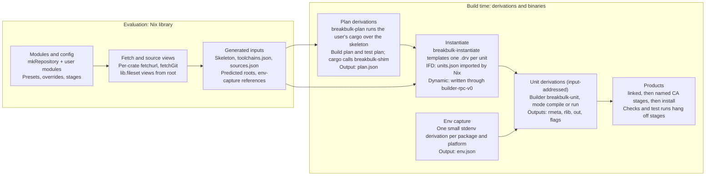

# breakbulk: implementation

Nov 6, 2026 · @Chaz Schlarp

## Scope and starting point

This document describes how to build the system in [breakbulk: design](design.md). It is a new implementation.

[cargo-dyndrv](https://github.com/obsidiansystems/cargo-dyndrv), by Obsidian Systems, is the closest prior art. It showed that per-unit derivations can be written from inside a build and handed back to Nix. Its repository has no license file, so no code is copied from it.

The project is named **breakbulk**: break-bulk cargo is loaded piece by piece rather than in containers. Its binaries are `breakbulk-shim`, `breakbulk-plan`, `breakbulk-instantiate` and `breakbulk-unit`.

| Idea from cargo-dyndrv | Decision |
| --- | --- |
| Writing `.drv` files from inside a build and handing roots back to Nix | **Adopt**, through Nix's `builder-rpc-v0` interface, in dynamic-derivation mode only |
| A wrapper that applies `KEY=value` files and then `exec`s the real program | **Adopt** inside `breakbulk-unit` |
| A build-script runner that turns directives into argument files | **Adopt**, with placement observed from Cargo, failure on death by signal, and correct `rustc-flags` handling |
| Rebuilding rustc flags from `--unit-graph` | **Avoid**: trace Cargo instead |
| A separate derivation computing `CARGO_CFG_*` | **Unneeded**: the trace records it |
| Overrides keyed by full package ID | **Avoid**: per-package module options |
| Content-addressed units | **Avoid** by default: input-addressed units, CA only at the edges (see the design doc) |

Out of scope here: the decisions already argued in the design doc. This document covers interfaces, formats, algorithms, tests and the order of work.

## Components



The skeleton and toolchain spec feed planning; the source map, toolchains and env captures feed instantiation by reference. Stage and check configuration from the modules is applied when products are assembled.

| Component | Kind |
| --- | --- |
| `breakbulk-shim` | Rust binary: rustc wrapper and build-script stub |
| `breakbulk-plan` | Rust binary: drives cargo and writes `plan.json` |
| `breakbulk-instantiate` | Rust binary: templates unit derivations as JSON for IFD; also the library that `breakbulk-drv` uses |
| `breakbulk-drv` | Rust binary: the dynamic-derivation-mode outer builder; writes the same derivations into the store through `builder-rpc-v0` with harmonia |
| `breakbulk-unit` | Rust binary: the builder of every unit |
| `lib/` (Nix) | `mkRepository`, modules, presets, fetchers, env capture, stage helpers |

The first four binaries live in one Cargo workspace. `breakbulk-drv` has its own workspace and lockfile (`breakbulk-drv/`), so that its dependencies (harmonia, tokio) never change the other binaries' inputs. `breakbulk-unit` stays small and nearly dependency-free, because it is an input of every unit and any change to it rebuilds everything. `breakbulk-shim` and `breakbulk-plan` only affect the plan derivations.

## Trace planner

`breakbulk-plan` runs the user's real cargo once per (workspace, target, variant, plan kind), with a rustc wrapper that records instead of compiling. It combines the records with `cargo metadata`, which is stable, to produce `plan.json`.

Spike A tested this design on Cargo 1.95, 1.97, 1.99 and nightly 1.101. The result, with source citations and the experiments, is in [spikes/A-trace-fidelity.md](spikes/A-trace-fidelity.md).

### Invocation

```sh
# build plan
cargo build --frozen --offline <selection> \
  --target <triple> --profile <profile> [--features …] \
  --config <generated source-replacement file, one directory per source> \
  --config '<spec rustflags and linkers, see below>'
# test plan: the same, with `cargo test --no-run`, then `cargo test --doc` for doctests
# bench variant: `cargo bench --no-run` with the bench profile
# env: RUSTC_WRAPPER=breakbulk-shim  RUSTDOC=<dir>/rustdoc (a symlink to breakbulk-shim)
#      BREAKBULK_RUSTDOC=<real rustdoc>  CARGO_TARGET_DIR=<scratch>  BREAKBULK_RECORD=<record dir>
```

- `<selection>` is `--workspace`, or `-p` for each package in the target's `packages` list.
- The vendor configuration is described under [Vendoring for planning](#vendoring-for-planning).
- Before tracing, the planner writes the `cargo metadata` JSON to `$BREAKBULK_RECORD/metadata.json`. Stubs read it to learn their package's targets.
- **Spec rustflags.** Cargo takes rustflags from exactly one source: the first of `CARGO_ENCODED_RUSTFLAGS`, `RUSTFLAGS`, `target.<triple>` together with `target.<cfg>`, and `build.rustflags`. Arrays concatenate only within one key. The planner therefore reads the project's `.cargo/config.toml` files (a documented format). If the project sets `build.rustflags` and no per-target rustflags, spec rustflags go under `build.rustflags`; otherwise under `target.<triple>.rustflags`. Which `target.'cfg(…)'` keys apply depends on rustflags, because Cargo asks `rustc --print=cfg` with the flags it has and then recomputes them (up to two rounds); the planner repeats those queries with the spec's flags in place, so a spec flag such as `--cfg x` or `-C target-feature=+avx2` that turns on a cfg key moves the spec's flags under the target key. The planner then checks in the trace that every target unit carries both the project's and the spec's flags.
- **Linkers** go under `target.<triple>.linker`. Cargo passes `-C linker` to every unit, including rlibs that never link, so a linker change changes every unit's derivation. The planner keeps Cargo's argv as it is.
- Spec env is **not** passed to Cargo. Cargo's `[env]` reaches every process, including host build scripts; spec env is added per unit by platform at instantiation.
- The user's own `.cargo/config.toml` is in the skeleton and applies as it does locally. Nothing from the user's home directory or shell is visible. Cargo reads `.cargo/config.toml` from every ancestor of its working directory, whatever `CARGO_HOME` says. In the Nix sandbox no ancestor has one; local planner runs and tests must stage the project outside `$HOME` (see [Testing and conformance](#testing-and-conformance)).
- The planner never sets `CARGO_INCREMENTAL` and never passes it through from its own environment, because the incremental setting is part of every unit's `-C metadata`. The `-C incremental=…` argument is stripped from argv instead (see [Env filtering](#env-filtering)).
- The planner runs Cargo without `-v`. Verbosity changes argv: with `-vv`, non-local crates get `--cap-lints warn` instead of `--cap-lints allow`.
- No runner is configured while tracing. With a runner, Cargo adds `--test-runtool` to `rustdoc --test`.
- The clippy variant adds `RUSTC_WORKSPACE_WRAPPER=clippy-driver`. Cargo then calls `breakbulk-shim clippy-driver rustc …` for workspace members only. This chain is parsed but not yet tested.
- Doctests: `cargo test --no-run` skips them, because rustdoc compiles doctests at run time. After the faked build, the test plan runs `cargo test --doc`; the shim, acting as `RUSTDOC`, records one `rustdoc --test` command per library (proc macros included) and exits successfully. Cargo runs nothing else in that mode.
- Documentation (later): `cargo doc` is traced the same way, with the shim recording each `rustdoc` command.

### Which targets each command builds

Observed on every supported Cargo release:

| Command | Builds |
| --- | --- |
| `cargo build` | Libraries and bins. Never examples. |
| `cargo test --no-run` | Libraries, lib and bin test harnesses, integration tests, and examples (as plain bins). Bins only when the package has integration tests. **No benches.** |
| `cargo bench --no-run` | Lib and bin harnesses in bench mode, and benches. No examples or integration tests. |

Benches therefore come only from the bench variant.

### trim-paths

Cargo's `trim-paths` profile setting is stable from Cargo 1.101. On earlier releases any `trim-paths` setting is a hard error, so it is always off there. Its default is `none` for every profile, `release` included.

- **Detection.** A unit is under Cargo's trim-paths when its argv has `--remap-path-scope=…` followed by `--remap-path-prefix` pairs ending in `…=/cargo/build-dir` and `…=/rustc/<commit>`. User rustflags never produce the `/cargo/build-dir` pair. The plan header's `trimPaths` records the result.
- **Default.** A profile setting from `--config` overrides the manifest's, so passing it blindly would replace the project's own choice. The planner traces once. Only when the trace shows trim-paths off and Cargo is 1.101 or later does it trace again with `--config profile.<profile>.trim-paths=…`. Reading the profiles from the manifests instead would mean encoding Cargo's profile merging.
- With trim-paths on, path crates outside the workspace root hash without their absolute path, and build-script runs get `CARGO_TRIM_PATHS_SCOPE`.

### Fixed skeleton location

Cargo hashes the absolute path of a path crate that lies outside the workspace root into its `-C metadata`. The planner therefore places the skeleton at one canonical absolute path inside the sandbox and records it in the plan header. When a workspace has path dependencies outside its root, `trim-paths` is not in effect, and the canonical path is not available (non-default `sandbox-build-dir`, an unsandboxed build, macOS), planning fails with a message naming the crates affected. Otherwise the location does not matter and no check is made.

### `breakbulk-shim` modes

The shim decides its mode from how it was started and from its arguments, checked in this order:

| Mode | Detected by | Action |
| --- | --- | --- |
| Build-script stub | `breakbulk-stub.json` in the directory of the running executable | Record argv, cwd and the full env; print sentinel directives; exit 0 |
| Rustdoc | The executable's file name contains `rustdoc`. The planner sets `RUSTDOC` to a `rustdoc` symlink to the shim, because Cargo starts `RUSTDOC` with the same env it gives `RUSTC_WRAPPER`. | For queries, `exec` `$BREAKBULK_RUSTDOC`; otherwise record and exit 0 without output |
| Query | `-vV`, `-V`, `--version`, any `--print`, or `-` as the input; or no `--crate-name` or no input file | Record, then `exec` the real rustc unchanged |
| Compile | `--crate-name` plus an input file | Record, then fake the outputs |

As `RUSTC_WRAPPER` the shim is started as `breakbulk-shim [workspace-wrapper] rustc ARGS`. The program chain is every leading argument that is not an option; Cargo always starts rustc's arguments with an option.

The record of the `rustc -vV` query carries Cargo's own process environment. It is the baseline for [Env filtering](#env-filtering).

### Faking a compile

1. Write a record: argv (with the wrapper chain), env, cwd.
2. Ask the real rustc for output names: the same arguments plus `--print=file-names` (it does not compile, and it does not resolve `--extern` paths). Add the `.rmeta` and `.d` names that `--emit` implies. The query names every link output for every crate type, `--emit` set and `--test`, but not debuginfo side files (`.dwp`, `.dwo`; by the same logic `.pdb` and `.dSYM`, not tested). Cargo tolerates their absence during the trace.
3. Create each output as an empty file. Write the dep-info file as `<output>: <input file>`, because Cargo parses it after every compile.
4. When the arguments contain `--json=…artifacts…` and `--emit` includes `metadata`, print one `{"$message_type":"artifact","artifact":"<path>","emit":"<kind>"}` line per output on stderr, as rustc does. Cargo waits for the metadata notification before starting pipelined dependents.
5. For a build-script compile (crate name `build_script_build`), copy the shim binary to the output path and write `breakbulk-stub.json` next to it, naming the record directory, the `cargo metadata` file and the compile unit.

When Cargo runs a stub, the stub records argv, cwd and the full env Cargo gave it, including `TARGET`, `HOST`, `PROFILE`, `OPT_LEVEL`, `DEBUG`, `CARGO_CFG_*`, `CARGO_FEATURE_*`, `CARGO_ENCODED_RUSTFLAGS`, `CARGO_MANIFEST_LINKS`, `OUT_DIR` and any `DEP_*` sentinels from upstream stubs. It finds its package in the `cargo metadata` JSON (`$BREAKBULK_METADATA`, default `$BREAKBULK_RECORD/metadata.json`) by `CARGO_MANIFEST_DIR`, to learn the package's targets.

### Sentinel directives

Each stub prints one tagged directive of every kind that applies to its package. The tag `R` is the run's hash from its `OUT_DIR`: `build/<pkg>-<hash>/out`, or `build/<pkg>/<hash>/out` in the new build-directory layout. This table is the authoritative list of sentinels, their shapes and where Cargo places them. Placement is identical on every Cargo release tested (1.95 to 1.101); the evidence and source citations are in [spike A's wrapping table](spikes/A-trace-fidelity.md#wrapping-table).

"R's package" is the package whose build script is run R. A run's values reach only units of the run's own platform (host or target), except the dynamic-library paths in the last rows.

| Kind | Sentinel printed | Printed when | Shape in traced argv or env | Reaches |
| --- | --- | --- | --- | --- |
| `rustc-cfg` | `__bb_R_cfg` | Always | `--cfg __bb_R_cfg` | Every compile of R's package (lib, bins, examples, tests, benches, all test harnesses) and its `rustdoc --test`. Not its own build script. |
| `rustc-check-cfg` | `cfg(__bb_R_ccfg)` | Always | `--check-cfg cfg(__bb_R_ccfg)` | Same as `rustc-cfg`. |
| `rustc-env` | `__BB_R_ENV=__bb_R_env` (`R` uppercased in the name) | Always | Env var `__BB_R_ENV` on the process | Same as `rustc-cfg`. |
| `rustc-link-search`, inside `OUT_DIR` | `native=<OUT_DIR>/__bb_R_search` | Always | `-L native=<OUT_DIR>/__bb_R_search` | Every compile of R's package and of every package that depends on it on the same platform, any crate type. For a host run (build dependency, proc macro): the compiles of its dependents' build scripts. |
| `rustc-link-search`, outside `OUT_DIR` | `native=/__bb_R_search_ext` | Always | `-L native=/__bb_R_search_ext` | Same as above. |
| `rustc-link-lib` | `__bb_R_lib` | Always | `-l __bb_R_lib` | R's package only: its lib (every lib crate type, proc macro included) and lib test harness; its bins, tests, examples and benches only when the package has no lib. Never `rustdoc --test`. |
| `rustc-link-arg` | `__bb_R_arg` | Always | `-C link-arg=__bb_R_arg` | Every compile of R's package, including rlib-only libs, the lib test harness, proc macros, and its `rustdoc --test`. |
| `rustc-link-arg-bins` | `__bb_R_arg_bins` | The package has a bin | `-C link-arg=__bb_R_arg_bins` | R's bins and their test harnesses. |
| `rustc-link-arg-bin` | `NAME=__bb_R_arg_bin_NAME` | For each bin | `-C link-arg=__bb_R_arg_bin_NAME` | That bin and its test harness. |
| `rustc-link-arg-tests` | `__bb_R_arg_tests` | The package has an integration test | `-C link-arg=__bb_R_arg_tests` | Integration tests only, not lib or bin harnesses. |
| `rustc-link-arg-examples` | `__bb_R_arg_examples` | The package has an example | `-C link-arg=__bb_R_arg_examples` | Examples. |
| `rustc-link-arg-benches` | `__bb_R_arg_benches` | The package has a bench | `-C link-arg=__bb_R_arg_benches` | Benches (bench variant only). |
| `rustc-link-arg-cdylib` | `__bb_R_arg_cdylib` | Always | `-C link-arg=__bb_R_arg_cdylib` | R's lib when built as a cdylib, not in test mode; also the cdylibs of packages that depend on R's package, a compatibility exception Cargo keeps (rust-lang/cargo#9562; `add_native_deps` in `src/compiler/mod.rs`), which the directive differential test exercises. Printed even when R's package has no cdylib, for those dependents. |
| `metadata` | `__bb=R` | The package declares `links` | Env var `DEP_<LINKS>___BB=R` on runs | Build-script runs of packages that **directly** depend on R's package as a normal dependency. Not transitive, and not through build dependencies. |
| Dynamic-library path of a compile | (the inside search sentinel) | — | `LD_LIBRARY_PATH` entry `<OUT_DIR>/__bb_R_search` on the rustc process | Compiles whose package has R's package as a host plugin dependency (a proc macro, or a build dependency with a build script). |
| Dynamic-library path of a run | (same) | — | `LD_LIBRARY_PATH` entry on the run | Runs whose build script depends on R's package. |
| Dynamic-library path of a test process | (same) | — | `LD_LIBRARY_PATH` entries | **Every** run of the test's platform, not only dependencies. |
| Dynamic-library path of `rustdoc --test` | (same) | — | `LD_LIBRARY_PATH` entries | Every host run. |
| Search paths of `rustdoc --test` | both search sentinels | — | `-L native=…` | **Every** run in the invocation, both platforms, both sentinels, **sorted by value** and deduplicated. Not positional. |

Cargo rejects `rustc-link-arg-bins`, `-bin=NAME`, `-tests`, `-examples` and `-benches` when the package has no such target, so the stub prints them only when the target exists. `rustc-link-arg` is printed always, because Cargo passes it to every compile of the package; so is `rustc-link-arg-cdylib`, which Cargo accepts without a cdylib target (with a warning) and passes to dependents' cdylibs. The outside search sentinel is a root-level path that no real build uses, so the forbidden-literal check catches a missed splice. Stubs use the `cargo:` single-colon syntax when the package's `rust-version` predates the `cargo::` syntax (1.77). Shapes are the same in both syntaxes.

The planner then:

1. Finds every sentinel token in recorded argv and env.
2. Checks that each appears in the exact shape the table expects (for example `-l`, `__bb_R_lib`). Any other shape fails the plan, naming the Cargo version, the kind and the arguments seen.
3. Replaces sentinels with splice points in the plan:
   - `rustc-cfg`, `rustc-check-cfg`, `rustc-link-lib` and `rustc-env`: one splice per sentinel, "run R's values of kind K go here".
   - `rustc-link-search`: one splice per sentinel, "run R's search paths inside R's `out` go here" for the inside sentinel and "R's other search paths go here" for the outside one. A literal `-L` from a `links` override stays where Cargo put it, between them.
   - Link arguments: in a unit's argv, all of run R's link-arg sentinels are adjacent. The planner replaces the whole group with one splice that records the set of link-arg kinds present. That set is exactly the set of kinds that apply to the unit.
   - In `rustdoc --test`, the planner replaces the whole set of sentinel `-L native=` arguments with one splice that lists every run in the invocation.
4. Turns `DEP_<LINKS>___BB=R` in a dependent stub's env into a metadata edge from run R.
5. Turns sentinel search paths found in dynamic-library path variables of compiles, runs, tests and `rustdoc --test` into dynamic-path splice points.
6. Fails the plan if any sentinel token is left unconverted.

The expected shapes are pinned by golden tests per Cargo release.

### Unit identity and graph edges

- **Compile units** are keyed by Cargo's `-C metadata=<hash>` value; **build-script runs** by the `<pkg>-<hash>` (or `<pkg>/<hash>`) component of their `OUT_DIR`. These hashes come from Cargo's stable unit identity. The sentinels leave every `-C metadata` and every run hash unchanged (observed on every supported release).
- **Keys are per plan.** `-C metadata` does not contain rustflags; Cargo hashes rustflags only into `-C extra-filename`. Two variants that differ only in rustflags (coverage, a `--cfg`) therefore share `-C metadata`, and units without `-C extra-filename` (cdylibs, and in the new layout bins and dylibs) also share output names. Unit keys identify a unit only within one plan. Sharing across plans is decided by derivation paths, and `explainSharing` compares argv and env, not hashes.
- **Edges** come from the records: a `--extern name=<path>` or `-L dependency=<dir>` path names the producing unit's output; `OUT_DIR` in a compile's env names its build-script run; the stub's path names the run's compile unit; sentinels give directive placement and metadata edges. In the new layout each compile gets one `-L dependency=<dep's out>` per dependency instead of one shared `deps` directory.
- **Platform** is read from the output location: Cargo always receives `--target`, so host units write under `<scratch>/<profile>/` and target units under `<scratch>/<triple>/<profile>/`, in both layouts.
- **`links` overrides** in config (`[target.<triple>.<links>]`) need no special case. Cargo skips the build script and passes the flags directly, so they appear in the recorded arguments.

### Path rewriting

Every recorded argument and env value is split into literal text and references. Any remaining absolute path that is not in the store is an error that names the unit and the argument.

Cargo has two build-directory layouts. Releases up to 1.99 use the classic one. Current nightly Cargo (1.101) uses a new layout by default (opt-out `__CARGO_TEMPORARY_BUILD_DIR_NEW_LAYOUT_OPT_OUT=1`), and it will reach stable unless reverted. In the new layout every unit gets `build/<pkg>/<hash>/{out,fingerprint,run}`, compile outputs go to that unit's `out`, there is no `deps/`, build scripts are `…/out/build_script_build` with no hash and no `build-script-build` copy, and bins, dylibs, cdylibs and build scripts have no `-C extra-filename`. The planner supports both. In the new layout an output path names its unit's directory directly.

| Recorded path | Becomes |
| --- | --- |
| Classic: `<scratch>/[<triple>/]<profile>/deps/<file>` | `{"out": <unit>, "output": "rmeta" or "rlib" or "bin", "file": <name>}` |
| Classic: `<scratch>/…/build/<pkg>-<hash>/out` | `{"out": <run unit>, "output": "out"}` |
| New: `<scratch>/…/build/<pkg>/<hash>/out/<file>`, where `<hash>` is a compile unit's directory | `{"out": <compile unit>, "output": "rmeta" or "rlib" or "bin", "file": <name>}` |
| New: `<scratch>/…/build/<pkg>/<hash>/out`, where `<hash>` is a run's directory | `{"out": <run unit>, "output": "out"}` |
| The stub binary path (both layouts) | `{"out": <compile unit>, "output": "bin"}` |
| `<skeleton>/<rel>` | `{"src": <workspace package>, "rel": <rel>}`, resolved at instantiation |
| `<vendor dir>/<source>/<crate>/<rel>` | `{"crateSrc": <package id>, "rel": <rel>}` |
| `/nix/store/…` | Literal; the containing store path becomes an input |

Two rewrites go beyond paths:

- **Same-triple linkers.** When host and target triples are equal, Cargo gives every host unit (build scripts, proc macros and host rlibs) `-C linker=<target linker>`, and every build-script run `RUSTC_LINKER=<target linker>`. When the host spec's linker differs from the target's, each host unit's `-C linker=` value, and `RUSTC_LINKER` on each host run, is replaced with the host linker. The planner first checks that the unit carries exactly one `-C linker=` equal to the configured target linker. A linker set by the user's own config is left alone, because local Cargo applies it the same way. (Nightly's `-Zhost-config` does not help: host rlibs still get the target linker.)
- **Build-directory remap.** When Cargo's `trim-paths` is in effect, Cargo emits one `--remap-path-prefix=<build dir>=/cargo/build-dir`. In breakbulk the build directory is split into one store path per `OUT_DIR`, so the planner expands it into one remap per referenced `OUT_DIR`.

### Env filtering

A unit's recorded env is the recorded env minus a baseline: the env of the shim's `rustc -vV` query record, which is Cargo's own process environment. That keeps exactly what Cargo set per process, except the project's `[env]`: Cargo applies `[env]` to the `rustc -vV` query too, so it is in the baseline. The planner therefore reads the `[env]` names and `force` flags from the project's config files, keeps those Cargo applies (forced, or not already in Cargo's environment), takes their values from the records (so `relative` paths come out as Cargo resolved them), and records them as `configEnv` so test runs can export them too. The env the planner gave Cargo is not the right baseline: Cargo sets `SSL_CERT_FILE` and `SSL_CERT_DIR` on itself at startup and, from 1.97, `CARGO`; every child inherits them, and they are machine-specific. Then:

- Drop `RUSTC_WRAPPER`, `CARGO_MAKEFLAGS` and the planner's own variables. Keep `RUSTC_WORKSPACE_WRAPPER` only in the clippy variant.
- Rewrite `RUSTDOC` to the real rustdoc. Cargo passes `RUSTC_WRAPPER` (when set) and `RUSTDOC` as configured to every build-script run, so the trace shows the shim for both.
- Strip `-C incremental=…` from argv. It does not affect `-C metadata`; `CARGO_INCREMENTAL` and `profile.*.incremental` do, which is why the planner never sets them.
- Replace `NUM_JOBS` with `$NIX_BUILD_CORES`, applied by the runner at build time.
- Never pass `RUSTC_BOOTSTRAP` to a build-script run. If it reached one, build scripts that probe for nightly would turn on nightly-only code paths. Compile units may receive it only from the pipelined split's `-Zno-codegen` backend.

## Plan format

`plan.json` is a versioned, deterministic description of one (workspace, target, variant, plan kind): every unit, with arguments split into literals, references and splice points. It contains no store paths for sources, so it changes only when manifests, the lockfile, config or the toolchain change.

```json
{
  "version": 1,
  "kind": "build",
  "cargo": "1.96.1", "rustc": "1.96.1 (…)", "host": "x86_64-unknown-linux-gnu",
  "target": "wasm32-unknown-unknown", "variant": { "profile": "release", "features": [], "mode": "build" },
  "skeletonRoot": "/build/skeleton", "trimPaths": false,
  "units": {
    "c-8f3a1d2e9b0c4f17": {
      "kind": "compile",
      "package": "registry+https://github.com/rust-lang/crates.io-index#ring@0.17.14",
      "crate": { "name": "ring", "types": ["lib"], "edition": "2021" },
      "platform": "target",
      "program": ["/nix/store/…-rustc/bin/rustc"],
      "args": ["--crate-name", "ring", [{ "crateSrc": "…ring@0.17.14", "rel": "src/lib.rs" }], "…",
               "--extern", ["cfg_if=", { "out": "c-…", "output": "rmeta", "file": "libcfg_if-….rmeta" }],
               { "splice": "r-ring-…", "kind": "rustc-cfg" },
               { "splice": "r-ring-…", "kind": "rustc-link-lib" },
               { "splice": "r-ring-…", "kind": "rustc-link-arg", "kinds": ["rustc-link-arg"] }],
      "env": { "CARGO_PKG_NAME": "ring", "OUT_DIR": [{ "out": "r-ring-…", "output": "out" }] },
      "envSplices": [{ "splice": "r-ring-…", "kind": "rustc-env" }],
      "cwd": { "crateSrc": "…ring@0.17.14", "rel": "" },
      "outputs": { "rmeta": ["libring-….rmeta"], "rlib": ["libring-….rlib"] }
    },
    "r-ring-…": {
      "kind": "run", "package": "…ring@0.17.14", "platform": "target", "links": "ring_core_0_17_14_",
      "script": { "out": "c-…", "output": "bin" },
      "env": { "TARGET": "wasm32-unknown-unknown", "…": "…" },
      "metadataFrom": []
    }
  },
  "roots": [{ "package": "…", "target": "app", "kind": "bin", "unit": "c-…", "test": false }]
}
```

### Fields

- **Argument segments.** A string is a literal argument. An array is one argument made by concatenating literals and references. A reference object is `src`, `crateSrc` or `out`. A splice object expands at build time to zero or more arguments, wrapped as the sentinel table shows, in the order the script printed them:
  - `{ "splice": R, "kind": K }` for `rustc-cfg`, `rustc-check-cfg` and `rustc-link-lib`: run R's values of kind K.
  - `{ "splice": R, "kind": "rustc-link-search", "in": "out" }` or `"in": "other"`: run R's search paths inside its `out`, or all its other search paths.
  - `{ "splice": R, "kind": "rustc-link-arg", "kinds": [ … ] }`: run R's link arguments whose kind is in `kinds`, in printed order across kinds. A `rustc-link-arg-bin` entry carries its bin name (`"rustc-link-arg-bin=app"`). One splice per run covers every link-arg kind, because Cargo keeps one ordered list of link arguments per run; one splice per kind would reorder them.
  - `{ "searchPathsOf": [R, …] }` (only in `rustdoc --test`): the search paths of every listed run, deduplicated and sorted by value.
- **`envSplices`** add run R's `rustc-env` values to the unit's env.
- **`platform`** is `host` or `target`, observed from Cargo's output layout. Instantiation picks the matching toolchain spec and env capture, so host and target settings never mix.
- **`metadataFrom`** on a run lists upstream runs whose `DEP_<links>_*` metadata it receives, observed from sentinels.
- **`roots`** are the plan's products: bins, cdylibs and staticlibs in a build plan (plain `cargo build` never builds examples); test and example binaries in a test plan; bench binaries in the bench variant's plan.

### Invariants

1. Keys and arrays are sorted, and the file is canonical JSON. Two traces of the same inputs produce byte-identical plans.
2. Every `out` reference and every splice names a unit in the same plan.
3. No literal contains the scratch directory, the skeleton, the vendor directory, `/build`, `$HOME` or a sentinel token. Validation fails the plan otherwise.
4. Every literal store path is a declared toolchain input or a store path from the evaluation-time source map.

## Instantiation

`breakbulk-instantiate` turns `plan.json` plus a source map into unit derivations. It does no compiling, fetching or source serialization. The same templating code serves both delivery modes, so both produce identical unit derivation paths.

### Inputs

- `plan.json`: the output of a plan derivation.
- `sources.json`: the names of workspace source views (keyed by directory relative to the repository root) and crate sources (keyed by package id).
- `toolchains.json`: the host and target specs. Tool store paths are passed as plain strings, so that literal store paths in the plan (rustc in `program`) can be matched to a tool by prefix.
- `overrides.json`: per-package env and env-capture names, keyed `name@version` or `name`.

In IFD mode, nothing with string context reaches instantiation. `units.json` names every path it needs (`{"unit": id, "output": o}`, `{"input": key}`) and the Nix side fills in the values with their context. This has two consequences: the output must contain zero store references, because `builtins.fromJSON` refuses strings with context; and a source edit or an override change does not rerun instantiation at all, only a plan change or an added or removed input does. Dynamic-derivation mode runs the same instantiation, then does the Nix side's substitution itself (see [Dynamic-derivation mode](#dynamic-derivation-mode)). Unit tests check that both substitutions give identical text and inputs; `nix run .#test-dynamic` checks identical `.drv` paths on Nix master.
- The predicted root list.

Instantiation therefore realises nothing except the plan and the source views. Neither the toolchain, nor crate sources, nor embedded products are built before units are known.

### Derivation shape per unit

| Field | Value |
| --- | --- |
| `name` | `<crate>-<version>-<kind>`, for example `ring-0.17.14-lib` or `ring-0.17.14-build-run` |
| `builder` / `args` | `breakbulk-unit`, `["unit"]` |
| `env.BREAKBULK_UNIT` | Canonical JSON of the unit with every reference rendered |
| `outputs` | Library: `rmeta`, `rlib`. Bin or test: `out`. Build-script run: `out`, `flags`. Target-platform linking units (bins, tests, examples, cdylibs, dylibs, staticlibs) also `debug`, last, for their debuginfo side files; it is declared always, because Nix outputs are fixed before the build, and is empty unless rustc writes side files. Input-addressed |
| `inputs` | `Built{drv, output}` for each referenced unit output, crate source, toolchain component and env capture; `Opaque` for each source view |
| `system` | The builder platform: the planner's system for compile units |

Referenced outputs are input-addressed or fixed-output, so their paths are known and rendered literally. The one exception is a product referenced through a package override in dynamic-derivation mode: products are resolved at build time there, so the reference is a placeholder and the referencing unit is resolved at build time too. So is every unit downstream of it, and each such reference is a placeholder as well (spike B).

### IFD mode

The instantiate derivation runs `breakbulk-instantiate --emit json` and writes `units.json`, mapping each unit to its complete derivation attributes, plus a map from root names to units. The Nix side imports it and applies `derivation` to each entry. Nix computes output paths.

### Dynamic-derivation mode

One outer derivation per plan (`lib/dynamic.nix`) is content-addressed with text-hashed outputs and requires the system feature `builder-rpc-v0`, which Nix advertises automatically when `dynamic-derivations` is enabled (Nix master since 2026-07-21; first release 2.36). Nix's own error names the missing feature. It is named `<ws>-<triple>-<variant>` for the build plan and `<ws>-<triple>-<variant>-test` for the test plan, because submitted outputs must be named `<outer name>-<output>` and that name appears in store paths. It has one output per predicted root, `<package>.<kind>.<target>.drv` (the root name with `/` as `.`), plus `units.drv` (below). The bench plan, when there is one, is `<ws>-<triple>-<variant>-bench`.

Its builder is `breakbulk-drv`, a separate binary with its own Cargo workspace and lockfile (`breakbulk-drv/`), so that harmonia and tokio reach neither the main `Cargo.lock`, from which every breakbulk binary is built (a harmonia update must not change `breakbulk-unit` and so every unit), nor `breakbulk-instantiate`, which IFD mode builds before evaluation can continue. It uses `breakbulk-instantiate` as a library:

1. It runs the same instantiation as IFD mode over the same `sources.json`, `toolchains.json`, `overrides.json` and `roots.json`, giving the same `units.json` structure in memory.
2. It substitutes every reference as `lib/instantiate.nix` does, from `values.json`: every input key's value without context, plus its string context as `builtins.getContext` gives it. From those contexts and the unit references it computes each derivation's input derivations and input sources exactly as `derivation` would (a plain path becomes an input source, an output an input derivation; `drvPath` strings with "all outputs" context are rejected). `BREAKBULK_UNIT` moves to `passAsFile` above the same length as in IFD mode.
3. It writes units, root stubs and wrappers in topological order with harmonia (pinned git commit) over the restricted daemon socket in `$NIX_REMOTE`, one connection for the whole build: output paths from harmonia's `hashDerivationModulo` (input `.drv` files it wrote are kept in memory, because the builder cannot read back what it added; the others are read from the store), the ATerm added as a text-hashed object whose references are its input sources and input derivations. `nix derivation add` cannot be used: paths added during the build are not visible inside its sandbox, and it reads its inputs. Every output variable must be present (as an empty string) before hashing. A derivation with a content-addressed or deferred input stays deferred, and its dependents reference its outputs by placeholder.
4. Each root gets a wrapper derivation named `<outer name>-<package>.<kind>.<target>`, submitted with `SubmitOutput` as that root's output. Its output is a directory: `root`, a symlink to the root unit's output (or to the root stub's), and `breakbulk-root.json`, which says whether the plan has the root (or why not) and, for a test binary, what its test run needs from the plan (runtime `CARGO_*` env, the project's `[env]` variables Cargo set on it, the `flags` of its `rustc-env` runs, and the `flags` and `out` of every run of its platform for the dynamic-library path), with real paths that are all inputs of the wrapper.

The outer derivation's inputs are the plan, `breakbulk-drv`, the files above, and every `.drv` that a value's context names, as a plain path: the builder needs those `.drv` files to hash the units, but nothing is built before it runs except the plan. It prints one `breakbulk-drv: wrote <unit> <.drv path>` line per derivation; the dynamic-mode test compares them with IFD mode's.

On the evaluation side, each root is a small derivation that symlinks `builtins.outputOf <outer>."<output>".outPath "out"` + `/root`, and carries `breakbulkRoot` as in IFD mode, with `dynamic = true`, `unit = "<dynamic>"` and `wrapper` (the wrapper's output placeholder). Downstream code that needs only the root's output works unchanged.

What is not known at evaluation time in this mode, and what that changes:

- **Unit derivations** (`ws.units`) are not available; reading them is an error. `explainSharing` needs IFD mode. Instead, the outer derivation has one more output, `units.drv`, a derivation that depends on every output of every unit of the plan (`ws.allUnits.<kind>`). Check and clippy variants, which have no roots, build their plans through it.
- **Roots Cargo did not build** (required features) cannot be told apart from built ones at evaluation time. Their wrappers depend on the root stub, so building such a product root fails with the reason, and so does a product containing it; in IFD mode the product leaves it out. A test-run stub succeeds and logs that it was skipped, as in IFD mode.
- **Test runs** read what they need from the wrapper's `breakbulk-root.json` at build time (`dynamic.mkTestRuns`), with the same environment, working directory, runner and arguments as IFD mode.
- **Doctests and test apps** are not available yet: the doctest derivations are templated from the plan and would have to be written by the outer derivation with the test configuration passed in, and test apps need the plan at evaluation time.

The spike result is in [spikes/B-delivery.md](spikes/B-delivery.md).
- `recursive-nix` is not used. It has an open removal proposal, and `builder-rpc-v0` replaces it for this purpose.

### Mode selection

`mode = "auto"` (the default) chooses dynamic-derivation mode when `builtins ? outputOf` (the builtin is only registered when the `dynamic-derivations` feature is enabled) and `builtins.compareVersions builtins.nixVersion "2.36pre" >= 0` (master reports `2.36.0pre…`, which compares below `"2.36"`). Otherwise it chooses IFD. Determinate Nix reports its upstream base version there, so the same check works for it. `mode = "ifd"` and `mode = "dynamic"` override the choice; `mode = "dynamic"` on an evaluator without `builtins.outputOf` is an evaluation error. A daemon or builder older than the evaluator still fails with Nix's own error; the docs point to `mode = "ifd"`. The daemon needs `dynamic-derivations` too: a daemon without it refuses to store the outer derivation ("text-hashed derivation output") even when the evaluator has it. mkRepository resolves the mode once and passes it to each workspace instance as `delivery`.

Unit derivations are identical in both modes. Products are not (resolved at build time in dynamic-derivation mode, input-addressed in IFD mode), so teams that mix Nix versions should pin the mode to share product cache entries.

### Root names are fixed at evaluation time

Nix attribute names, and a dynamic derivation's outputs, must be known at evaluation time, but the roots are discovered by the planner. The Nix library predicts them from the manifests with `builtins.fromTOML` and directory listings, implementing Cargo's documented target auto-discovery: `src/main.rs`, `src/bin/*.rs` and `src/bin/*/main.rs`, `examples`, `tests`, `benches`, the `auto*` switches, explicit target tables merged with discovered ones, custom `path =`, and `test`/`bench` flags.

`required-features` is ignored during prediction, because deciding it would need feature resolution. The prediction is a superset of what Cargo builds, computed separately for build and test plans. Instantiation fills each predicted root with:

- the real root, when the plan contains it;
- for a product the plan lacks, a stub derivation that fails with the reason ("`admin-cli` was not built by Cargo in variant `release`: required features `[cli]` not enabled");
- for a test run the plan lacks, a stub that succeeds and logs that the test was skipped, as `cargo test` does.

A root in the plan that was not predicted is an error listing both sets, because it means the discovery implementation has a bug. An explicit `roots` option is the escape hatch. A single "all roots" output was rejected because building any one product would then build every product.

## Unit execution

`breakbulk-unit` is the builder of every unit. It is a small, dependency-light Rust binary with two modes: `compile` and `run`. Test runs belong to products.

### Environment contract

A unit's environment is built in layers; later layers win, except for list-like variables (`PATH`, `NIX_CFLAGS_COMPILE`, `NIX_LDFLAGS`), where later layers append:

1. A fixed base: `HOME=/homeless-shelter`, `TMPDIR`, `NIX_BUILD_CORES`, `LC_ALL=C`, `TZ=UTC`.
2. The env capture for the unit's package and platform, or the base capture for the platform.
3. Cargo's recorded env, after filtering.
4. The toolchain spec's env for the unit's platform.
5. The package override's env for the unit's platform.

Nothing from the planner's environment reaches a unit.

### `compile`

1. Read `BREAKBULK_UNIT` and set up the environment contract. Replace `NUM_JOBS` with `$NIX_BUILD_CORES`.
2. Build a dependency directory: `$TMPDIR/deps` with symlinks to the crate files of every transitive dependency (`rmeta` for units that do not link, `rlib` for units that do). Pass one `-L dependency=$TMPDIR/deps`. This replaces Cargo's single shared `deps` directory (classic layout) or its one `-L dependency=` per dependency (new layout), and keeps argv short.
   - A library unit's derivation names only its **direct** dependencies. Each library's `rmeta` output holds a manifest, `breakbulk-deps.json`: its own `.rmeta`, the proc macros it names directly, the `flags` directories of the build scripts whose search paths it was given that no manifest below names, and its direct dependencies' `rmeta` directories. Nix's reference scanning therefore puts everything below a unit into its sandbox, and `breakbulk-unit` walks the manifests to fill the dependency directory. Splices of runs a manifest below names are written into the unit as paths without being inputs (weak references in `units.json`). Each manifest names only what is new at its level, so the graph's input edges and references grow with its edges, not with the sum of its closures (see `docs/spikes/scale.md`).
   - Units that link (bins, tests, proc macros, cdylibs, build scripts) and doctests still name every `rlib` as an input. An `rlib` output cannot carry such a manifest: Nix records references only to paths in the builder's input closure, and a library compile has only `rmeta` inputs. `rlib` outputs carry no references, so fetching an `rmeta` never fetches an `rlib`.
   - When both Cargo and rustc are nightly, Cargo passes `-Zembed-metadata=no`: rlibs carry no metadata, and dependents get both `--extern name=lib….rlib` and `--extern name=lib….rmeta`. Units that link then also take every `rmeta` below them from the manifests.
3. Expand splice points from each referenced run's `flags` output, using the sentinel table and the value-dependent rules below. Set the dynamic-library path from the unit's dynamic-path splices (the host plugin dependencies' runs).
4. Add path remapping, unless the plan already carries Cargo's own remaps (`trimPaths`): map every source view, crate source and upstream `OUT_DIR` to a stable name (`<name>-<version>` for crates, the package's path from the repository root for workspace members), with the scope for the unit's product kind (see below).
5. Point `--out-dir` at `$TMPDIR/out` and run the recorded program.
6. Parse rustc's JSON diagnostics from stderr, print each `rendered` field, and drop artifact notifications. Without this, build logs are unreadable JSON.
7. Move outputs into place: `.rmeta` to `$rmeta`, `.rlib` to `$rlib`, binaries and cdylibs to `$out`. Discard dep-info. Debuginfo side files (`.dwp` with `split-debuginfo=packed`, `.dwo` with `unpacked`, and `.pdb` and `.dSYM` on other platforms) are not in the plan's output list, because `--print=file-names` does not name them. They are collected by scanning `$TMPDIR/out` for `.pdb`, `.dwp` and `.dwo` files and moved, under rustc's names, to the unit's `debug` output; units without one (libraries, host units) discard them with a warning.

### `run` (build scripts)

1. Set up the environment contract, and set `OUT_DIR` to `$out`, which is writable and empty.
2. For each unit in `metadataFrom`, read its `flags/metadata.json` and set `DEP_<LINKS>_<KEY>`, uppercased with `-` mapped to `_`, as Cargo does. Set the dynamic-library path from the run's dynamic-path splices (the runs of packages its build script depends on).
3. Execute the script from its compile unit's output, with the package source as the working directory. The source is read-only, as it is in any Nix build.
4. Parse stdout. Write `$flags/directives.json` (values grouped by kind, in printed order), and `$flags/metadata.json` when the package declares `links`.
5. Fail on a non-zero exit, on death by signal (with the signal named), and on any `error` directive. Print `warning` directives.
6. Check every `rerun-if-changed` path against the sandbox. On failure, add a hint for each missing path naming the package option to add it to; likewise for `rerun-if-env-changed` variables that are unset. On success, warn about missing paths, or fail when `strictSources` is set.
7. Remove CMake's internal state: in every directory of `$out` that holds both `CMakeCache.txt` and `CMakeFiles/` (the `cmake` crate's `$OUT_DIR/build`), delete `CMakeFiles`. Its configure log names randomly named try-compile directories, so the run would not be reproducible, and nothing reads it after the script (the `cmake` crate reads its build tree back only within one run). The rest of the tree stays, because crates link from it (decision 65).

### Directive parsing

Build-script output is a documented, line-based format: `cargo::KEY=VALUE`, or the older `cargo:KEY=VALUE`. Lines without the prefix are ignored. Values are opaque strings and are never interpreted beyond the splitting below.

| Key | Parsing | Wrapping |
| --- | --- | --- |
| `rustc-cfg` | Value as is | `--cfg <value>` |
| `rustc-check-cfg` | Value as is | `--check-cfg <value>` |
| `rustc-env` | Split on the first `=` | Env var on the compile |
| `rustc-link-lib` | Value as is | `-l <value>` |
| `rustc-link-search` | Value as is | `-L <value>` |
| `rustc-link-arg` and its target-specific forms | Value as is; `-bin=` splits `NAME=ARG` | `-C link-arg=<value>` |
| `rustc-flags` | Split on whitespace into `-l` and `-L` parts; anything else is an error | Joins the `rustc-link-lib` and `rustc-link-search` lists in printed order |
| `metadata` | Split on the first `=` | `DEP_<LINKS>_<KEY>` for dependents' runs |
| Unknown key, `cargo:` syntax | Treated as `metadata` | As `metadata` |
| Unknown key, `cargo::` syntax | Error | — |
| `warning`, `error` | Message | Printed; `error` fails the run |
| `rerun-if-changed`, `rerun-if-env-changed` | Path or variable | Used only by the sandbox check |

The wrapping column is also what the planner asserts against Cargo's placement of sentinels on every trace.

**Validations copied from Cargo:** `rustc-env` may not set `RUSTC_BOOTSTRAP`; `rustc-link-arg-bin=NAME=` must name an existing bin target; `rustc-flags` accepts only `-l` and `-L`.

**Value-dependent rules**, each implemented explicitly and tested:

- **Search-path order.** For one compile, Cargo collects the search paths of every run in dependency order, then stable-sorts them: paths inside the printing run's own `OUT_DIR` first, all others after. Search paths from `links` overrides always count as outside. At an inside splice, put R's values that lie inside R's `out`, in printed order; at an outside splice, R's other values, in printed order.
- **Link arguments.** All `rustc-link-arg*` kinds of one run share one list in printed order. A link-arg splice emits the run's values whose kind is in its `kinds`, in that order.
- **Doctest search paths.** A `searchPathsOf` splice emits the search paths of all listed runs, both classes, deduplicated and sorted by value. The values are the real store paths at build time, so the order is computed then, not copied from the trace.
- **Dynamic-library paths** keep only values inside some run's `out`, matching Cargo's rule that only paths inside the target directory are added.
- Duplicate values within one kind are kept in printed order, as Cargo does.
- `rustc-flags` splitting, as above.

### Source paths at run time

Path remapping uses rustc's `--remap-path-scope` (stable since 1.95):

| Unit | Scope |
| --- | --- |
| Units linked into a shipped product that gets `splitDebug` | `macro,diagnostics` (plus `coverage` in coverage variants); debug info keeps store paths |
| Test binaries, and products without `splitDebug` | All scopes |
| Any unit, with rustc older than 1.95 | All scopes (no scope flag) |

When Cargo's `trim-paths` is in effect, Cargo's own remaps and scope are used instead, and breakbulk adds none of its own, because rustc picks one remap when several match.

`CARGO_MANIFEST_DIR` must be the real source-view store path: crates use it in `include_str!(concat!(env!("CARGO_MANIFEST_DIR"), …))` and in build scripts. Remapping does not rewrite `env!` values, so a binary can still retain a source store path. Every product therefore gets a default check that fails when its main output references a source path. The `debug` output is allowed to.

## Environment capture

Inputs declared on a package become environment through nixpkgs' own setup hooks, not through code in breakbulk.

- For each (package, platform) with `nativeInputs` or `inputs`, a derivation runs `stdenv.mkDerivation` with `nativeBuildInputs = nativeInputs` and `buildInputs = inputs`, and writes the environment its setup hooks produced as `env.json`. Target units use the target's stdenv (`pkgsCross.<target>.stdenv` when cross); host units use the build platform's stdenv. Tools stay native inputs there, but libraries must be the build platform's `buildInputs`, or the wrappers add no include or library flags; `inputs` is therefore a function of a package set (`inputs = p: [ p.openssl ]`), called with the package set matching each platform.
- One **base capture** per platform has no inputs. It gives build scripts the baseline `buildRustPackage` has: coreutils, bash, make, the C compiler on `PATH`, and the standard hardening and wrapper variables.
- A capture keeps only what setup hooks added relative to a plain shell, minus per-build values: `NIX_BUILD_TOP`, `TMPDIR`, `PWD`, `out`, log descriptors, `SOURCE_DATE_EPOCH` (set by the base layer instead), and any value naming the capture's own output.
- The capture derivation sets `strictDeps = true` (otherwise every input's `bin/` reaches `PATH` and flags are doubled) and `NIX_NO_SELF_RPATH = 1` (otherwise every binary gets an rpath to the capture). It strips stdenv's own `-frandom-seed`; each unit adds its own, as stdenv does, but derived from the unit's plan key (Cargo's `-C metadata` hash for a compile, the `OUT_DIR` hash for a run) instead of its output path. GCC records its switches in debug info, so a seed from the output path would change C objects whenever a unit's inputs change without its content changing (a new `breakbulk-unit`, a new env capture). `NIX_*` variables are always kept, because some stdenvs (musl) set `NIX_HARDENING_ENABLE` as a derivation attribute.
- A unit gets exactly one capture. Variables such as `CC`, `PATH` and `NIX_CFLAGS_COMPILE` mean "this stdenv's platform", so host and target captures never merge.
- C objects carry source paths in their debug info; units add `-ffile-prefix-map` for the source views to the C flags, matching the Rust remaps.

The spike result is in [spikes/C-env-capture.md](spikes/C-env-capture.md).
- Captures are input-addressed. Their output references the inputs' store paths, so building a unit realises the inputs, and substituting a unit does not.

To verify in a spike: that nixpkgs' compiler and linker wrappers behave the same when their role variables come from a replayed environment, and that no common setup hook relies on anything other than environment variables.

## Nix library

The library is one `lib.evalModules` call over user modules, plus functions that turn the evaluated config into derivations. A flake-parts module wraps it for flake users.

### Entry point

```nix
repo = breakbulk.lib.mkRepository {
  inherit pkgs;
  root = ./.;
  modules = [ ./nix/rust.nix ];
};
```

### Options

```nix
{
  mode = "auto";                      # auto | ifd | dynamic
  strictSources = false;              # fail on missing rerun-if-changed paths

  workspaces.<ws> = {
    path = ".";                       # relative to root; its Cargo.lock is used
    toolchain = breakbulk.toolchains.fromRustupToolchainFile ./rust-toolchain.toml;
    targets.<triple> = {
      packages = null;                # null: --workspace; or a list traced with -p
    };
    variants.<v> = { profile = "release"; features = [ ]; mode = "build"; };  # build | check | clippy | coverage
                                      # check/clippy: allTargets = true (--all-targets; false: plain `cargo check`)
    roots = null;                     # override predicted root names
    devShell.setTarget = true;        # export CARGO_BUILD_TARGET in the dev shell
    test.runner = null;               # default test runner of its packages: libtest | nextest
    test.nextest = { profile = null; configFile = null; package = null; };  # defaults; packages override
    benchSmoke = false;               # run each bench once in test mode, as a check
    docs.noDeps = true;               # cargo doc --no-deps (later)
  };

  targets.<triple> = {
    preset = breakbulk.presets.linuxGnu;  # or msvc { … }, wasmBrowser, wasmComponent, musl, staticGlibc
                                      # default: linuxGnu for the native triple on a Linux glibc host, else null
    linker = null; cc = null; cxx = null; ar = null; cflags = [ ];
    bindgen.extraClangArgs = [ ];
    rustflags = [ ];                  # passed with --config under the key the project uses (see Invocation)
    env = { };                        # added to this platform's units only
    runner = null;                    # wine, wasmtime, qemu-user, …
    testSystem = null;                # e.g. "aarch64-linux" to run tests on native builders
    stages = { };                     # default post-link stages for this target
  };

  packages.<name> = {
    version = null;                   # optional version constraint
    env = { }; nativeInputs = [ ]; inputs = [ ]; extraSources = [ ];
    host = { env = { }; nativeInputs = [ ]; inputs = [ ]; };   # only for host units of this package
    target.<triple> = { env = { }; inputs = [ ]; stages = { }; checks = { }; };
    stages = { }; checks = { };
    test = {
      env = { }; path = [ ]; sourceScope = [ ];
      args = [ ];                     # libtest flags for every test binary, e.g. [ "--skip" "net::" ]
      includeIgnored = false;         # also run #[ignore] tests
      runner = null;                  # libtest | nextest (null: the workspace's test.runner, else libtest)
      binaries.<binary> = { args = [ ]; enable = true; };  # enable = false: built, not run in checks
    };
    strictSources = null;             # per-package override
    pipelining = null;                # opt in or out of the pipelined split (later)
  };

  registries.<name>.dl = "…";         # download URL template for alternative registries
  gitHashes."<source url>" = "sha256-…";  # optional; makes a git source substitutable
}
```

- `env` values may reference any derivation, including another workspace's products: `env.UI_DIST = repo.workspaces.ui.target.wasm32-unknown-unknown.packages.ui;`. They are passed to instantiation by reference.
- A curated module of defaults for common `-sys` crates ships with the library: native inputs only, never a switch that swaps a bundled C library for a system one (decision 106; the removed ones are listed in `lib/sys-defaults.nix`). User values merge over it with ordinary module priorities.
- An override whose `version` or name matches nothing in any lockfile is an evaluation warning, not silence.

### Outputs

| Attribute | Contents |
| --- | --- |
| `repo.workspaces.<ws>.target.<triple>.packages.<pkg>` | The product after default stages; `.stages.<name>` for each intermediate; `.debug` where split |
| `repo.workspaces.<ws>.packages.<pkg>` | The same, for the native target |
| `repo.workspaces.<ws>.target.<triple>.tests.<pkg>.<test>` | Test binaries, for VM and system tests |
| `repo.workspaces.<ws>.target.<triple>.testRuns.<pkg>.<test>` | Test-run derivations |
| `repo.workspaces.<ws>.target.<triple>.testApps.<pkg>.<test>` | Runnable apps: the test binary with its test-run environment, run outside the sandbox |
| `repo.workspaces.<ws>.target.<triple>.doctests.<pkg>` | Doctest derivations |
| `repo.workspaces.<ws>.target.<triple>.benches.<pkg>.<bench>` | Bench binaries from the bench variant |
| `repo.workspaces.<ws>.target.<triple>.docs` | The documentation product (later) |
| `repo.checks` | All checks and test runs flattened, ready for `checks.<system>` |
| `repo.sources.<crate>` | Fetched crate sources by name (and `<name>@<version>`) |
| `repo.workspaces.<ws>.devShell` | A shell matching the planner's Cargo invocation (see below) |
| `repo.workspaces.<ws>.plans.<triple>.<variant>.{build,test}` | `plan.json`, for debugging |
| `repo.explainSharing` | Given two plans and a package, the inputs that make its units differ |

### Dev shell

The planner always passes `--target`, and local Cargo without it behaves differently: rustflags reach build scripts, every unit's `-C metadata` changes, and outputs move. The dev shell therefore:

- exports `CARGO_BUILD_TARGET=<native triple>`, unless `devShell.setTarget = false`;
- exports the toolchain spec as Cargo env config (`CARGO_TARGET_<TRIPLE>_LINKER`, and `CARGO_TARGET_<TRIPLE>_RUSTFLAGS` or `CARGO_BUILD_RUSTFLAGS`, whichever key the planner chose), matching the planner's `--config`;
- includes the union of the packages' native env captures, because one shell cannot scope env per unit (a union is only valid within one platform);
- warns about `CARGO_*` variables in the user's environment that the planner will not see.

Limits, documented: binaries move to `target/<triple>/…`; a missing input declaration can work locally and fail in Nix; and for same-triple presets (static glibc, zig) local Cargo cannot keep target env away from host build scripts.

## Fetching and source views

Fetch derivations are created from the lockfiles at evaluation time. Registry crates download at build time. Git sources are fetched during evaluation.

### Registry crates

- Every `Cargo.lock` in the repository is read with `builtins.fromTOML`. Entries are merged by (source, name, version, checksum), so a crate locked by several workspaces is fetched once.
- A crates.io entry becomes `fetchurl` of `https://static.crates.io/crates/<name>/<name>-<version>.crate`, using the lockfile's SHA-256 checksum. An unpack derivation then writes the `.cargo-checksum.json` (`{"files":{},"package":"<checksum>"}`) that Cargo's directory sources require.
- Other registries need their download URL template from `registries.<name>.dl`, because reading the registry's `config.json` would need a fetch at evaluation time.

### Git dependencies

- A `git+<url>?…#<rev>` entry becomes `builtins.fetchGit { url; rev; allRefs = true; shallow = true; }`. A full revision makes the input locked, so this works in pure evaluation without a hash. Submodules are an option per URL.
- Without a content hash, every fresh machine clones the source during evaluation, and evaluation fails if the remote is unreachable. `gitHashes.<source url>` (optional) switches that source to a fixed-output fetch, which a binary cache can serve. This follows crane's `outputHashes`.
- The crate inside the repository is found by walking the fetched tree's `Cargo.toml` files, stopping at the first match. A `subdir` hint per URL skips the walk.
- Fetches are keyed by URL and locked revision, because two workspaces can lock the same git source at different revisions.

### Vendoring for planning

Each workspace gets a vendor directory with one subdirectory per source, following crane's layout:

- **Registries:** one directory per registry, named by a hash of its URL.
- **Git:** one directory per source id (URL plus `branch`, `tag` or `rev` query, without the locked revision), named by a hash of the id.
- **Inside each:** `<name>-<version>` symlinks to the fetched crates, for crates in this workspace's lockfile only.

Generated config, passed as a file (`--config <file>`; an inline `--config` value may hold only one dotted key), replaces each source with its directory:

```toml
[source.crates-io]
replace-with = "breakbulk-<hash>"
[source.breakbulk-<hash>]
directory = "<vendor>/<hash>"
[source."git+https://github.com/me/serde?rev=abc"]
git = "https://github.com/me/serde"
rev = "abc"
replace-with = "breakbulk-<hash2>"
```

The planner sees exactly the crates in the lockfile, the lockfile's checksums are verified, and two sources providing the same name and version never collide.

### Source views

A workspace package's source is `lib.fileset.toSource { root = <repository root>; fileset = …; }`. Because the root is the repository root, relative paths outside the crate resolve unchanged.

- **Default fileset:** the package directory, minus `target/`, `.git`, `result*`, and any nested directories that belong to other workspace members.
- **Plus:** the package's `extraSources`, at their original relative paths.
- **Test units** additionally get `test.sourceScope`.

### The planning skeleton

The plan derivations' source is a skeleton, so they are rebuilt only when the manifests, the lockfile, config or the toolchain change:

- every `Cargo.toml`, `Cargo.lock`, `.cargo/config.toml` and `rust-toolchain.toml`;
- an empty `README.md`, `README.txt` or `README` wherever one exists, because Cargo sets `CARGO_PKG_README` from its presence;
- an empty file for every file name in the conventional target directories (`src/lib.rs`, `src/main.rs`, `src/bin`, `examples`, `tests`, `benches`, including `*/main.rs` forms), every explicit `path =` target and every `build.rs`.

The skeleton copies file names only and needs no discovery rules; Cargo performs its own discovery during the trace.

## Toolchain presets

The LLVM version matching rustc comes from `rustc.llvmPackages` only for nixpkgs' own rustc; rust-overlay and fenix toolchains do not carry it. The library ships a table from Rust version to LLVM major version, overridable per toolchain (`llvmMajor`, `llvmPackages`). The table is the fast path; for a rustc it does not cover (older than its first release, newer than the last release checked, or without a version), a tiny derivation reads the major from `rustc -vV`, through import-from-derivation (decision 41).

A preset is a function from `{ pkgs, triple, …options }` to a `targets.<triple>` module, so users override any field with ordinary module priorities. On a Linux (glibc) build machine the native target gets `linuxGnu` unless another preset is set, either through `targets.<native>.preset` or by defining the target directly from a preset (every preset's value carries an internal marker for this); `preset = null` turns it off (decision 105). Every preset also sets the host spec from `pkgs.buildPackages`, so host units always get the build machine's tools. Preset env is added per unit by platform, never through Cargo's `[env]`.

| Preset | Linker | C toolchain | Rustflags and env (target units) | Runner | Default stages |
| --- | --- | --- | --- | --- | --- |
| `linuxGnu` | mold via wrapped bintools (`-fuse-ld=mold`); lld when cross-language LTO is on | `pkgsCross.<x>.stdenv.cc` | `CC_<triple>`, `AR_<triple>` | native; `qemu-user` when cross without a builder | `splitDebug` |
| `linuxMusl` | as `linuxGnu` | `pkgsCross.<x>-musl.stdenv.cc` | `+crt-static` | as `linuxGnu` | `splitDebug` |
| `staticGlibc` | mold, same as host | host `cc` | `+crt-static`, static-pie (mold links non-PIE static glibc Rust programs that crash at startup; `relocationModel = "static"` restores non-PIE), `-L native=` for `glibc.static` and the declared static archives; static `pkg-config` mode | native | `splitDebug` |
| `msvc { arch; sdk }` | `lld-link` | `clang-cl`, `llvm-lib` from the LLVM matching rustc | `-Lnative=` for CRT, `um` and `ucrt` libs; `CFLAGS_<triple>` with `-imsvc`; `BINDGEN_EXTRA_CLANG_ARGS_<triple>` with `-isystem`; `RC`, `RCFLAGS`, `LIB`; optional `+crt-static` | `wine` with a `WINEPREFIX` in `$TMPDIR` | none |
| `wasmBrowser` | lld from rustc's target spec, version-matched | unwrapped clang targeting wasm32 | none by default | `wasm-bindgen-test-runner` + headless Chromium, or Node | `bindgen` → `wasmOpt` |
| `wasmComponent` | as `wasmBrowser` | clang + `wasilibc` when C is present | `-C link-self-contained=no` + `-L` to `wasilibc` when C is present | `wasmtime` | `wasmOpt` (optional) → `componentize` |
| `wasip2` | rustc's own `wasm-component-ld` (found on the PATH rustc gives its linker), through a wrapper adding `--wasm-ld-path` to the version-matched `wasm-ld` | unwrapped clang + nixpkgs `wasilibc` rebuilt for `wasm32-wasip2`, when `withC` | `-L native=` to that `wasilibc`, ahead of rustc's self-contained directory; the wrapper swaps rustc's `crt1-command.o`/`crt1-reactor.o` for wasilibc's | `wasmtime` | none |
| `linuxGnu` for `riscv64gc-unknown-linux-gnu` | as `linuxGnu` (`pkgsCross.riscv64`) | as `linuxGnu` | as `linuxGnu` | `qemu-riscv64` | `splitDebug` |
| `windowsGnu` | the toolchain's C driver with `-fuse-ld=lld`, `--no-insert-timestamp`, and an `ld.lld` shim that drops GCC's default `-pie` | `pkgsCross.mingwW64` (gcc, msvcrt) for `-gnu`; nixpkgs' `mingw-ucrt-x86_64-llvm` (clang, ucrt) for `-gnullvm` | `+crt-static` by default (only system DLLs); `-L native=` winpthreads for `-gnu` | `wine` (x86\_64, i686) | none |
| `zig { glibc }` | `zig cc -target <arch>-linux-gnu.<glibc>` | the same `zig cc`, `zig c++`, `zig ar` | none | the build machine's `ld.so` (zig links the FHS loader path) | `splitDebug` |

### msvc

```nix
targets.x86_64-pc-windows-msvc.preset = breakbulk.presets.msvc {
  arch = "x86_64";
  sdk = breakbulk.xwinSdk {            # fixed-output; meta.license = unfree
    inherit pkgs;
    manifestVersion = 17; crt = "14.44.17.14"; sdk = "10.0.26100";
    arches = [ "x86_64" "aarch64" ];  # one download can serve both; the hash depends on the set
    channelManifest = null;           # optional: pin Microsoft's channel manifest too
    hash = "sha256-…";
  };
  crtStatic = true;
  extraSdks = [ ];                  # e.g. a driver kit, with its own include and lib dirs
};
```

The include directories are passed twice in different syntax: `-imsvc` for `clang-cl` and `-isystem` for bindgen's libclang. `aarch64` uses the same preset with `arch = "aarch64"`. `RC`, `RCFLAGS`, `LIB` and `INCLUDE` have no target suffix, so the preset applies them to target units only.

`lld-link` records the path of rustc's randomly named temporary directory in the PDB, and the PDB's hash goes into the `.exe`, so links are not reproducible as is (`/Brepro` does not help). The preset's linker is a wrapper that copies those inputs to a fixed path before linking. Details are in [spikes/msvc.md](spikes/msvc.md).

### wasm

- **wasm-bindgen version.** The `bindgen` stage reads the `wasm-bindgen` version from the workspace's `Cargo.lock`. It picks the matching `wasm-bindgen-cli_<version>` from nixpkgs, or builds that version from crates.io with a hash from a table shipped with the library. If neither exists, evaluation fails naming the version.
- **Unwrapped clang.** C code uses clang from the LLVM matching rustc, never the stdenv compiler wrapper. A wrapped gcc can silently produce host objects for a wasm target.

### wasip2

`-C link-self-contained=no` is the wrong switch on `wasm32-wasip2`: rustc's target spec lists `crt1-command.o` only among its self-contained objects (`rustc_target` `targets/wasm32_wasip2.rs`, `crt_objects.rs`), so turning self-contained linking off links executables without `_start` ("entry symbol not defined"). The preset leaves it on and instead puts nixpkgs' wasi-libc directory before rustc's on the search path (user `-L` comes first in `rustc_codegen_ssa` `back/link.rs`), and its linker wrapper replaces the crt1 objects. Only `libunwind.a` still comes from rustc. Rust 1.99 bundles wasi-libc from wasi-sdk 33; nixpkgs has 32, rebuilt for wasip2 without shared libraries. Products are components, installed under `pkg/` like every wasm product. The wasmtime runner keeps its compilation cache in `$TMPDIR`.

### windows-gnu

GCC 15 and later passes `-pie` to the linker for every executable (its link spec `%{static|shared|r:;!no-pie:-pie}`). GNU ld reads it as `--dynamicbase` for PE; lld's MinGW driver rejects it, so the preset's `ld.lld` drops it (lld's MinGW driver uses `--dynamicbase` by default, and rustc passes it too). lld stamps PE headers with the current time unless told otherwise (`lld/MinGW/Driver.cpp`), hence `--no-insert-timestamp`. With these, the `.exe` link units of both triples pass `nix-build --check`. nixpkgs' mingw gcc keeps winpthreads outside the toolchain, and rustc's `+crt-static` link asks for `-l:libpthread.a`, hence the extra search path. aarch64 `-gnullvm` maps to `pkgsCross.ucrtAarch64` but is untested.

### Zig

For an old glibc version: `zig cc -target <arch>-linux-gnu.<glibc>` wrappers as linker, C and C++ compiler and archiver for target units. The host triple is the same, so host units keep the host linker through the planner's linker rewrite. A separate derivation pre-warms zig's global cache for the target (an executable and a shared library linked with the libraries rustc passes). zig refuses a read-only cache (`manifest_create AccessDenied`, zig 0.17.0), but a copy at another path is a full hit: about 60 MB, copied in well under 0.1 s, against about 10 s to rebuild it. The wrapper itself copies the cache into `$TMPDIR` on first use in a unit (copy aside, then rename, so parallel cc jobs do not race), so `breakbulk-unit` has no zig special case. The wrapper also drops the `--target=<Rust triple>` the cc crate passes, which zig cannot parse. Test binaries name the FHS loader `/lib64/ld-linux-x86-64.so.2`, which a Nix sandbox lacks, so the runner starts them through the build machine's `ld.so`. Native libraries from `packages.<name>.inputs` are nixpkgs builds against nixpkgs' newer glibc and defeat the purpose; the preset is for programs whose C code is vendored.

### build-std (not working yet)

A nightly toolchain with `rust-src` and `[unstable] build-std = ["core", "compiler_builtins"]` in the project's config builds `x86_64-unknown-none` with plain Cargo. Under breakbulk, planning fails: Cargo resolves the standard library's own workspace (`library/Cargo.lock` in `rust-src`) even for `core` only, and its crates.io dependencies (`hashbrown`, `libc`, `rustc-literal-escaper`, …) are not in the project's lockfile, so the offline planner's vendor directory lacks them ("no matching package named `rustc-literal-escaper`"). Next steps: fetch the crates in the toolchain's `library/Cargo.lock` like the project's own (they have checksums) and add them to the planning vendor directory and the unit sources; then check that units whose sources are in the toolchain's store path are remapped and keyed correctly, and that `-Z` flags reach them. The exploratory fixture is `tests/fixtures/build-std` (not a check).

### Darwin (not started)

There are no Mac builders here. What it would take: the planner and units must run on `aarch64-darwin` (the Nix sandbox on macOS is weaker, so the determinism check matters more); the linker is the nixpkgs Darwin cc wrapper (ld64, or lld for cross-language LTO) with the SDK from nixpkgs' `apple-sdk`; products need the Darwin stages already listed in design.md (`dsymutil`, `strip`, ad-hoc code signing, which must come last since it hashes the binary); split debug info is `.dSYM` bundles, not `.debug` files; and `-C split-debuginfo` defaults differ (`unpacked` on macOS), which changes what the linking unit must capture. Cross-building to Darwin from Linux is out of scope (SDK licensing); tests need a native builder (`testSystem`).

## Products, stages and tests

Every product starts at a fixed stage named `linked` and passes through an ordered set of named stages. Each stage is one content-addressed derivation. Checks hang off stages without joining the chain.

### The `linked` stage

`linked` is a small derivation that symlinks the root unit's output. In IFD mode it depends on the root unit like any derivation. In dynamic-derivation mode it depends on the root derivation of `lib/dynamic.nix`, which depends on `builtins.outputOf <outer drv>."<root>.drv" "out"` (the wrapper), so Nix resolves both at build time; the path goes through three symlinks (root, wrapper's `root`, unit output), which is harmless. Either way, later stages get an ordinary derivation to depend on.

### Stage ordering

```nix
stages.<name> = {
  after = "linked";   # or another stage; default: the previous stage in the preset's chain
  before = null;
  run = { input, product, target, pkgs }: <derivation>;   # input = previous stage's output
};
```

- The effective stage set is the preset's defaults merged with the target's and the package's stage modules. `lib.mkForce null` removes a stage.
- Order comes from `lib.toposort` over the `after` and `before` constraints. A cycle, or a reference to a missing stage, fails evaluation and lists every stage with its constraints.
- The last stage in the order is the product. The `install` stage normalizes the layout (`bin/`, `lib/`, `.exe` with DLLs, `pkg/`) and runs last unless removed.

### Checks

```nix
checks.<name> = { on = "linked"; run = { input, product, pkgs }: <derivation>; };
```

Each check becomes `repo.checks."<ws>/<triple>/<pkg>/<name>"`. Every product gets `noSourceReferences` by default, which fails if the main output's runtime closure contains a source-view or crate-source store path. The `debug` output is exempt.

Debuginfo side files (decision 89): the `linked` stage has a second output, `debug`, with the root units' `.pdb`, `.dwp` and `.dwo` files under the names Cargo uplifts them to (a bin's `.dwp` as `<bin>.dwp`; `.pdb` and `.dwo` under rustc's names, which the binaries record). Stages see it as `product.linkedDebug`. `splitDebug` copies the files into its `debug` output; without an earlier stage that splits debug information, `install` writes them to its own `debug` output in the install layout (`$debug/bin/app.pdb` for `$out/bin/app.exe`). `products.<pkg>.debug` is the last such output. On msvc the PDB references the sources and the rlibs it was linked from; the main output references neither.

### Stage helpers

| Helper | Does |
| --- | --- |
| `splitDebug` | Reads the GNU build ID, writes `$debug/lib/debug/.build-id/<xx>/<rest>.debug` with `objcopy --only-keep-debug`, then strips debug info and adds a debuglink |
| `strip` | `strip --strip-debug` (or `--strip-all` when asked) |
| `patchelfRpath { libs }` | Adds rpaths for libraries loaded at runtime, after any rpath shrinking |
| `bindgen { target ? "web" }` | Lockfile-matched `wasm-bindgen` |
| `wasmOpt { flags ? [ "-Oz" ] }` | `wasm-opt` on a core module |
| `componentize { adapter ? null; metadata ? { } }` | `wasm-tools component new`, then `wasm-tools metadata add` |
| `deterministicZip` | Sorted entries, fixed timestamps, no extra attributes |
| `install` | Final layout; the link units' debuginfo side files (`.pdb`) in a `debug` output in the same layout, when no earlier stage split debug information |

### Tests

- **Test binaries** are roots with `test = true` in the test plan. `tests.<pkg>.<name>` is the binary's `linked` stage. Test binaries are never stripped.
- **`CARGO_BIN_EXE_<name>`** is compile-time env recorded by the planner, and is rewritten to the bin root's `linked` output. The test's compile unit therefore depends on that link.
- **`CARGO_TARGET_TMPDIR`** is also compile-time env, but must be writable when the test runs. It is rewritten to a fixed path under the build directory, and the test-run derivation creates that path before running (see spikes).
- **Test runs** are one derivation per test binary. A small CA derivation copies the test binary, and the test run consumes that copy, so a byte-identical binary does not re-run. The run uses the target's `runner`, with the package source view as the working directory (as Cargo does), plus Cargo's runtime env (`CARGO_MANIFEST_DIR`, `CARGO_PKG_*`), the package's `test.env`, and `test.path` on `PATH`. Its `system` is the target's `testSystem` when set. Its dynamic-library path holds the in-`out` search paths of **every** run of the test's platform in the plan, not only the test's dependencies, as Cargo does, then the sysroot's target library directory, from a small derivation holding only that directory's shared libraries (so a test run does not depend on the whole toolchain; decision 94). It succeeds on exit 0, and its output records the log.
- **Skipped tests:** a predicted test the plan lacks gets a test-run stub that succeeds and logs the reason.
- **Test arguments:** `test.args` and `test.binaries.<binary>.args` are passed to the binary; `includeIgnored` adds `--include-ignored`. They are part of the test-run derivation, so changing them re-runs only the affected runs. `enable = false` leaves a binary's run out of `repo.checks`. Every test run sets `RUST_TEST_THREADS=$NIX_BUILD_CORES`.
- **Test apps:** each test binary also gets a runnable app with the test run's working directory, environment and runner, run on the user's machine. It is the escape hatch for tests that need network, and the way to rerun one binary under a debugger or with a filter. Network access inside `nix flake check` (through a fixed-output test run) is a possible later addition; impure derivations are not used.
- **nextest.** Test binaries run directly (libtest) by default. With `test.runner = "nextest"`, each test run synthesizes the `binaries-metadata` file that nextest's reuse-build mode reads, so per-test retries, timeouts, test groups and default filters from the nextest config apply; each binary is still its own test run. The setting is per package (`packages.<name>.test.runner`, `.nextest.{profile,configFile,package}`), with a workspace-wide default (`workspaces.<ws>.test.runner` and `.test.nextest.*`, decision 93) that a package's own non-null setting overrides.
- **Doctests:** one derivation per library crate, from the test plan's traced `rustdoc --test` command. Inputs are the crate's `rlib`, its dependencies with test-plan features, and the source view. Cargo gives `rustdoc --test` an `-L native=` for every run in the invocation, sorted by value, so the derivation also depends on the `flags` output of every run the `searchPathsOf` splice lists, and rebuilds that list at build time. Its dynamic-library path holds every host run's in-`out` search paths. It gets no `-l`. It runs with the target's runner and records the log; it appears in `repo.checks`. There is no cutoff, because compiling and running happen in one rustdoc process. If the toolchain cannot run doctests for a cross target, the derivation is a stub that logs why.
- **Benches:** `cargo test --no-run` builds no benches, so the test plan has none. Bench binaries come only from the bench variant (`cargo bench --no-run`, bench profile), exposed for running outside Nix. With `benchSmoke`, each bench binary also runs once with `--test` as a check. Timed runs never happen inside Nix.

### Documentation (later)

One derivation per workspace and target replays the traced `rustdoc` commands in Cargo's order into a single output directory, because rustdoc updates cross-crate indexes in place. Its inputs are the check-mode `rmeta` units shared with check and clippy variants. Per-crate derivations with a final merge wait for rustdoc's mergeable cross-crate info to become stable.

## Pipelined split (later)

An optional per-package split of a library into an `rmeta` derivation and an `rlib` derivation, described in the design doc. Implementation notes:

- Both derivations carry the identical rustc command. The `rmeta` derivation stops at the `"emit":"metadata"` artifact notification, which `breakbulk-unit` already reads from rustc's JSON stream.
- Backends: rerun and stop (stable), CRIU checkpoint and restore (one frontend; Linux; needs a nested user and PID namespace inside the sandbox and a CPU and kernel check before restore), and `-Zno-codegen` (with `RUSTC_BOOTSTRAP` on the compile only, and `-Zallow-features=` empty).
- The `rlib` derivation reads the crate hash from the `rmeta` it was paired with and from its own `lib.rmeta` member, and fails with "crate X does not build reproducibly; disable splitting for X" when they differ.
- Every backend falls back to an unsplit compile.
- Which crates are split is configuration (`packages.<name>.pipelining`, or a deterministic size rule), never a measurement taken on the building machine.

## Testing and conformance

Trace golden tests and directive differential tests guard against Cargo changes; invalidation and sharing tests guard the main promise, that an edit rebuilds only what it should.

1. **Rust unit tests** for the directive parser (both syntaxes, every directive, malformed input), path rewriting, env filtering, splice expansion, plan canonicalization and unit ordering.
2. **Trace golden tests.** For each fixture, run real `cargo build -vv` and the traced planner on the same skeleton, render the plan back to concrete argv and env with the same scratch layout, and diff per unit after normalizing paths. Both sides run at the same verbosity, because verbosity changes argv (`--cap-lints`) and only `-vv` prints per-process env. The comparison also diffs target-directory file listings, which differ only in debuginfo side files. A negative control (one splice per kind, no search-path ordering) must produce diffs, so the comparison is not vacuous. Fixtures are copied outside `$HOME` before each run, because Cargo reads `.cargo/config.toml` from every ancestor directory. This runs against the oldest release in the supported window (about six months of stable), the latest stable and the latest nightly. The spike A driver (`spikes/trace-fidelity/`) is the first version.
3. **Directive differential tests.** Generate dependency graphs and build-script outputs (several values per kind, duplicates, paths inside and outside the build directory, mixed order). Let stubs replay them so Cargo applies them, and separately expand the sentinel plan with `breakbulk-unit`'s splicing. The two argv and env sets must be identical. The same harness checks that sentinels do not change any unit's `-C metadata`.
4. **Root prediction tests.** Compare the Nix prediction with `cargo metadata` targets over a corpus of real workspaces. The target sets must be identical, with `required-features` as the only allowed difference in what is built.
5. **Fixture builds.** Each fixture builds and tests on its targets in IFD mode, and in dynamic-derivation mode on a Nix with `builder-rpc-v0`. Unit derivation paths must be identical in both modes, and product bytes identical. `nix run .#test-dynamic` (`tests/dynamic/run.sh`) does this on Nix master in a private chroot store: the system Nix builds each fixture in IFD mode, everything upstream of the units is copied into the private store, and Nix master builds the fixture in dynamic-derivation mode (so the outer derivations write and build every unit) and then in IFD mode, and compares every unit `.drv` path of both plans, the product bytes and the test runs. It is opt-in, because `nix flake check` on a released Nix cannot run it.
6. **Invalidation tests.** Instantiate a fixture, apply a scripted edit, instantiate again, and compare the sets of unit `.drv` paths. Each test states which units may change. For example: changing a build stamp on the top package changes only that package's units.
7. **Sharing tests.** For fixtures with several workspaces or variants, assert the exact set of shared unit derivations, using the same comparison as `explainSharing`.

### Fixtures

One small workspace per pattern from the design doc, under `tests/fixtures/`.

| Fixture | Pattern | Targets | Asserts |
| --- | --- | --- | --- |
| `directives` | Every build-script directive, `links` chains, `DEP_*` | linux-gnu | Placement matches Cargo; signal death fails |
| `build-dep-leak` | A build dependency emitting `rustc-link-lib` | linux-gnu → aarch64 | Target link args contain no host libs |
| `sys-native` | pkg-config, cmake and bindgen `-sys` crates with `nativeInputs` and `inputs` | linux-gnu, aarch64 | Builds; captured env reaches only that package |
| `missing-input` | A `-sys` crate with an undeclared input | linux-gnu | Failure names the variable or path and the option to set |
| `crate-types` | `["cdylib", "rlib"]`, `staticlib`, proc macro | linux-gnu, wasm | All outputs present |
| `outside-reads` | `include_str!` of `../`, a proc macro reading a sibling directory | linux-gnu | Builds; editing an unrelated sibling changes nothing |
| `multi-ws` | Three workspaces sharing a path crate and registry crates; one workspace contains the path crate | linux-gnu | Registry units shared; path crate shared only outside every root; `explainSharing` names the reason otherwise |
| `git-revisions` | Four workspaces depending on one local git repository: the same branch locked at two commits, the same commit by `branch` and by `rev` | linux-gnu | Each workspace gets its own revision; git units shared only between workspaces locking the same source at the same commit; package ids equal real Cargo's |
| `vendor-collision` | A crates.io crate and a git fork with the same name and version | linux-gnu | Each consumer gets its own source |
| `dev-dep-features` | A dev-dependency enabling extra features on a normal dependency | linux-gnu | The build plan's product lacks the feature; the test plan's binaries have it |
| `required-features` | Bins and tests with `required-features` | linux-gnu | Stubs fail or skip with the reason; enabled variants build them |
| `feature-unification` | `resolver.feature-unification = "package"` in project config | linux-gnu, nightly | The plan contains one unit per feature set of a shared dependency |
| `embed` | A host crate embedding a wasm product via env | linux-gnu + wasm | Host instantiation does not depend on the product; only the embedding chain references it; identical wasm bytes do not rebuild the host (dynamic-derivation mode) |
| `stamps` | Git revision and `SOURCE_DATE_EPOCH` per package | linux-gnu | Only the stamped package's units change |
| `msvc` | C code, a resource via `rustc-link-arg-bins`, bindgen | x86\_64 msvc, aarch64 msvc | Builds; tests pass under wine |
| `wasm-browser` | wasm-bindgen, `ring`, getrandom backend cfg from config | wasm | Bindgen version matched; browser tests pass |
| `wasm-component` | C via `wasilibc`, componentize, metadata stamp | wasm | Component has no imports |
| `static` | musl and static-glibc products | musl x2, host | No `INTERP` or `NEEDED`; build scripts dynamic |
| `same-triple` | Target spec with a marker linker and marker env on the host triple | host | No host unit (build-script compile, proc macro, host run) sees either marker; target-platform build-script runs do see spec env |
| `variants` | Feature powerset, clippy, coverage, a custom profile that only inherits `release` | linux-gnu | Host units shared between build and clippy at the same profile; dependencies shared between check and clippy; no target units shared between build and coverage; all units shared between `release` and the custom profile |
| `post-link` | Custom stages, `mkForce null` on `strip`, a check on `linked` | linux-gnu, msvc | Stage order; check sees unstripped bytes |
| `source-paths` | Panics in dependencies, `splitDebug`, test binaries | linux-gnu | No source references in main outputs; `debug` references sources; editing a README in a package does not change its test binary |
| `trim-paths` | `trim-paths = "all"` in the profile; a second workspace without the setting | linux-gnu, Cargo ≥ 1.101 | Cargo's remaps used, none added; path crates outside the root hashed without absolute paths; the project's setting kept; the second workspace traced again with trim-paths on |
| `doctests` | Doctests using a dev-dependency, one `should_panic`, an edition-2024 crate | linux-gnu, aarch64 | Doctests run; cross doctests run under the runner or skip with a reason |
| `test-control` | Tests that need network, `#[ignore]` tests, a skip list per binary | linux-gnu | Skipped tests do not run; changing a skip list re-runs only that test run; the test app runs the network test outside the sandbox |
| `benches` | A libtest bench and a Criterion bench | linux-gnu | Bench binaries come from the bench variant only, built with the bench profile; the test plan has none; smoke checks pass with `--test` |

### Determinism and dogfooding

- CI runs `nix build --rebuild` on every fixture product and on a sample of units, and fails on any difference.
- The tool builds itself from the second milestone on.

### CI environment

- A released Nix for IFD mode, and Nix master (until a release ships `builder-rpc-v0`) with `dynamic-derivations` and `ca-derivations` enabled for dynamic-derivation mode.
- A binary cache that stores realisations, for the CA island and embed tests.
- An aarch64 builder for native test runs. Without one, qemu-user through binfmt.
- wine and headless Chromium for runners.
- `allowUnfree` scoped to the xwin SDK, for the msvc fixtures.

## Milestones

Each milestone ends with fixtures passing in CI, so progress is measured by patterns supported rather than by components written.

1. **M0: Spikes.** Prove the risky assumptions before building on them (next section).
   - **Exit:** each spike has a written result and a go or no-go decision.
2. **M1: Traced planner with IFD delivery, on native Linux.** Starts with a walking skeleton: one binary, one registry dependency and one build script, end to end. Then `breakbulk-shim` with sentinels, `breakbulk-plan`, the plan format, `breakbulk-instantiate` emitting JSON, `breakbulk-unit` with splicing and remapping, input-addressed units, build and test plans.
   - **Exit:** `directives`, `build-dep-leak`, `crate-types`, `dev-dep-features` and `sys-native` (native only) pass. Trace golden tests and directive differential tests pass on three stable Cargo releases. `nix build --rebuild` is clean.
3. **M2: Nix library.** Module options, fetching, per-source vendoring, `gitHashes`, source views, the skeleton, env capture, per-package overrides, root prediction with stubs, the repository with many workspaces, the dev shell, `explainSharing`.
   - **Exit:** `outside-reads`, `multi-ws`, `vendor-collision`, `required-features`, `missing-input` and `stamps` pass, including their invalidation and sharing tests. Root prediction tests pass on the corpus. The tool builds itself.
4. **M3: Day-one targets.** The `linuxGnu`, `linuxMusl`, `staticGlibc`, `msvc`, `wasmBrowser` and `wasmComponent` presets; mold and lld selection; platform-scoped env and the linker rewrite; runners; `testSystem`.
   - **Exit:** `msvc`, `wasm-browser`, `wasm-component`, `static`, `same-triple` and cross `sys-native` pass, with tests running under their runners.
5. **M4: Products and variants.** Stage pipelines, CA islands, checks, helpers, `splitDebug` with scoped remapping, test-run derivations with test arguments, test apps, doctests, bench binaries and smoke checks, products as inputs, clippy, coverage and feature variants.
   - **Exit:** `post-link`, `embed`, `variants`, `source-paths`, `doctests`, `test-control` and `benches` pass. One of the author's multi-workspace repositories with an embedded product builds end to end, with its CI using `repo.checks`.
6. **M5: Dynamic-derivation delivery.** The outer derivation on `builder-rpc-v0`, root submission, `mode = "auto"` detection. Developed against Nix master; becomes the automatic choice once a release ships the feature.
   - **Exit:** every fixture passes in both modes with identical unit derivation paths and identical product bytes.
7. **M6: Below-crate seams and measurement.** The pipelined split with its backends, the history-replay harness reporting rmeta stability per edit, optional dep-info source narrowing, nextest integration, the documentation product, `trim-paths` by default once Cargo 1.101 is stable, and full-CA units once Nix resolves derivations without fetching input contents.
   - **Exit:** a published measurement on stable and on nightly with relink-don't-rebuild flags, and a go or no-go on each pipelining backend.
8. **M7: Later targets.** wasip2, riscv64, windows-gnu, build-std targets, Darwin on Mac builders, zig.
   - **Status:** wasip2, riscv64, windows-gnu and windows-gnullvm (x86\_64), and zig pass their fixtures (`tests/presets/m7.nix`). build-std fails at planning and Darwin is not started; see "Toolchain presets".

## Spikes and open questions

Spikes A, B and C gate M1 and M2. The rest are measurements to take as soon as the code can produce them.

| Spike | Question | Method | Feeds |
| --- | --- | --- | --- |
| A. Trace fidelity | Does Cargo accept empty outputs, synthetic dep-info and artifact notifications across releases, including pipelining and `links` overrides? Where do sentinels land, in what shapes, and do they leave `-C metadata` unchanged? Does `--target <host>` keep rustflags off host units while applying the linker? Does a path crate hash differently from two workspaces? How should breakbulk tell whether the project set `trim-paths`? Does `cargo test --doc` with a `RUSTDOC` shim record doctests without running anything? Which targets does `cargo test --no-run` build by default, and is the profile name part of a unit's identity (bench versus release)? | Shim prototype on the M1 fixtures across the supported Cargo window | M1 go or no-go; the wrapping table. Done: go, see [spikes/A-trace-fidelity.md](spikes/A-trace-fidelity.md) |
| B. Delivery mechanics | Can a `builder-rpc-v0` derivation add input-addressed unit derivations whose paths equal those Nix computes in IFD mode? How does Nix treat a stage that depends on `outputOf`? What does `post-build-hook` with `"$DRV_PATH^*"` upload? | Prototype on Nix master | M5 design; the instantiation backend |
| C. Env capture | Do replayed captures make nixpkgs' compiler and linker wrappers behave as in a live stdenv? Does any common setup hook rely on more than environment variables? | Capture and replay for `openssl-sys`, `ring` and a bindgen crate | Env capture design |
| Pipelining gap | How much of Cargo's pipelining gain applies to real repositories? | `cargo build --timings` on several workspaces; compute the critical path with and without starting dependents at rmeta | Whether M6's pipelined split is worth building |
| Compile-time paths | Which compile-time env values must be valid at run time (`CARGO_TARGET_TMPDIR`, others), and is a fixed build-directory path portable across sandbox configurations? | Grep the plan of each fixture for paths; run tests with a non-default build directory | Test-run design |
| CA island cost | How long does resolving a test run or stage take with a cold cache, and what does it download? | Populate a cache; time cold substitution of products and test runs | Whether to batch realisation lookups |
| Per-unit overhead | What does sandbox setup cost per unit, compared with compiling tiny crates? | Build a 1,000-unit graph; profile | Whether small units need special handling |
| Graph size | How large do instantiated derivations get with transitive inputs, and how fast is instantiation? | Instantiate a 1,000-unit graph in both modes | Store write batching; evaluation time in IFD mode |
| CRIU in a sandbox | Can a builder checkpoint and restore rustc inside a nested namespace in the Nix sandbox, and is the rlib byte-identical to a normal compile? | Prototype outside Nix, then inside | The CRIU pipelining backend |
| nextest reuse | Can a synthesized `binaries-metadata` file drive nextest over binaries that live in separate store paths? | Prototype with one fixture | M6 nextest integration |
| Zig cache | Does zig accept a pre-warmed global cache that is read-only or only partly populated? | Try both on one target | The zig preset. Done: read-only fails; a writable copy at another path is a full hit (see "Zig") |
