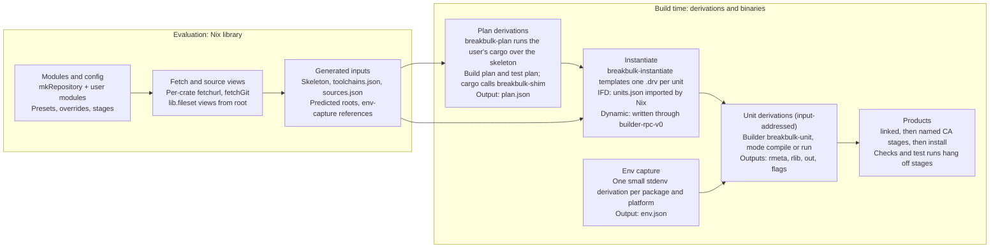

# Components

The skeleton and toolchain spec feed planning; the source map, toolchains and env captures feed instantiation by reference. Stage and check configuration from the modules is applied when products are assembled.

| Component | Kind |
| --- | --- |
| `breakbulk-shim` | Rust binary: rustc wrapper and build-script stub |
| `breakbulk-plan` | Rust binary: drives cargo and writes `plan.json` |
| `breakbulk-instantiate` | Rust binary: templates unit derivations as JSON for IFD; also the library that `breakbulk-drv` uses |
| `breakbulk-drv` | Rust binary: the dynamic-derivation-mode outer builder; writes the same derivations into the store through `builder-rpc-v0` with harmonia |
| `breakbulk-unit` | Rust binary: the builder of every unit |
| `lib/` (Nix) | `mkRepository`, modules, presets, fetchers, env capture, stage helpers |

The first four binaries live in one Cargo workspace. `breakbulk-drv` has its own workspace and lockfile (`crates/breakbulk-drv/`, excluded from the main workspace), so that its dependencies (harmonia, tokio) never change the other binaries' inputs. `breakbulk-unit` stays small and nearly dependency-free, because it is an input of every unit and any change to it rebuilds everything. `breakbulk-shim` and `breakbulk-plan` only affect the plan derivations.

`mkRepository` builds these binaries with breakbulk's own flake-locked nixpkgs for the build platform (`defaultTools` in `lib/default.nix`), not with the project's `pkgs`, so they are the same store paths in every project at a given breakbulk version. To build them with the project's nixpkgs instead, set `inputs.breakbulk.inputs.nixpkgs.follows = "nixpkgs"` or pass `tools = breakbulk.mkTools pkgs`. `import ./lib` without the flake has no locked nixpkgs and uses `mkTools pkgs`.

## Prior art

[cargo-dyndrv](https://github.com/obsidiansystems/cargo-dyndrv), by Obsidian Systems, is the closest prior art. It showed that per-unit derivations can be written from inside a build and handed back to Nix. Its repository has no license file, so no code is copied from it.

The project is named **breakbulk**: [break-bulk cargo](https://en.wikipedia.org/wiki/Breakbulk_cargo) is loaded piece by piece rather than in containers. Its binaries are `breakbulk-shim`, `breakbulk-plan`, `breakbulk-instantiate` and `breakbulk-unit`.

| Idea from cargo-dyndrv | Decision |
| --- | --- |
| Writing `.drv` files from inside a build and handing roots back to Nix | **Adopt**, through Nix's `builder-rpc-v0` interface, in dynamic-derivation mode only |
| A wrapper that applies `KEY=value` files and then `exec`s the real program | **Adopt** inside `breakbulk-unit` |
| A build-script runner that turns directives into argument files | **Adopt**, with placement observed from Cargo, failure on death by signal, and correct `rustc-flags` handling |
| Rebuilding rustc flags from `--unit-graph` | **Avoid**: trace Cargo instead |
| A separate derivation computing `CARGO_CFG_*` | **Unneeded**: the trace records it |
| Overrides keyed by full package ID | **Avoid**: per-package module options |
| Content-addressed units | **Avoid** by default: input-addressed units, CA only at the edges (see [Caching and early cutoff](../caching.md)) |
